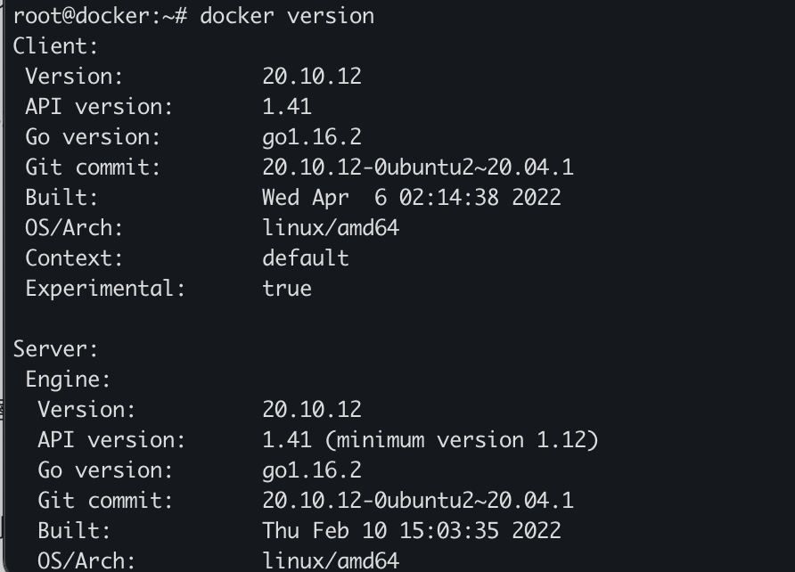
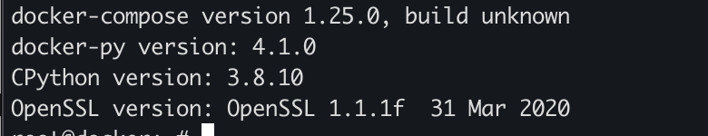
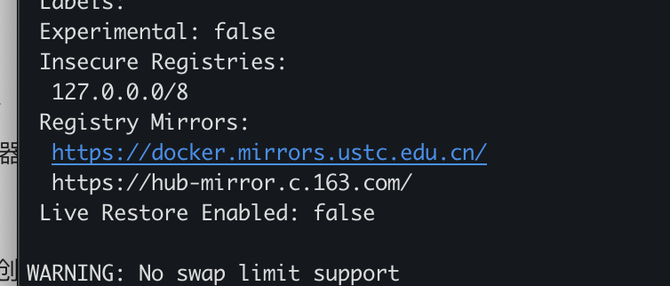

# 2.docker 安装及配置

## 环境
操作系统：Ubuntu20
## 安装docker
### 更新apt仓库
```
apt-get update
```
### 安装docker
```
apt install -y docker.io
```
### 验证docker是否安装成功
```
docker version
```

## 安装docker-compose（可选）
### 安装docker-compose
```
apt install -y docker-compose
```
### 验证是否安装成功
```
docker-compose version
```

## 配置镜像加速
### 编辑配置文件
```
vim /etc/docker/daemon.json


{
"registry-mirrors": [
"https://docker.mirrors.ustc.edu.cn",
"https://hub-mirror.c.163.com/"]
}
```
### 重启docker服务
```
systemctl reload docker
systemctl restart docker
```
### 查看docker 镜像仓库地址是否更新
```
docker info
```

