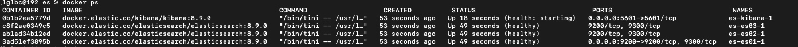
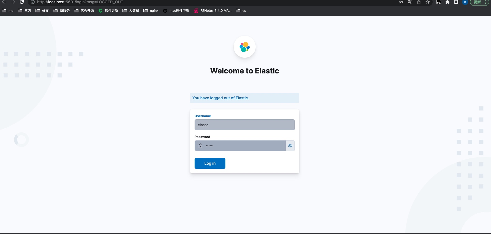
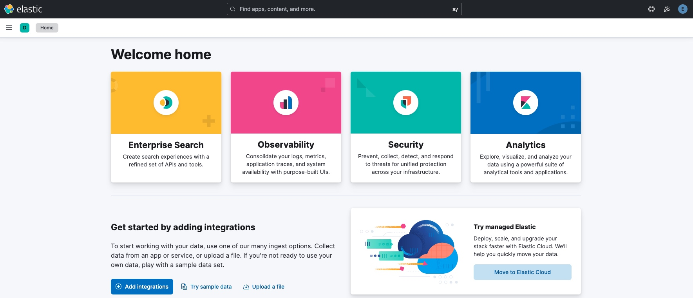
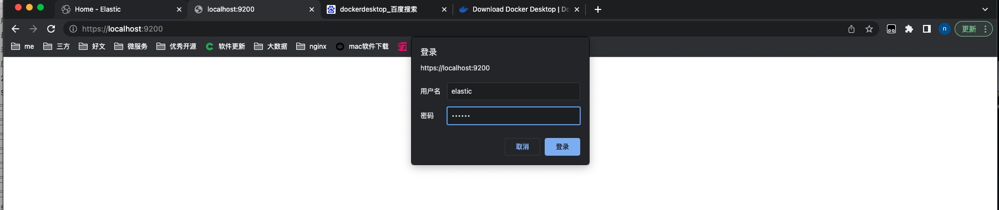
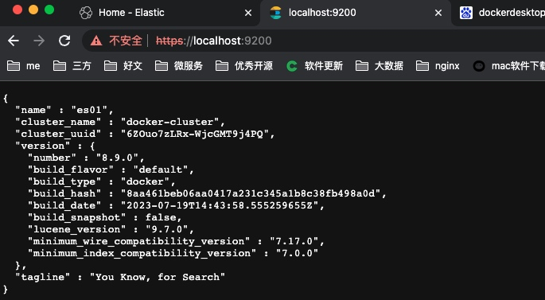

# 1.ElasticSearch 集群搭建和Kibana安装
## 本节内容
* 安装docker
* 参数介绍
* 搭建ES集群
* 安装Kibana
* 体验ES
## 安装docker
* Linux
```
apt-get update
apt install -y docker.io
apt install -y docker-compose
```
* Mac
```
直接下载安装包，下载地址
https://desktop.docker.com/mac/main/amd64/Docker.dmg?utm_source=docker&utm_medium=webreferral&utm_campaign=dd-smartbutton&utm_location=module&_gl=1*122e27p*_ga*MTgxNzMyODM5LjE2ODgwNDMwMzA.*_ga_XJWPQMJYHQ*MTY5MDU0ODA0OC40LjAuMTY5MDU0ODA0OC42MC4wLjA.
```
## 配置环境变量
```
# 创建一个文件夹
mkdir -p ~/docker/es
cd ~/docker/es
vim .env
```
保存以下内容
```
# Password for the 'elastic' user (at least 6 characters)
ELASTIC_PASSWORD=123456
# Password for the 'kibana_system' user (at least 6 characters)
KIBANA_PASSWORD=123abc
# Version of Elastic products
STACK_VERSION=8.8.0
# Set the cluster name
CLUSTER_NAME=docker-cluster
# Set to 'basic' or 'trial' to automatically start the 30-day trial
LICENSE=basic
#LICENSE=trial
# Port to expose Elasticsearch HTTP API to the host
ES_PORT=9200
#ES_PORT=127.0.0.1:9200
# Port to expose Kibana to the host
KIBANA_PORT=5601
#KIBANA_PORT=80
# Increase or decrease based on the available host memory (in bytes)
MEM_LIMIT=1073741824
# Project namespace (defaults to the current folder name if not set)
#COMPOSE_PROJECT_NAME=myproject
```
## 编写docker-compose.yml
```
vim ~/docker/es/docker-compose.yml
```
```
version: "2.2"

services:
  setup:
    image: docker.elastic.co/elasticsearch/elasticsearch:${STACK_VERSION}
    volumes:
      - certs:/usr/share/elasticsearch/config/certs
    user: "0"
    command: >
      bash -c '
        if [ x${ELASTIC_PASSWORD} == x ]; then
          echo "Set the ELASTIC_PASSWORD environment variable in the .env file";
          exit 1;
        elif [ x${KIBANA_PASSWORD} == x ]; then
          echo "Set the KIBANA_PASSWORD environment variable in the .env file";
          exit 1;
        fi;
        if [ ! -f config/certs/ca.zip ]; then
          echo "Creating CA";
          bin/elasticsearch-certutil ca --silent --pem -out config/certs/ca.zip;
          unzip config/certs/ca.zip -d config/certs;
        fi;
        if [ ! -f config/certs/certs.zip ]; then
          echo "Creating certs";
          echo -ne \
          "instances:\n"\
          "  - name: es01\n"\
          "    dns:\n"\
          "      - es01\n"\
          "      - localhost\n"\
          "    ip:\n"\
          "      - 127.0.0.1\n"\
          "  - name: es02\n"\
          "    dns:\n"\
          "      - es02\n"\
          "      - localhost\n"\
          "    ip:\n"\
          "      - 127.0.0.1\n"\
          "  - name: es03\n"\
          "    dns:\n"\
          "      - es03\n"\
          "      - localhost\n"\
          "    ip:\n"\
          "      - 127.0.0.1\n"\
          > config/certs/instances.yml;
          bin/elasticsearch-certutil cert --silent --pem -out config/certs/certs.zip --in config/certs/instances.yml --ca-cert config/certs/ca/ca.crt --ca-key config/certs/ca/ca.key;
          unzip config/certs/certs.zip -d config/certs;
        fi;
        echo "Setting file permissions"
        chown -R root:root config/certs;
        find . -type d -exec chmod 750 \{\} \;;
        find . -type f -exec chmod 640 \{\} \;;
        echo "Waiting for Elasticsearch availability";
        until curl -s --cacert config/certs/ca/ca.crt https://es01:9200 | grep -q "missing authentication credentials"; do sleep 30; done;
        echo "Setting kibana_system password";
        until curl -s -X POST --cacert config/certs/ca/ca.crt -u elastic:${ELASTIC_PASSWORD} -H "Content-Type: application/json" https://es01:9200/_security/user/kibana_system/_password -d "{\"password\":\"${KIBANA_PASSWORD}\"}" | grep -q "^{}"; do sleep 10; done;
        echo "All done!";
      '
    healthcheck:
      test: ["CMD-SHELL", "[ -f config/certs/es01/es01.crt ]"]
      interval: 1s
      timeout: 5s
      retries: 120

  es01:
    depends_on:
      setup:
        condition: service_healthy
    image: docker.elastic.co/elasticsearch/elasticsearch:${STACK_VERSION}
    volumes:
      - certs:/usr/share/elasticsearch/config/certs
      - esdata01:/usr/share/elasticsearch/data
    ports:
      - ${ES_PORT}:9200
    environment:
      - node.name=es01
      - cluster.name=${CLUSTER_NAME}
      - cluster.initial_master_nodes=es01,es02,es03
      - discovery.seed_hosts=es02,es03
      - ELASTIC_PASSWORD=${ELASTIC_PASSWORD}
      - bootstrap.memory_lock=true
      - xpack.security.enabled=true
      - xpack.security.http.ssl.enabled=true
      - xpack.security.http.ssl.key=certs/es01/es01.key
      - xpack.security.http.ssl.certificate=certs/es01/es01.crt
      - xpack.security.http.ssl.certificate_authorities=certs/ca/ca.crt
      - xpack.security.http.ssl.verification_mode=certificate
      - xpack.security.transport.ssl.enabled=true
      - xpack.security.transport.ssl.key=certs/es01/es01.key
      - xpack.security.transport.ssl.certificate=certs/es01/es01.crt
      - xpack.security.transport.ssl.certificate_authorities=certs/ca/ca.crt
      - xpack.security.transport.ssl.verification_mode=certificate
      - xpack.license.self_generated.type=${LICENSE}
    mem_limit: ${MEM_LIMIT}
    ulimits:
      memlock:
        soft: -1
        hard: -1
    healthcheck:
      test:
        [
          "CMD-SHELL",
          "curl -s --cacert config/certs/ca/ca.crt https://localhost:9200 | grep -q 'missing authentication credentials'",
        ]
      interval: 10s
      timeout: 10s
      retries: 120

  es02:
    depends_on:
      - es01
    image: docker.elastic.co/elasticsearch/elasticsearch:${STACK_VERSION}
    volumes:
      - certs:/usr/share/elasticsearch/config/certs
      - esdata02:/usr/share/elasticsearch/data
    environment:
      - node.name=es02
      - cluster.name=${CLUSTER_NAME}
      - cluster.initial_master_nodes=es01,es02,es03
      - discovery.seed_hosts=es01,es03
      - bootstrap.memory_lock=true
      - xpack.security.enabled=true
      - xpack.security.http.ssl.enabled=true
      - xpack.security.http.ssl.key=certs/es02/es02.key
      - xpack.security.http.ssl.certificate=certs/es02/es02.crt
      - xpack.security.http.ssl.certificate_authorities=certs/ca/ca.crt
      - xpack.security.http.ssl.verification_mode=certificate
      - xpack.security.transport.ssl.enabled=true
      - xpack.security.transport.ssl.key=certs/es02/es02.key
      - xpack.security.transport.ssl.certificate=certs/es02/es02.crt
      - xpack.security.transport.ssl.certificate_authorities=certs/ca/ca.crt
      - xpack.security.transport.ssl.verification_mode=certificate
      - xpack.license.self_generated.type=${LICENSE}
    mem_limit: ${MEM_LIMIT}
    ulimits:
      memlock:
        soft: -1
        hard: -1
    healthcheck:
      test:
        [
          "CMD-SHELL",
          "curl -s --cacert config/certs/ca/ca.crt https://localhost:9200 | grep -q 'missing authentication credentials'",
        ]
      interval: 10s
      timeout: 10s
      retries: 120

  es03:
    depends_on:
      - es02
    image: docker.elastic.co/elasticsearch/elasticsearch:${STACK_VERSION}
    volumes:
      - certs:/usr/share/elasticsearch/config/certs
      - esdata03:/usr/share/elasticsearch/data
    environment:
      - node.name=es03
      - cluster.name=${CLUSTER_NAME}
      - cluster.initial_master_nodes=es01,es02,es03
      - discovery.seed_hosts=es01,es02
      - bootstrap.memory_lock=true
      - xpack.security.enabled=true
      - xpack.security.http.ssl.enabled=true
      - xpack.security.http.ssl.key=certs/es03/es03.key
      - xpack.security.http.ssl.certificate=certs/es03/es03.crt
      - xpack.security.http.ssl.certificate_authorities=certs/ca/ca.crt
      - xpack.security.http.ssl.verification_mode=certificate
      - xpack.security.transport.ssl.enabled=true
      - xpack.security.transport.ssl.key=certs/es03/es03.key
      - xpack.security.transport.ssl.certificate=certs/es03/es03.crt
      - xpack.security.transport.ssl.certificate_authorities=certs/ca/ca.crt
      - xpack.security.transport.ssl.verification_mode=certificate
      - xpack.license.self_generated.type=${LICENSE}
    mem_limit: ${MEM_LIMIT}
    ulimits:
      memlock:
        soft: -1
        hard: -1
    healthcheck:
      test:
        [
          "CMD-SHELL",
          "curl -s --cacert config/certs/ca/ca.crt https://localhost:9200 | grep -q 'missing authentication credentials'",
        ]
      interval: 10s
      timeout: 10s
      retries: 120

  kibana:
    depends_on:
      es01:
        condition: service_healthy
      es02:
        condition: service_healthy
      es03:
        condition: service_healthy
    image: docker.elastic.co/kibana/kibana:${STACK_VERSION}
    volumes:
      - certs:/usr/share/kibana/config/certs
      - kibanadata:/usr/share/kibana/data
    ports:
      - ${KIBANA_PORT}:5601
    environment:
      - SERVERNAME=kibana
      - ELASTICSEARCH_HOSTS=https://es01:9200
      - ELASTICSEARCH_USERNAME=kibana_system
      - ELASTICSEARCH_PASSWORD=${KIBANA_PASSWORD}
      - ELASTICSEARCH_SSL_CERTIFICATEAUTHORITIES=config/certs/ca/ca.crt
    mem_limit: ${MEM_LIMIT}
    healthcheck:
      test:
        [
          "CMD-SHELL",
          "curl -s -I http://localhost:5601 | grep -q 'HTTP/1.1 302 Found'",
        ]
      interval: 10s
      timeout: 10s
      retries: 120

volumes:
  certs:
    driver: local
  esdata01:
    driver: local
  esdata02:
    driver: local
  esdata03:
    driver: local
  kibanadata:
    driver: local
```
## 参数介绍
### bootstrap.memory_lock
开启内存锁，防止操作系统的缓存数据被交换到外存，导致查询性能下降，产线一定要打开
### node.name
设置节点在集群中的名称
### cluster.name
设置集群名称
### cluster.initial_master_nodes
用于定义初始的主节点，确保主节点选举的有效性。这里面的名字要和node.name保持一致
### discovery.seed_hosts
用于节点发现，帮助新节点找到其他节点并加入集群


## 启动服务
```
cd ~/docker/es
docker-compose up -d
```
## 验证

访问地址 http://localhost:5601
输入用户名：elastic （千万不要使用kibana的用户名，那是给es连接的）
输入密码: 123456


访问 https://localhost:9200 验证es安装
输入用户名：elastic （千万不要使用kibana的用户名，那是给es连接的）
输入密码: 123456
记住要用https访问！！！



到此为止，所有安装已经完成，后面开始ES学习

## 体验ES
打开Kibana-》Dev Tools
### 创建索引
```
PUT example_demo
{
  "settings": {
    "number_of_replicas": 1,
    "number_of_shards": 3
  },
  "mappings": {
    "properties": {
      "userId":{
        "type": "text"
      },
      "stuNo":{
        "type": "integer"
      }
    }
  }
}
```  
### 添加数据
```
PUT example_demo/_doc/1
{
 "userId":"001",
 "stuNo":"130101210"
}
```
### 查询数据
```
GET example_demo/_search
```
这节内容就到这里了，下一我们从mapping开始学习