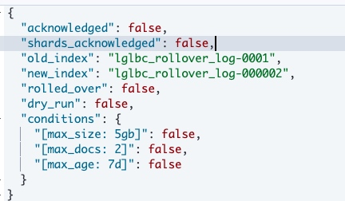
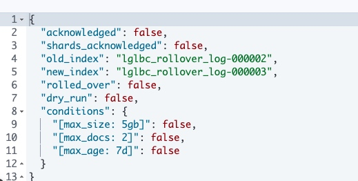

# 10.善用滚动索引
索引滚动是一种管理索引的策略，用于优化性能和资源利用，特别是在处理大量数据时。当索引数据量逐渐增大时，可能会出现性能下降或资源压力过大的情况。为了避免这些问题，可以使用索引滚动策略来定期创建新的索引，并将数据从旧索引滚动（移动）到新索引。

## 创建一个有规律的索引名称
注意-后面必须是整数，这样ES才会给你递增
```
PUT example_rollover_log-0001
{
  "aliases": {
    "example_rollover_log": {}
  }
}
```
## 为别名添加滚动条件
```
POST example_rollover_log/_rollover
{
  "conditions": {
    "max_age": "7d",
    "max_docs": 2,
    "max_size": "5gb"
  }
}
```
当前滚动的规则如下，满足任意条件即可
* max_age：最长服务时间为7天
* max_docs:文档数量限制为2
* max_size:索引大小不超过5gb

执行之后，返回如下内容：


## 添加数据
```
PUT example_rollover_log/_doc/001
{
  "name":"登录",
  "api":"/login",
  "method":"post"
}

PUT example_rollover_log/_doc/002
{
  "name":"登录",
  "api":"/login",
  "method":"post"
}
```
## 手动触发rollover条件
```
POST example_rollover_log/_rollover
{
  "conditions": {
    "max_age": "7d",
    "max_docs": 2,
    "max_size": "5gb"
  }
}
```
结果中返回了新索引的名称：example_rollover_log-000002


我们验证下新的索引是否存在
```
GET example_rollover_log-000002
```
结果显示还没创建，因为还没满足条件，所以再添加一条数据
```
PUT example_rollover_log/_doc/003
{
  "name":"登录",
  "api":"/login",
  "method":"post"
}
```
再调用端点触发
```
POST example_rollover_log/_rollover
{
  "conditions": {
    "max_age": "7d",
    "max_docs": 2,
    "max_size": "5gb"
  }
}
```

发现已经返回了新的索引名称，并且索引example_rollover_log-000002已经创建
，并且已经返回了下一次的索引名称。

需要注意的是：ES并不在我们添加数据的时候校验这个规则，而是需要我们手动带着这个条件去触发，所以这个接口我们需要定时轮训调用，分割的是否精确取决于我们轮训的间隔。
