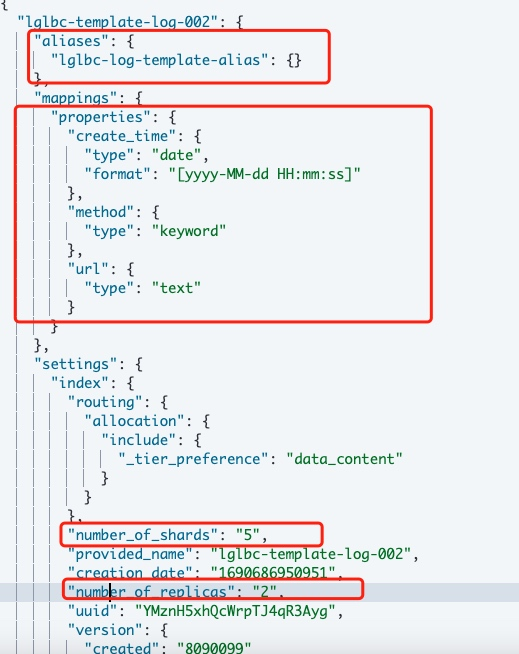

# 11.索引模版
## 索引模版能干什么
Elasticsearch 索引模板（Index Template）是一种用于自动创建和管理索引的模板，它允许你在创建新索引时自动应用一组预定义的设置和映射规则。索引模板通常用于定义一组共享的索引设置，确保新创建的索引具有一致的结构和配置。

索引模板的主要目的是在索引创建时自动应用一组规则，而无需手动干预或重复定义设置。这对于拥有多个类似结构的索引非常有用，例如日志索引、时间序列索引等。
## 使用索引模版
### 创建索引模版
在这个模版中，预定义了以下内容
* 设置分片数量和副本数量
* 约定共用字段和字段类型
* 指向同一别名
* 模版匹配条件是:以example-template-log开头的都会使用这个模版
* priority指定优先级，值越大优先级越高

```
PUT _index_template/example-log-template
{
  "index_patterns": [
    "example-template-log-*"
    ],
    "template": {
      "settings": {
        "number_of_replicas": 2,
        "number_of_shards": 5
      },
      "mappings": {
        "properties": {
          "create_time":{
            "type": "date",
            "format": ["yyyy-MM-dd HH:mm:ss"]
          },
          "url":{
            "type": "text"
          },
          "method":{
            "type": "keyword"
          }
        }
      },
      "aliases": {
        "example-log-template-alias": {}
      }
    },
    "priority": 200,
    "version": 3,
    "_meta": {
      "description":"first template"
    }
}
```
### 查看索引模版
```
GET _index_template/example-log-template
```
### 添加索引数据，验证模版
```
PUT example-template-log-002/_doc/1
{
  "create_time":"2023-10-11 23:00:00",
  "url":"/login",
  "method":"post"
}
```
加入一条数据后，我们获取下这个索引的信息
```
GET example-template-log-002
```
可以看出，所有的配置都是按照模版来的，所以验证成功

再来看下按照别名查询
```
GET example-log-template-alias/_search
```
### 删除索引模版
```
DELETE _index_template/example-log-template
```