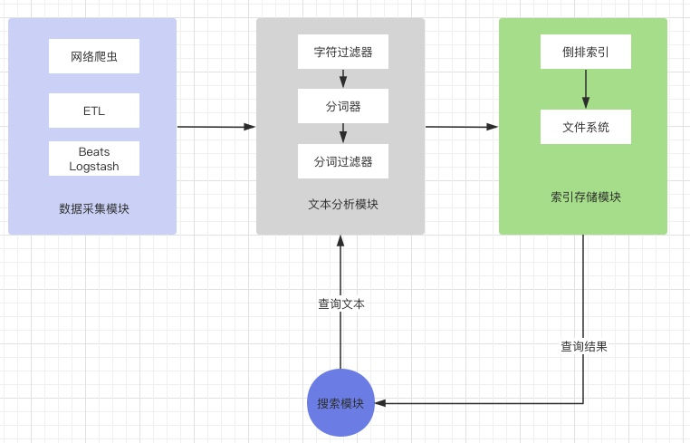

# 12.搜索引擎的基本原理
## 本节内容
* 认识搜索引擎组成
* 认识倒排索引
## 搜索引擎组成
搜索引擎由众多模块组成，包括数据采集模块、文本分析模块、索引存储模块、搜索模块，那么接下来我们依次分析每个模块的作用

### 数据采集
对于Elasticsearch，数据采集主要来自主动采集和应用推送，可以借助官方提供的Beats等工具进行采集，也可以通过Java客户端进行数据的主动推送
### 文本分析
采集的内容进行分词处理，将文本划分成一系列关键词或术语。然后，建立倒排索引，即将每个关键词映射到包含该关键词的记录。这样的索引结构使得搜索引擎能够高效地执行搜索查询。当然有些业务数据可能需要进行精确搜索，不需要搜索，这个也可以借助Elasticsearch实现
### 索引存储
负责将经过文本分析后的内容按照定义好的结构写入索引。
### 搜索模块
根据用户输入的查询文本找到索引中匹配的文档，这期间也会进行分词处理，将用户输入的关键词进行文本分析，得到最终的关键词去倒排索引中匹配，匹配度越高(或得分越高)的记录会在排在最前面。


## 倒排索引
### 定义
倒排索引（Inverted Index）是一种常用于搜索引擎中的数据结构，用于加速文本搜索。它与传统的正排索引（Forward Index）相反，正排索引将文档映射到单词，而倒排索引将单词映射到文档。

在倒排索引中，每个文档中的每个单词都被处理和存储为一个独立的索引项，该项包含了该单词所在的文档信息。每个索引项通常包括以下信息：
### 组成
通过使用倒排索引，搜索引擎可以轻松地根据用户查询中的关键词查找包含这些关键词的文档。倒排索引可以有效地提高搜索的速度，因为搜索引擎只需要检索包含查询关键词的索引项，而不必遍历所有文档。
* 单词（Term）：文档中出现的单词或术语。

* 文档ID（Document ID）：标识文档的唯一ID。

* 位置信息（Position）：单词在文档中的位置，有助于支持短语搜索。

### 举例说明
有三个文档

```
文档1： "This is a sample document"
文档2： "Another example for testing"
文档3： "Test document for Elasticsearch"
```
进行倒排索引处理后的内容如下：
```
Term       Document IDs
-----------------------------------
This       1
is         1
a          1
sample     1
document   1, 3
Another    2
example    2
for        2, 3
testing    2
Test       3
Elasticsearch 3

```
假设用户查询 "sample document"，搜索引擎只需要检索倒排索引中 "sample" 和 "document" 对应的文档ID（在此处为文档1和文档3），而不必遍历所有文档。这样可以显著加快搜索速度，并提高搜索引擎的性能。

### 顺便说下正排索引
正排索引（Forward Index）是搜索引擎中的另一种数据结构，与倒排索引相反。在正排索引中，文档被映射到其中包含的单词或术语，而不是将单词映射到文档。正排索引通常用于支持文档的查找和检索，特别是在需要根据文档ID获取文档内容时非常有用。