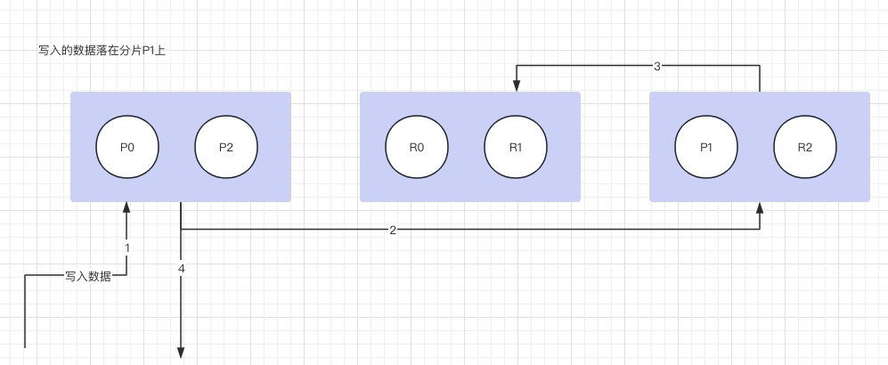
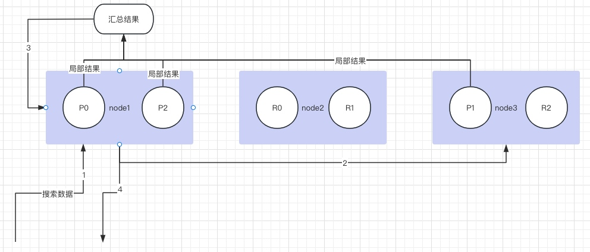

# 14.索引数据的写入和搜索过程
## 数据写入过程

### 应用程序发送写入请求
应用程序向 Elasticsearch 发送写入请求，请求包含要写入的文档数据和目标索引名称。

### 路由到正确的分片
Elasticsearch 根据文档的 ID 或路由值，将写入请求路由到正确的数据分片上。分片的选择是基于分片路由策略，默认情况下，Elasticsearch 使用文档 ID 的哈希值来决定文档应该存储在哪个分片上。

### 文档写入到主分片
一旦确定了目标分片，写入请求将被发送到该分片的主副本（primary shard）上。主分片负责处理写入操作。

### 分片副本写入
主分片接收到写入请求后，会将文档写入到本地的主分片副本和配置的分片副本（replica shard）上。副本分片用于实现数据冗余和高可用性。

### 响应应用程序
一旦写入操作成功，Elasticsearch 将向应用程序返回写入成功的响应，标志着文档的写入过程完成。
## 数据搜索过程
演示的是不带路由key的

### 应用程序发送搜索请求
应用程序向 Elasticsearch 发送搜索请求，请求包含查询条件、索引名称、要返回的结果数量等信息。

### 路由到正确的分片
Elasticsearch 根据查询条件，将搜索请求路由到可能包含匹配文档的分片上。它使用分片路由策略来确定哪些分片可能包含相关文档。

### 主分片搜索
一旦确定了目标分片，搜索请求将被发送到该分片的主副本上。主分片将执行搜索操作，并返回倒排索引中与查询匹配的文档 ID 列表。

### 分片副本搜索
如果搜索请求同时发送给了副本分片，副本分片也会执行相同的搜索操作。副本的搜索结果将用于搜索结果的合并和排序。

### 结果合并与排序
主节点负责将来自不同分片和副本的搜索结果合并，并根据相关性得分对结果进行排序。然后，将排序后的结果返回给应用程序。

### 响应应用程序
一旦搜索操作完成，Elasticsearch 将向应用程序返回包含搜索结果的响应，应用程序可以根据需求进行结果展示或后续处理。