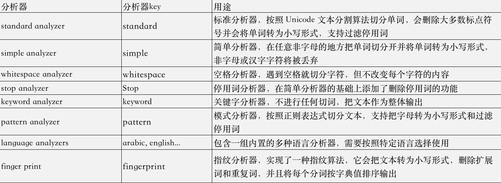

# 15.如何使用ES内置的分析器
分析器在索引和搜索过程中起到了将文本数据转换成结构化信息的关键作用。通过合理选择和配置分析器，可以提高搜索的准确性和性能，使得 Elasticsearch 能够更好地理解和处理文本数据。分析器的选择应该根据具体的应用场景和数据特点来进行调整，以确保搜索的效果最佳。

## 分析器的作用
### 分词（Tokenization）
分析器将输入的文本按照一定规则（分词器）进行分词，将文本拆分成一个个单独的词语或标记，这些单独的词语被称为 "词条" 或 "分词"。

### 小写化
在分词的过程中，分析器通常会将文本转换成小写形式。这样可以使搜索不区分大小写，提高搜索的准确性和覆盖率。

### 去除停用词
停用词是指在搜索中没有实际含义或者过于常见的词语，如 "and"、"the"、"is" 等。分析器可以去除这些停用词，以减少索引大小和提高搜索效率。

### 同义词处理
有些分析器支持同义词处理，可以将一些词语或短语映射成同一个词条，从而增加搜索的灵活性。

### 词干化（Stemming）
词干化是将词语转换成其词根或词干的过程，将不同形态的词汇映射到同一个词干，从而扩大搜索结果的覆盖范围。

### 格式化
分析器还可以对文本进行格式化，去除特殊字符、标点符号或进行其他预处理操作。
## 内置分析器的使用
ES内置的分析器包括:

接下来，我会带大家来体验下前面3个常用的分析器
### standard analyzer(标准分析器)
按照 Unicode 文本分割算法切分单词，会删除大多数标点符号并会将单词转为小写形式，支持过滤停用词
```
POST _analyze
{
  "analyzer": "standard",
  "text": "Hello. I'm 编程学习. nice to meet u."
}
```
从分析结果来看，确实将大写字母转成小写，并且标点符号被移除，并且按照unicode进行分割
```
{
  "tokens": [
    {
      "token": "Hello",
      "start_offset": 0,
      "end_offset": 5,
      "type": "<ALPHANUM>",
      "position": 0
    },
    {
      "token": "i'm",
      "start_offset": 7,
      "end_offset": 10,
      "type": "<ALPHANUM>",
      "position": 1
    },
    {
      "token": "乐",
      "start_offset": 11,
      "end_offset": 12,
      "type": "<IDEOGRAPHIC>",
      "position": 2
    },
    {
      "token": "哥",
      "start_offset": 12,
      "end_offset": 13,
      "type": "<IDEOGRAPHIC>",
      "position": 3
    },
    {
      "token": "聊",
      "start_offset": 13,
      "end_offset": 14,
      "type": "<IDEOGRAPHIC>",
      "position": 4
    },
    {
      "token": "编",
      "start_offset": 14,
      "end_offset": 15,
      "type": "<IDEOGRAPHIC>",
      "position": 5
    },
    {
      "token": "程",
      "start_offset": 15,
      "end_offset": 16,
      "type": "<IDEOGRAPHIC>",
      "position": 6
    },
    {
      "token": "nice",
      "start_offset": 18,
      "end_offset": 22,
      "type": "<ALPHANUM>",
      "position": 7
    },
    {
      "token": "to",
      "start_offset": 23,
      "end_offset": 25,
      "type": "<ALPHANUM>",
      "position": 8
    },
    {
      "token": "meet",
      "start_offset": 26,
      "end_offset": 30,
      "type": "<ALPHANUM>",
      "position": 9
    },
    {
      "token": "u",
      "start_offset": 31,
      "end_offset": 32,
      "type": "<ALPHANUM>",
      "position": 10
    }
  ]
}
```
### simple analyzer(简单分析器)
在任意非字母的地方把单词切分开并将单词转为小写形式，非字母或汉字字符将被丢弃
```
POST _analyze
{
  "analyzer": "simple",
  "text": "Hello. I'm 编程学习. nice to meet u."
}
```
```
{
  "tokens": [
    {
      "token": "hello",
      "start_offset": 0,
      "end_offset": 5,
      "type": "word",
      "position": 0
    },
    {
      "token": "i",
      "start_offset": 7,
      "end_offset": 8,
      "type": "word",
      "position": 1
    },
    {
      "token": "m",
      "start_offset": 9,
      "end_offset": 10,
      "type": "word",
      "position": 2
    },
    {
      "token": "编程学习",
      "start_offset": 11,
      "end_offset": 16,
      "type": "word",
      "position": 3
    },
    {
      "token": "nice",
      "start_offset": 18,
      "end_offset": 22,
      "type": "word",
      "position": 4
    },
    {
      "token": "to",
      "start_offset": 23,
      "end_offset": 25,
      "type": "word",
      "position": 5
    },
    {
      "token": "meet",
      "start_offset": 26,
      "end_offset": 30,
      "type": "word",
      "position": 6
    },
    {
      "token": "u",
      "start_offset": 31,
      "end_offset": 32,
      "type": "word",
      "position": 7
    }
  ]
}
```
### whitespace analyzer（空格分析器）
遇到空格就切分字符，但不改变每个字符的内容
```
POST _analyze
{
  "analyzer": "whitespace",
  "text": "Hello. I'm 编程学习. nice to meet u."
}
```
```
{
  "tokens": [
    {
      "token": "Hello.",
      "start_offset": 0,
      "end_offset": 6,
      "type": "word",
      "position": 0
    },
    {
      "token": "I'm",
      "start_offset": 7,
      "end_offset": 10,
      "type": "word",
      "position": 1
    },
    {
      "token": "编程学习.",
      "start_offset": 11,
      "end_offset": 17,
      "type": "word",
      "position": 2
    },
    {
      "token": "nice",
      "start_offset": 18,
      "end_offset": 22,
      "type": "word",
      "position": 3
    },
    {
      "token": "to",
      "start_offset": 23,
      "end_offset": 25,
      "type": "word",
      "position": 4
    },
    {
      "token": "meet",
      "start_offset": 26,
      "end_offset": 30,
      "type": "word",
      "position": 5
    },
    {
      "token": "u.",
      "start_offset": 31,
      "end_offset": 33,
      "type": "word",
      "position": 6
    }
  ]
}
```