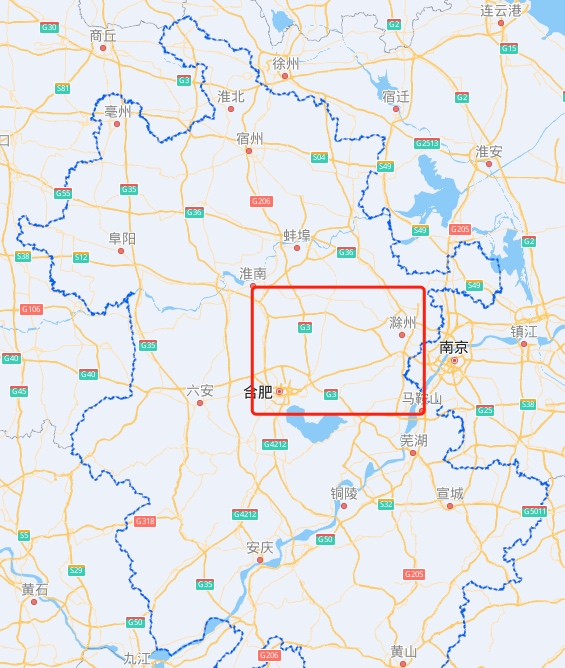

# 21.ES 实现经纬度搜索
在app中我们经常会看到有这样一个功能：查找附近的人。
那么在ES中可以通过经纬度搜索来实现这个。
## 准备数据
### 设置mapping
```
PUT example_geo
{
"mappings": {
  "properties": {
    "location":{
      "type": "geo_point"
    },
    "city":{
      "type": "keyword"
    }
    }
  }
}
```
### 准备数据
```
POST example_geo/_bulk
{"index":{}}
{"city":"合肥","location":[117.2841,31.8612]}
{"index":{}}
{"city":"芜湖","location":[118.4329,31.3529]}
{"index":{}}
{"city":"蚌埠","location":[117.3897,32.9163]}
{"index":{}}
{"city":"淮南","location":[117.2255,32.6255]}
{"index":{}}
{"city":"马鞍山","location":[118.5061,31.6704]}
{"index":{}}
{"city":"淮北","location":[116.9262,33.6708]}
{"index":{}}
{"city":"铜陵","location":[117.8121,30.9454]}
{"index":{}}
{"city":"安庆","location":[117.0635,30.5435]}
```
## 位置搜索
### 圆形搜索
```
POST example_geo/_search
{
  "query": {
    "geo_distance": {
      "distance": "100km",
      "location": {
        "lon": 117.2841,
        "lat": 31.8612
      }
    }
  }
}
```
```
{
  "took": 2,
  "timed_out": false,
  "_shards": {
    "total": 1,
    "successful": 1,
    "skipped": 0,
    "failed": 0
  },
  "hits": {
    "total": {
      "value": 2,
      "relation": "eq"
    },
    "max_score": 1,
    "hits": [
      {
        "_index": "example_geo",
        "_id": "n4lzvokB3oAoe5etjKJq",
        "_score": 1,
        "_source": {
          "city": "合肥",
          "location": [
            117.2841,
            31.8612
          ]
        }
      },
      {
        "_index": "example_geo",
        "_id": "oolzvokB3oAoe5etjKJq",
        "_score": 1,
        "_source": {
          "city": "淮南",
          "location": [
            117.2255,
            32.6255
          ]
        }
      }
    ]
  }
}
```
### 矩形搜索
矩形搜索需要提供左上和右下的经纬度，进行定位矩形
```
POST example_geo/_search
{
  "query": {
    "geo_bounding_box": {
      "location": {
        "top_left": {
          "lon": 117.2255,
          "lat": 32.6255
        },
        "bottom_right": {
          "lon": 118.5061,
          "lat": 31.6704
        }
      }
    }
  }
}
```
这个是搜索以淮南和马鞍构成的矩形内，有哪些城市


```
{
  "took": 5,
  "timed_out": false,
  "_shards": {
    "total": 1,
    "successful": 1,
    "skipped": 0,
    "failed": 0
  },
  "hits": {
    "total": {
      "value": 3,
      "relation": "eq"
    },
    "max_score": 1,
    "hits": [
      {
        "_index": "example_geo",
        "_id": "n4lzvokB3oAoe5etjKJq",
        "_score": 1,
        "_source": {
          "city": "合肥",
          "location": [
            117.2841,
            31.8612
          ]
        }
      },
      {
        "_index": "example_geo",
        "_id": "oolzvokB3oAoe5etjKJq",
        "_score": 1,
        "_source": {
          "city": "淮南",
          "location": [
            117.2255,
            32.6255
          ]
        }
      },
      {
        "_index": "example_geo",
        "_id": "o4lzvokB3oAoe5etjKJq",
        "_score": 1,
        "_source": {
          "city": "马鞍山",
          "location": [
            118.5061,
            31.6704
          ]
        }
      }
    ]
  }
}
```