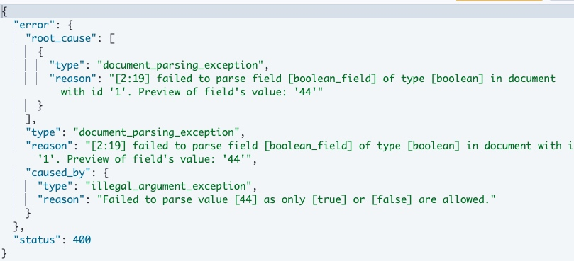
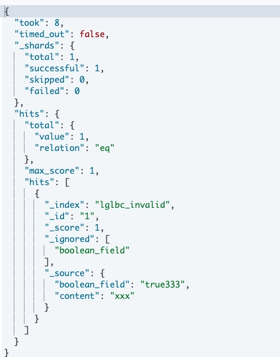
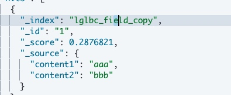
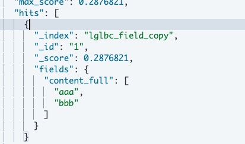

# 4.映射支持的常规字段类型使用
需要注意的是，一旦字段定义完成，将不能被修改。 
```
PUT example_demo_mapping
{
  "settings": {
    "number_of_replicas": 1,
    "number_of_shards": 3
  },
  "mappings": {
    "properties": {
      "default":{
        "type": "text"
      }
    }
  }
}
```  
## 常规字段类型
### Text类型
用于存储长文本数据。文本字段被分析为词项（terms），以支持全文搜索。您可以指定不同的分析器来处理不同语言或文本内容。
```
"text_field": {
  "type": "text",
  "analyzer": "standard"
}
```
### Keyword类型
用于存储短文本数据，如标签、关键字等。关键字字段不进行分词，整个字段内容作为一个关键词被索引。它通常用于精确匹配和聚合操作。
```
"keyword_field": {
  "type": "keyword"
}
```
### Numeric类型
用于存储数值类型的数据，包括整数和浮点数。
```
"numeric_field": {
  "type": "integer"
}
```
### Date类型
用于存储日期和时间数据。日期字段会被解析为特定的日期格式以支持日期范围查询和排序。
如果你传的是日期格式，会默认当成UTC时间。
```
"date_field": {
  "type": "date",
  "format": "yyyy-MM-dd || epoch_millis"
}
```
### Boolean类型
用于存储布尔值（true或false）
```
"boolean_field": {
  "type": "boolean"
}
```
### Binary类型
用于存储二进制数据，例如图像或文件。一般不会去用
```
"binary_field": {
  "type": "binary"
}
```
### Geo类型
用于存储地理位置数据，支持点、线和多边形等。
"location_field": {
  "type": "geo_point"
}
### Object类型
用于存储嵌套的JSON对象。您可以在对象内部定义子字段及其数据类型。
```
"object_field": {
  "type": "object",
  "properties": {
    "subfield1": { "type": "text" },
    "subfield2": { "type": "integer" }
  }
}

```
### nested类型
用于存储嵌套的JSON对象。您可以在对象内部定义子字段及其数据类型。和Object的区别在于嵌套的对象独立存在，利于搜索
```
"nested_field": {
  "type": "nested",
  "properties": {
    "subfield1": { "type": "text" },
    "subfield2": { "type": "integer" }
  }
}

```
### 数组类型
数组类型无需再mapping中使用额外的字段进行定义。
## 忽略不合法的数据
写入的数据类型和mapping中不一致，会导致写入失败，我们演示下
创建一个mapping
```
PUT example_invalid
{
  "mappings": {
    "properties": {
      "boolean_field":{
        "type": "boolean"
      }
    }
  }
}
```
写入正确的数据
```
PUT example_invalid/_doc/1
{
  "boolean_field":"true",
  "content":"xxx"
}
```
写入错误的数据
```
PUT example_invalid/_doc/1
{
  "boolean_field":"123",
  "content":"xxx"
}
```

那么我怎么能忽略呢？其实只需要在maaping中加入如下属性

```
PUT example_invalid/_mapping
{
    "properties": {
      "boolean_field":{
        "type": "boolean",
        "ignore_malformed": true
      }
    }
}
```
PUT example_invalid/_doc/1
{
  "boolean_field":"true333",
  "content":"xxx"
}
写入错误数据

## 字段复制
如果有这样一个需求：同时搜索多个字段里面的内容，但是你希望只搜索一个字段，需要搜索的字段的内容全部都在这一个字段上面，但是你又不想自己去做这个处理，那么你就可以使用mapping字段复制的功能
### 创建mapping
```
PUT example_field_copy
{
  "mappings": {
    "properties": {
      "content1":{"type": "text", "copy_to": "content_full"},
      "content2":{"type": "text", "copy_to": "content_full"},
      "content_full":{"type": "text"}
    }
  }
}
```
### 添加一条数据
```
PUT example_field_copy/_doc/1
{
  "content1":"aaa",
  "content2":"bbb"
}
```
### 搜索
从搜索结果来看，确实能搜到数据，但是大家会注意到，content_full字段并没有在source里面出现。
```
POST example_field_copy/_search
{
  "query": {
    "match_phrase": {
      "content_full": "bbb"
    }
  }
}
```

那么我们应该如何配置，能让content_full不仅能搜索还能在结果中能看到呢
## 字段存储
```
PUT example_field_copy
{
  "mappings": {
    "properties": {
      "content1":{"type": "text", "copy_to": "content_full"},
      "content2":{"type": "text", "copy_to": "content_full"},
      "content_full":{"type": "text","store": true}
    }
  }
}
```
搜索存储的字段
```
POST example_field_copy/_search
{
  "query": {
    "match_phrase": {
      "content_full": "bbb"
    }
  },
  "stored_fields": ["content_full"]
}
```

