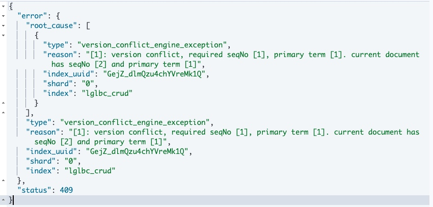

# 7.在ES中使用乐关锁

ES不支持事务管理，那么它如何保证对同一数据的顺序修改呢？
在ES中提供了乐观锁保证了这一点，那我们就来看下如何在ES中使用乐观锁。
## 什么是乐观锁

### 定义
乐观锁（Optimistic Locking）是一种并发控制的策略，用于处理多个用户或线程同时对同一数据进行更新的情况。它的基本思想是在更新数据之前，先检查数据是否被其他用户或线程修改过，如果没有则执行更新操作，如果有则进行相应的冲突处理。
### 实现方式
乐观锁的实现方式是在数据表中增加一个版本号（Version Number）字段或者使用时间戳（Timestamp）来标识数据的版本。每次更新数据时，都会检查当前的版本号或时间戳是否与更新前一致，如果一致则允许更新，否则拒绝更新，并根据实际需求进行相应的处理，例如向用户显示冲突信息或者自动合并数据等。
### 工作流程
* 读取数据：当用户或线程要更新数据时，首先读取数据并获取当前的版本号或时间戳。

* 执行更新：在执行更新之前，再次检查当前的版本号或时间戳是否与之前获取的一致。如果一致，则执行更新操作，并将版本号或时间戳加一（或更新为当前时间）。

* 处理冲突：如果检测到版本号或时间戳不一致，表示数据已被其他用户或线程修改过，此时可以根据实际需求选择合适的处理方式，例如中止更新、向用户显示冲突信息、尝试自动合并等。

乐观锁的优点在于它不需要显式地锁定数据，这样可以提高并发性能，因为多个用户或线程可以同时读取数据，只有在实际更新时才会进行冲突检测。另外，乐观锁适用于多读少写的场景，因为在写入时需要进行额外的冲突检测，如果写入频率较高，可能会增加冲突的概率，降低性能。

## ES中如何使用乐观锁
在ES中通过两个字段控制：
* _seq_no
* _primary_term

### 添加数据
```
POST example_crud/_doc/1
{
  "age":10,
  "stu_no":"1301098762",
  "score":90.8,
  "birth":"2023-07-01"
}
```
执行后，再查询这条数据
```
GET example_crud/_doc/1
```
```
{
  "_index": "example_crud",
  "_id": "1",
  "_version": 1,
  "_seq_no": 0,
  "_primary_term": 1,
  "found": true,
  "_source": {
    "age": 10,
    "stu_no": "1301098762",
    "score": 90.8,
    "birth": "2023-07-01"
  }
}
```
可以看到包含了这两个字段：
* "_seq_no": 0,
* "_primary_term": 1,

### 第一次更新
```
PUT example_crud/_doc/1
{
  "age":12,
  "stu_no":"1301098762",
  "score":90.8,
  "birth":"2023-07-01"
}
```
再查一次，可以看到字段数据被更新
* "_seq_no": 1,
* "_primary_term": 1,
```
{
  "_index": "example_crud",
  "_id": "1",
  "_version": 2,
  "_seq_no": 1,
  "_primary_term": 1,
  "found": true,
  "_source": {
    "age": 12,
    "stu_no": "1301098762",
    "score": 90.8,
    "birth": "2023-07-01"
  }
}
```
### 第二次更新 带上版本号
```
PUT example_crud/_doc/1?if_seq_no=1&if_primary_term=1
{
  "age":12,
  "stu_no":"1301098762",
  "score":90.8,
  "birth":"2023-07-01"
}
```
可以更新成功，但是你再执行一次就会更新失败，因为这两个字段已经更新

