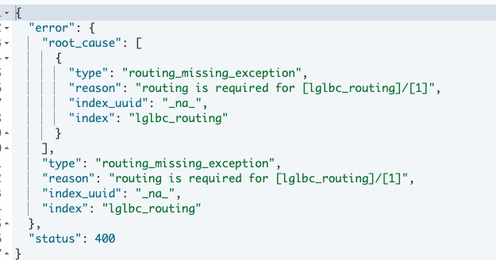
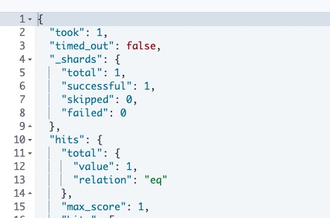

# 8.索引数据路由规则
## 索引路由规则
在 Elasticsearch 中，索引路由规则用于控制文档如何被分配到不同的分片(shard)上。索引路由规则是通过指定文档的某个字段值来决定文档应该被路由到哪个分片。这样可以使得具有相同路由值的文档被存储在同一个分片上，从而提高查询性能和分布式索引的效率。

路由计算一般有三种规计算规则
### 默认规则
shared_num = hash(_routing) % num_primary_shards
此时_routing = _id

### 指定routing
shared_num = hash(_routing) % num_primary_shards
此时_routing = 你携带的routing参数值

### 配置index.routing_partion_size
shared_num = (hash(_routing)+hash(_id) % routing_partion_size) % num_primary_shards
目的是为了避免大量的数据被路由到极少数分片，加上routing_partion_size，对于相同的routing，可以通过routing_partion_size打散开来

## 使用自定义路由分发数据
定义mapping，启用routing必填
```
PUT example_routing
{
  "settings": {
    "number_of_replicas": 1,
    "number_of_shards": 3
  }, 
  "mappings": {
    "_routing": {
      "required": true
    }
  }
}
```
添加一条数据
```
POST example_routing/_doc/1
{
  "id":"1",
  "name":"编程学习"
}
```
会出现报错，提示routing需要带上

带上routing，再来一次
```
POST example_routing/_doc/1?routing=10
{
  "id":"1",
  "name":"编程学习"
}
```
请求成功，现在演示搜索，也得带routing
```
GET example_routing/_doc/1?routing=10
```
演示查询全部数据，可以不带routing，但是会搜索所有分片      
```
POST example_routing/_search
{
  "query": {"match_all": {}}
}
```

带上routing，则只会搜索对应routing的分片
```
POST example_routing/_search?routing=13
{
  "query": {"match_all": {}}
}
```

删除同样需要带routing
```
DELETE example_routing/_doc/1?routing=10
```