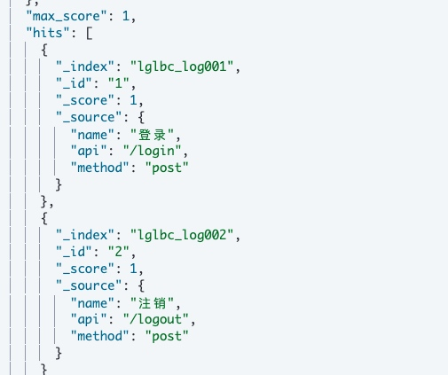
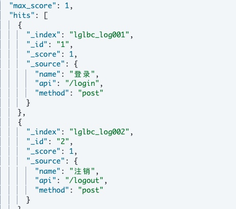

# 9.巧妙使用ES别名
在 Elasticsearch 中，索引别名（Index Alias）是一个非常有用的功能，它允许你为一个或多个索引分配一个更友好、更易于理解的名称。别名不是实际的索引，而是一个指向一个或多个索引的标识符。通过使用别名，你可以隐藏实际索引的名称，使得在应用程序中使用更具有可读性的名称，同时还能提供灵活性和便利性。
## 别名的创建
先创建两个普通索引
```
PUT example_log001/_doc/1
{
  "name":"登录",
  "api":"/login",
  "method":"post"
}
PUT example_log002/_doc/2
{
  "name":"注销",
  "api":"/logout",
  "method":"post"
}
```
执行创建别名请求
```
POST /_aliases
{
  "actions": [
    {
      "add": {
        "index": "example_log001",
        "alias": "example_log"
      }
    },
    
    {
      "add": {
        "index": "example_log002",
        "alias": "example_log"
      }
    }
  ]
}
```
## 按照别名搜索
```
GET example_log/_search
```


## 在别名中实现数据过滤
如果你想在查询别名时，提前加上过滤条件，那么你可以这么做：
先塞一条GET 请求的数据：
```
PUT example_log002/_doc/3
{
  "name":"用户列表",
  "api":"/user/list",
  "method":"get"
}
```
修改过滤器，使其支持method:post过滤
```
POST _aliases
{
  "actions": [
    {
      "add": {
        "index": "example_log001",
        "alias": "example_log",
        "filter": {
          "term": {
            "method": "post"
          }
        }
      }
    },
    {
      "add": {
        "index": "example_log002",
        "alias": "example_log",
        "filter": {
          "term": {
            "method": "post"
          }
        }
      }
    }
  ]
}
```
再次查询，发现刚才添加的数据被过滤掉了，说明过滤器有作用了

## 查看别名
```
GET _alias/example_log
```
## 删除别名
```
POST _aliases
{
  "actions": [
    {
      "remove": {
        "index": "example_log001",
        "alias": "example_log"
      }
    }
  ]
}
```