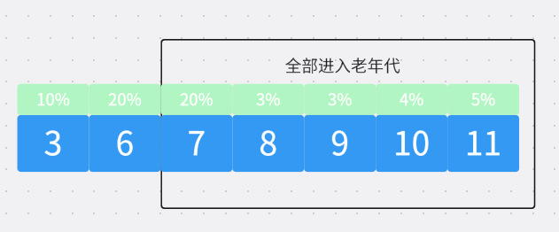

# JVM 什么样的对象直接进入老年代

## 面试题
为什么设置这些机制，让对象提前进入老年代呢？
## 大对象直接进入老年代
什么是大对象呢，这个是由jvm定义的参数值决定的，但是这个参数只在Serial和ParNew垃圾收集器中生效
：-XX:PretenureSizeThreshold

当我们新分配的对象大小大于等于这个值，就会直接在老年代中分配
## 长期存活的对象将进入老年代
在每个对象的头信息中，都包括一个年龄计数器

对象在经过一次minor gc之后，如果仍然存活，并且能够被 survior所容纳 ，那么这个年龄计数器就会加一，当计数器的值达到了默认值大小（一般默认值为15），就会进入到老年代。
## 对象动态年龄判断后决定是否进入老年代
当survior区域的存活对象的总大小占用了survior区域大小的50%(可以通过参数指定)，那么此时将按照这些对象的存活年龄从从到大排序，然后依次累加，当累加到对象大小超过50%，则将大于等于当前对象年龄的存活对象全部挪到老年代。

