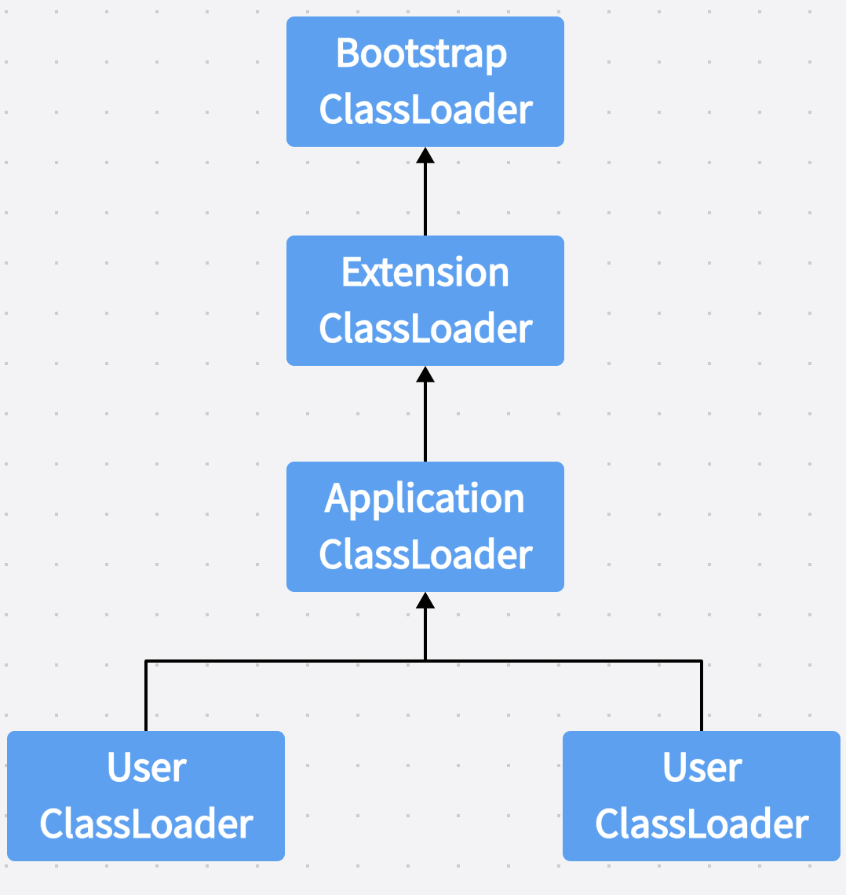

# JVM 从源码角度学习双亲委派机制

## 面试题：请问下面这段代码能运行成功么？如果不行，是为什么？
```
package java.util;

/**
 * @Description TODO
 * @Author 编程学习
 * @Date 2022/11/14 20:59
 */
public class Date {
    public static void print(){
        System.out.println("1111");
    }
    public static void main(String[] args) {
        Date.print();
    }
}
找不到main方法
```

## 什么是双亲委派机制

当一个类加载器收到了类加载请求，它首先检查自己是否已经加载过，如果自己没加载过，则把这个类委托给父类加载器去完成，如果到了顶级（没有父类加载器），还是没有加载过并且也没有找到此类，则就会要求子加载器尝试自己去加载，这个过程就是双亲委派机制
# 从源码角度看双亲委派机制
```
protected Class<?> loadClass(String name, boolean resolve)
    throws ClassNotFoundException
{
    synchronized (getClassLoadingLock(name)) {
        // First, check if the class has already been loaded
        Class<?> c = findLoadedClass(name);
        if (c == null) {
            long t0 = System.nanoTime();
            try {
                if (parent != null) {
                    c = parent.loadClass(name, false);
                } else {
                    c = findBootstrapClassOrNull(name);
                }
            } catch (ClassNotFoundException e) {
                // ClassNotFoundException thrown if class not found
                // from the non-null parent class loader
            }

            if (c == null) {
                // If still not found, then invoke findClass in order
                // to find the class.
                long t1 = System.nanoTime();
                c = findClass(name);

                // this is the defining class loader; record the stats
                sun.misc.PerfCounter.getParentDelegationTime().addTime(t1 - t0);
                sun.misc.PerfCounter.getFindClassTime().addElapsedTimeFrom(t1);
                sun.misc.PerfCounter.getFindClasses().increment();
            }
        }
        if (resolve) {
            resolveClass(c);
        }
        return c;
    }
}
```
## 为什么设计双亲委派机制

- 沙箱安全机制：自己写的Date类不会被加载，这样便可以防止核心API库被随意篡改 
- 避免类的重复加载：当父亲已经加载了该类时，就没有必要子ClassLoader再加载一 

次，保证**被加载类的唯一性 **
## 自定义类加载器
```
package com.example.day1;

import java.io.FileInputStream;
import java.lang.reflect.Method;

/**
 * @Description TODO
 * @Author 编程学习
 * @Date 2022/11/14 21:04
 */
public class MyClassLoader extends ClassLoader{
    private String classPath = "/Users/neil/Desktop/code/training-code/jvm/target";
    private byte[] loadByte(String name) throws Exception {
        name = name.replaceAll("\\.", "/");
        FileInputStream fis = new FileInputStream(classPath + "/" + name
                + ".class");
        int len = fis.available();
        byte[] data = new byte[len];
        fis.read(data);
        fis.close();
        return data;
    }
    @Override
    protected Class<?> findClass(String name) throws ClassNotFoundException {
        try {
            byte[] data = loadByte(name);
            return defineClass(name, data, 0, data.length);
        } catch (Exception e) {
            e.printStackTrace();
            throw new ClassNotFoundException();
        }
    }

    public static void main(String args[]) throws Exception {
        MyClassLoader classLoader = new MyClassLoader();
        Class clazz = classLoader.loadClass("com.example.UserService");
        Object obj = clazz.newInstance();
        Method method = clazz.getDeclaredMethod("print", null);
        method.invoke(obj, null);
        System.out.println("MyClassLoader 被"+MyClassLoader.class.getClassLoader()+"加载");
    }
}
```

