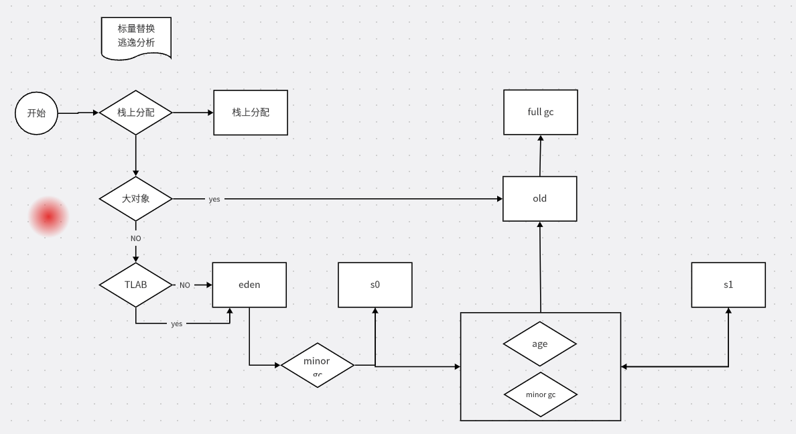
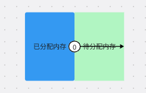

# JVM 内存分配过程详解

## 面试题
在栈上分配对象，使用标量替换的目的是什么？
## 内存分配过程

## 逃逸分析
如何确定对象是否在栈上进行分配，当然得通过逃逸分析了。
逃逸分析是什么意思呢？我们直接看两段代码
代码1:
```
public Student get(){
    Student student = new Student();
    student.setName("编程学习");
    student.setStuNo("编程学习");
    student.setAge(23);
    return student;
}
```
代码2:
```
public void save(){
    Student student = new Student();
    student.setName("编程学习");
    student.setStuNo("编程学习");
    student.setAge(23);
    // 保存到数据
}
```
比对两段代码，如果jvm开启逃逸分析：
那么代码1在经过逃逸分析之后：student不允许对象在栈上分配
那么代码2在经过逃逸分析之后：student允许对象在栈上分配

为什么会这样呢？
因为虚拟机在分析代码1后，发现student对象生成之后，被返回了，使用范围不止在当前方法，所以如果在栈上分配的话，那么当前方法结束后，对象就会被移除，但是此时对象是返回给当前方法的调用者的，导致拿到的是空的，最终导致程序出现问题。

同样道理，在分析代码2之后，student只在当前方法使用，所以允许在栈上分配
## 标量替换
当通过逃逸分析之后，如果对象在栈上分配，jvm将会通过标量替换拆解对象。
标量替换 = 将对象拆解成不能再分为止
聚合量 =对象中可以再次被分解的属性
```
public class Student {
    private String name;
    private String stuNo;
    private Teacher teacher;
    private int age;
}
```
Student对象首先拆解成name,stuNo,age
然后继续拆解Teacher对象，同样拆解方式。
## 内存划分方式
### 指针碰撞
将内存对半拆分，中间放一个指针，指针左边是已分配内存空间，右边是空闲内存空间。申请内存地址时，指针向右移动

### 空闲列表
空闲列表记录了哪段内存地址是空闲的，申请内存空间时，从这个空闲列表中的区域获取内存地址。
## 如果解决内存分配并发问题？

- CAS

compareAndSwap(a,oldValue,newValue)

- TLAB (本地线程分配缓冲区)

每个线程预先在堆中预先分配一小块内存 

