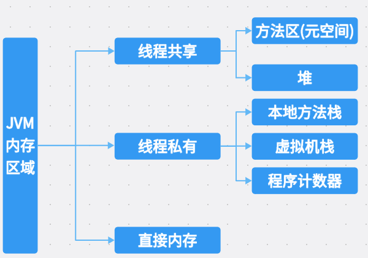
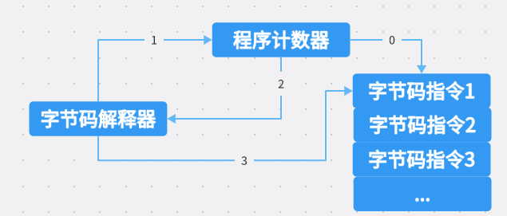
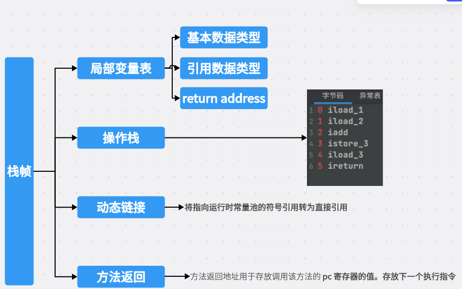
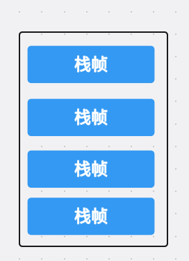
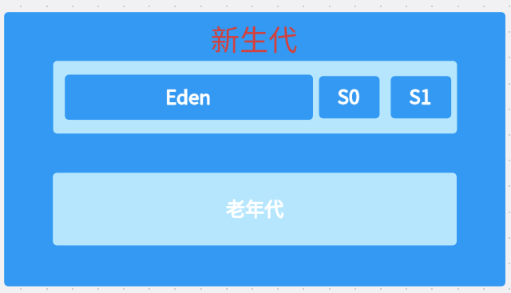
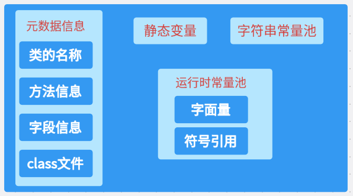
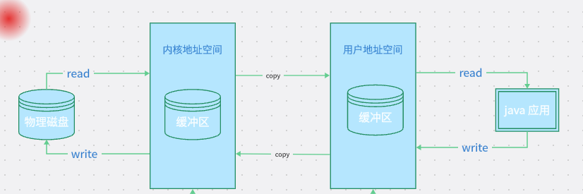
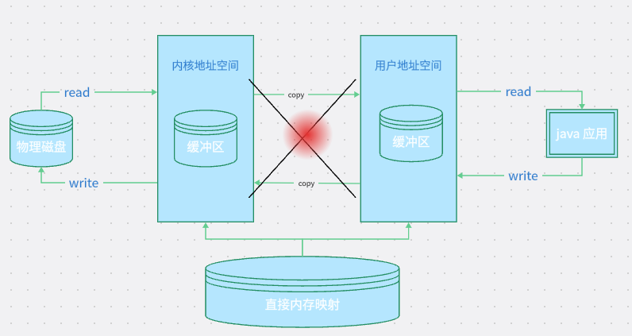

# JVM 内存区域详解

## 面试题：直接内存会导致OOM么？
## 程序计数器
代表当前线程所执行的字节码所在的行号，配合字节码解释器获取下一条需要执行的字节码指令。
代码中的分支、循环、跳转、异常处理、线程恢复都要依靠它来实现。

程序计数器是线程私有的，线程消失它就消失，每个线程维护自己的程序计数器，互不影响。

如果当前线程正在执行本地方法，此时程序计数器为空值。

## 虚拟机栈
虚拟机栈描述的是java方法执行的线程内存模型，当方法执行的时候，Java虚拟机会创建一个栈帧用于存储局部变量表、操作数栈、动态链接和方法出口等信息，在每个方法种调用其他方法都是进出栈的操作，当方法执行完毕，栈帧被移除。

## 本地方法栈
本地方法栈和虚拟机方法栈作用类似，不过它是为执行native方法服务
## 堆 
堆是被线程共享的一个内存区域，大部分对象都在堆上分配，少部分允许在栈上分配（通过逃逸分析）。堆中有新生代和老年代之分，目的是为了垃圾回收的更高效和更少停顿。

## 方法区
方法区也是一块内存区域，它用于存储已被虚拟机加载的类型信息、常量、静态变量、即时编译器编译后的代码缓存等。也包括运行时常量池。
jdk8以前主要通过永久代实现方法区
jdk8开始 通过元空间实现方法区 通过本地内存实现

## 直接内存
直接内存和堆内内存相对应，堆外内存就是把内存对象分配在Java虚拟机的堆以外的内存，这些内存直接受操作系统管理（而不是java虚拟机）。
传统BIO 访问

直接内存访问

