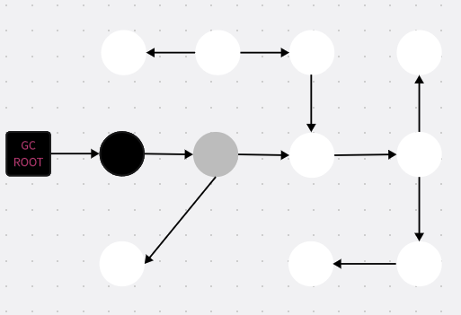
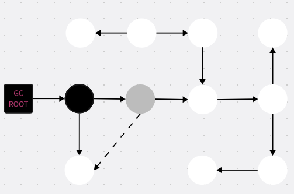
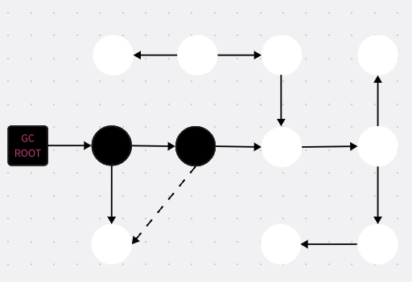

# JVM 如何解决并发标记过程中：多标和漏标的情况？

## 并发标记带来的问题
在cms收集器和g1收集器，都使用了并发标记，用户线程和gc线程同时工作，所以在并发收集过程中，或多或少会发生一些对象引用的变化，最终会导致多标或漏标的现象。
## 三色标记

### 黑色
如果一个对象被标记成黑色，那就说明它已经被垃圾回收器扫描过，并且这个对象的所有引用已经全部扫描过，黑色代表它是存活的，不会被回收
### 灰色
代表对象被扫描过，但是这个对象上至少还有一个引用没被扫描过
### 白色
代表对象从未被垃圾收集器扫描过，如果它一直是白色的，迎来它的只有一个结果：被垃圾回收器回收，但是在初始阶段时，所有对象都是标记成白色的
## 多标一定要解决么？
首先我们来看看，多标会产生什么问题，假如一个对象被扫描后，被标记成黑色(存活对象)，但是在并发标记过程中，这个对象引用发生了变化（变成需要回收的对象），但是我们已经将这个对象标记成不回收对象，最终导致这个对象在这次gc过程中，没有被回收(应当被回收的)，所以就变成了浮动垃圾。

其实针对这种现象，我们可以不用解决的，可以先保留这个对象，等下次gc ，回收这个对象。

## 漏标一定要解决!!!
相对于多标，漏标的问题就严重多了，因为它有可能导致程序出现意想不到的结果：回收了不该回收的对象，相当于你得罪了一个不该得罪的人，你知道后果严重性的哈。

那么这个问题怎么解决呢，这里有两种方式：
### 增量更新
当白色对象被重新指定引用时，如果被指定的对象被标记成黑色，就将这个引用关系记录下来，等并发标记结束后，将记录下来的这些引用关系重新扫描一遍，以黑色对象为根，相当黑色对象又变成了灰色对象。
### 原始快照
当如果一个白色对象要和灰色对象断开关系时，就将这对关系也记录下来，在并发标记结束之后，就从记录里面找出这些对象，以灰色对象为根，重新扫描，目的就是为了再次扫描白色对象，让白色对象存活下来，成为黑色对象。虽然有可能成为我浮动垃圾，但是没关系，可以等待下次gc被回收

