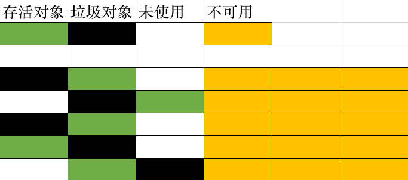
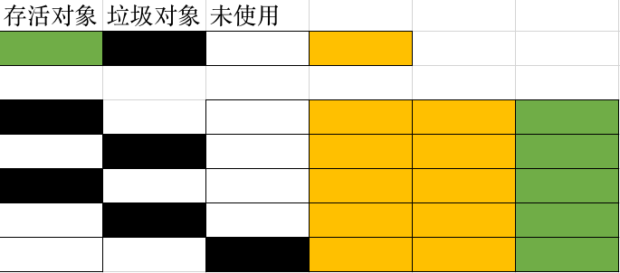
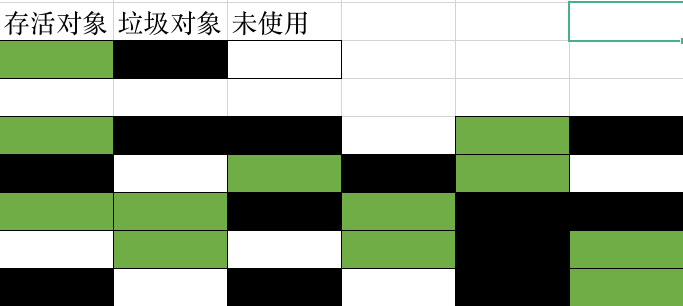
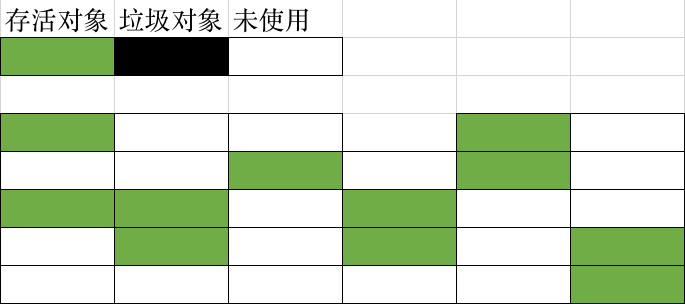
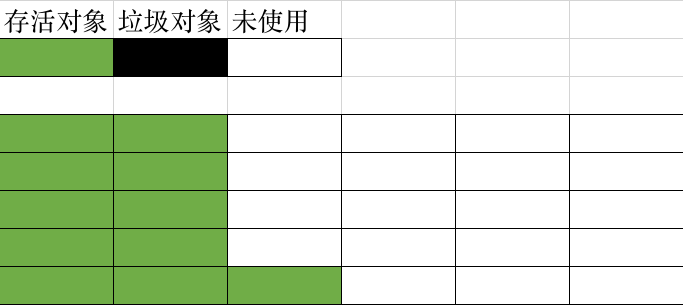

# JVM 常见的垃圾回收机制

## 分代收集
为什么会出现分代收集呢，这是由对象存活周期不同决定的。
在jvm中有些对象是用完就不需要的(业务对象)，有些对象则是长久存留的(如Spring的一些组件)，所以我们不可能按照同样的收集方式去处理这些对象，所以jvm就会把这些对象进行区分，将存活不久的对象放在新生代，长期存活的放在老年代，然后分别对新生代和老年代采用不同的收集算法，所以这个就叫分代收集。
## 标记复制
标记复制算法会将内存空间一分为二，每次只会使用一半，另外一半用来保存下次存活的对象。
在进行收集时，它会将存活对象全部复制到另外一半的内存空间，然后再把零碎的垃圾对象全部回收。
### 为什么标记复制一般用在年轻代？
因为标记复制 复制的是存活对象，存活对象越多，那么复制的效率就越低，但是年轻代存活对象一般比较少，所以非常适合使用标记复制算法。
### 回收前

### 回收后

## 标记清除
分为两个步骤：标记和清除，清除的是垃圾，标记的可以是垃圾也可以是存活对象，要看具体垃圾回收算法实现。
### 回收前

### 回收后

### 存在的问题
会产生空间碎片
## 标记压缩(整理)
标记压缩是在标记清除后，进行了一次碎片整理的操作，使得碎片空间小时，对象存放在连续的空间中。
### 回收前

### 回收后

## 面试题
为什么会出现分代收集呢？

