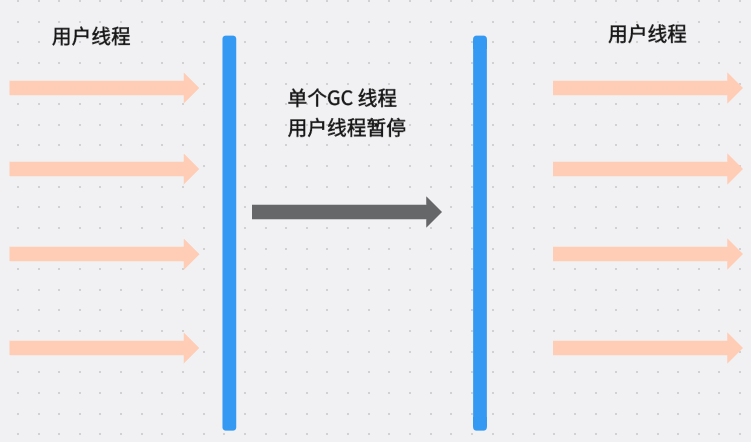
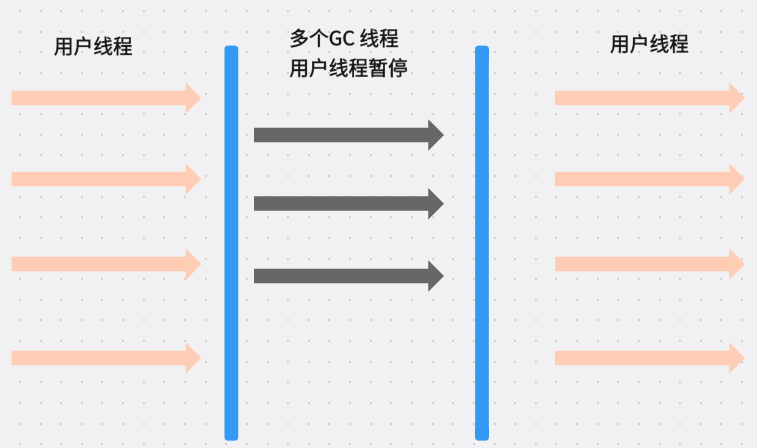
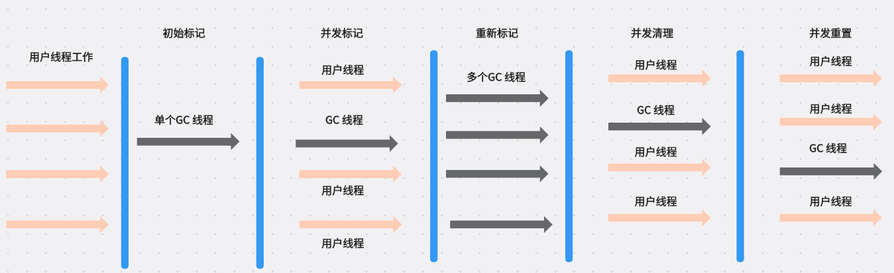
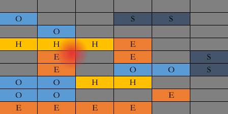
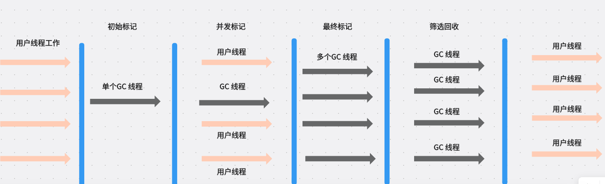

# JVM 必须要会的几种垃圾回收器

## Serial / Serial Old
从单词翻译过来看 serial = 串行，每次它就是一款单线程收集器。

Serial 工作在新生代垃圾回收，Serial Old在老年代进行垃圾回收，Serial Old一般作为CMS 并发收集失败后的备选回收方案。

在垃圾收集器面前，它可算是老前辈了，因为它历史最悠久，同样它和其它垃圾收集器一样，在垃圾收集期间，它会 STW，也就是stop the world. 什么意思呢？就是当它工作时，用户线程就得暂停，等它工作完成，用户线程才允许继续工作。可以用下面的图给大家演示下：

### 参数
-XX:+UseSerialGC -XX:+UseSerialOldGC
### 特点

- 收集效率高
- STW 时间长
- 实现简单
## Parallel Scavenge
为了让STW停顿时间少一点呢，咱们就弄个多线程版本的垃圾收集吧。默认的收集线程数跟cpu核数相同。

### 特点

- 多线程
- STW 相对少点
- 关注吞吐量，高效率利用CPU
### 参数
-XX:+UseParallelGC(年轻代),-XX:+UseParallelOldGC(老年代)
## ParNew收集器
和Parallel Scavenge 收集器一样，都是多线程进行回收，不过它主要和CMS 收集器配合使用

### 参数
-XX:+UseParNewGC=
## CMS收集器
为了在回收效率上和用户体验上（不要停顿太久）做一个平衡，我们迎来了一个新的真正意义上的并发收集器：CMS收集器，基本实现了用户线程和垃圾回收线程同时工作。
### 垃圾回收过程

- 初始标记：暂停所有用户线程，只标记GC Root 直接引用的的对象
- 并发标记：GC线程和用户线程同时工作，gc从gc goot开始遍历整个对象图
- 重新标记：因为上个过程是并发进行的，所以有些对象是在标记过程中新产生的，导致没有标记上，所以这个过程进行修正，将这些漏网之鱼都标上，这个过程是多线程 STW 进行。
- 并发清理：开始对三色标记后需要处理的对象进行清理，这个过程也是并发执行的
- 并发重置：将存活对象上的标记给移除掉，避免影响下次gc

### 特点

- STW 时间短
- 产生浮动垃圾
- 空间碎片(可以在清理后开启空间压缩处理)
- 如果一直清理不干净，会导致频繁出现full gc 最终导致并发收集失败，采用备选方案 serial old 单线程收集
### 参数

- -XX:+UseConcMarkSweepGC 启用cms
- -XX:+UseCMSCompactAtFullCollection 启用cms 压缩整理
- -XX:ConcGCThreads 设置线程数
## G1收集器
为了更好的利用服务器的cpu资源和大内存的机器，G1就来了，它号称满足最小stw(而且还能控制停顿时间)，并且还具备较高吞吐率。

g1为了满足上面两个特性，对内存空间做了如下调整：
### 调整

- 在新生代和老年代的基础上，加了一个存放大对象的区域
- 将整个内存区域全部划分成大小相同的网格(region)，最多有2048个region
- 每个region都有可能存储新生代或老年代或大对象
- 大对象的定义是超过region的50%
- 如果一个大对象存放不下，则会跨越多个region存放
- 可以通过参数控制停顿时间长短
### 回收过程

- 初始标记：暂停所有用户线程，记录GC ROOT 直接引用的对象
- 并发标记：GC线程和用户线程同时工作，gc从gc goot开始遍历整个对象图
- 最终标记：因为上个过程是并发进行的，所以有些对象是在标记过程中新产生的，导致没有标记上，所以这个过程进行修正，将这些漏网之鱼都标上，这个过程是多线程 STW 进行。
- 筛选回收：计算每个region的回收成本，并按照回收成本进行排序，然后按照用户期望的停顿时间进行计算：应该回收哪些region，才能满足停顿期望

### 特点

- 并发与并行
- 空间整合
- 可预测的停顿
### 垃圾收集分类
#### YoungGC
当eden区满了之后，不会立即做YoungGC，而是通过计算回收这些region的成本值是否接近用户预期的停顿值，如果接近，则进行YoungGC，否则新增region作为eden区(如果没有达到限值)
#### MixedGC
当老年代的region占有率达到了限制，则会触发MixedGC，将会回收年轻代，大对象和部分老年代(根据期望停顿时间动态选择)，如果回收后发现没有足够的空间存放对象，则会触发一次full gc
#### Full GC
STW,单线程执行标记清理、标记压缩
### 常用参数

- -XX:+UseG1GC:使用G1收集器
- -XX:G1HeapRegionSize:指定分区大小
- -XX:MaxGCPauseMillis 期望停顿时间
