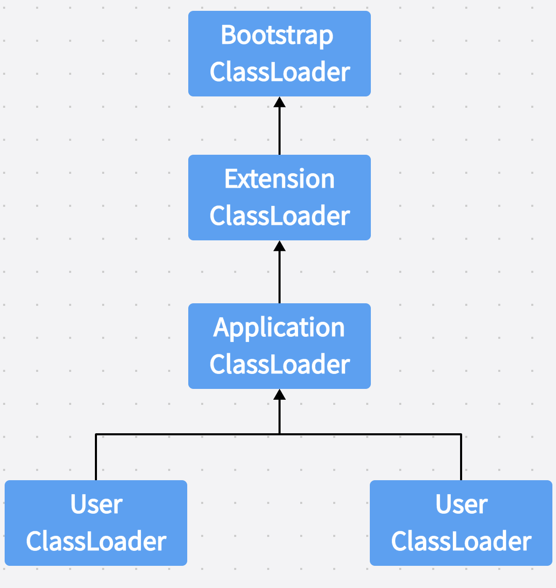
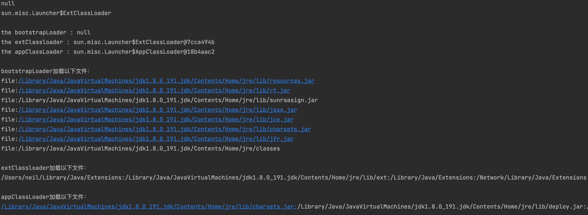

# JVM 类加载器详解及源码阅读

## 类加载器分类
### 引导类加载器(**Bootstrap ClassLoader**)
负责加载支撑JVM运行的位于JRE的lib目录下的核心类库，这个加载器是由C++写的，所以我们在java源码里面是找不到它的实现，如果尝试对它进行打印，输出将为空值。
### 扩展类加载器(**Extension ClassLoader**)
负责加载支撑JVM运行的位于JRE的lib目录下的ext扩展目录中的JAR 类包，也可以使用java.ext.dirs来指定路径，一般保持默认就好。
### 应用程序类加载器(**Application ClassLoader**)
负责加载类路径下的jar包和class文件，我们自己写的代码都是通过这个类加载加载的
### 自定义类加载器
我们自己去实现的类加载器，其父类加载器为应用程序类加载器。
## 类加载器之间的关系

## 验证类加载器加载的路径
```java
package com.example.day1;

import sun.misc.Launcher;

import java.net.URL;

/**
 * @Description TODO
 * @Author 编程学习
 * @Date 2022/11/13 20:57
 */
public class TestClassLoader {
    public static void main(String[] args) {
        System.out.println(String.class.getClassLoader());
        System.out.println(com.sun.crypto.provider.DESKeyFactory.class.getClassLoader().getClass().getName());
        System.out.println("===============手动分割================");
        ClassLoader appClassLoader = ClassLoader.getSystemClassLoader();
        ClassLoader extClassloader = appClassLoader.getParent();
        ClassLoader bootstrapLoader = extClassloader.getParent();
        System.out.println("the bootstrapLoader : " + bootstrapLoader);
        System.out.println("the extClassloader : " + extClassloader);
        System.out.println("the appClassLoader : " + appClassLoader);
        System.out.println("===============手动分割================");
        System.out.println("bootstrapLoader加载以下文件：");
        URL[] urls = Launcher.getBootstrapClassPath().getURLs();
        for (int i = 0; i < urls.length; i++) {
            System.out.println(urls[i]);
        }
        System.out.println("===============手动分割================");
        System.out.println("extClassloader加载以下文件：");
        System.out.println(System.getProperty("java.ext.dirs"));
        System.out.println("===============手动分割================");
        System.out.println("appClassLoader加载以下文件：");
        System.out.println(System.getProperty("java.class.path"));
    }
}

```

## 类加载器初始化过程(源码解读)
```java
 public Launcher() {
        Launcher.ExtClassLoader var1;
        try {
            var1 = Launcher.ExtClassLoader.getExtClassLoader();
        } catch (IOException var10) {
            throw new InternalError("Could not create extension class loader", var10);
        }

        try {
            this.loader = Launcher.AppClassLoader.getAppClassLoader(var1);
        } catch (IOException var9) {
            throw new InternalError("Could not create application class loader", var9);
        }

        Thread.currentThread().setContextClassLoader(this.loader);
        String var2 = System.getProperty("java.security.manager");
        if (var2 != null) {
            SecurityManager var3 = null;
            if (!"".equals(var2) && !"default".equals(var2)) {
                try {
                    var3 = (SecurityManager)this.loader.loadClass(var2).newInstance();
                } catch (IllegalAccessException var5) {
                } catch (InstantiationException var6) {
                } catch (ClassNotFoundException var7) {
                } catch (ClassCastException var8) {
                }
            } else {
                var3 = new SecurityManager();
            }

            if (var3 == null) {
                throw new InternalError("Could not create SecurityManager: " + var2);
            }

            System.setSecurityManager(var3);
        }

    }
```

