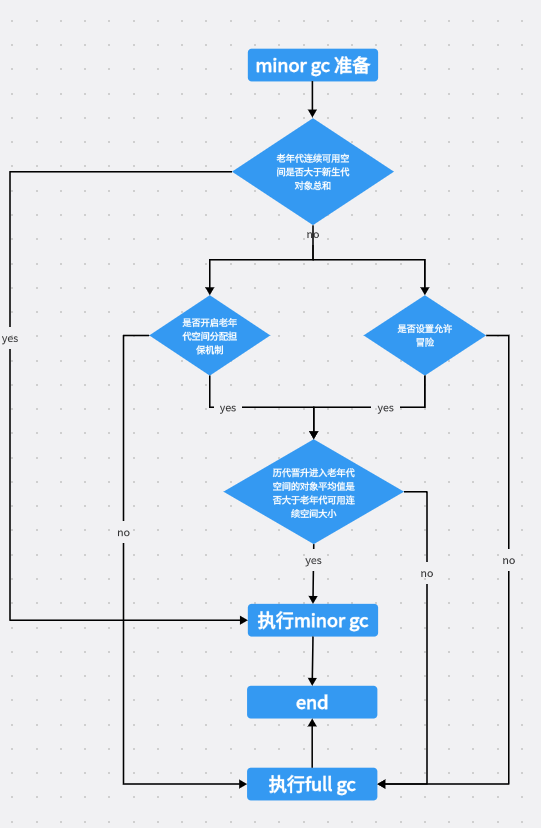

# JVM 老年代空间分配担保机制

## 面试题
为什么要设置老年代空间分配担保机制？
## 定义
在发生minor gc之前，jvm会首先检查老年代的可用连续空间是否大于新生代年龄总大小，如果成立，则进行minor gc，并且这个minor gc是安全的，不会触发full gc。

反之，如果不成立，则会检查jvm是否配置-XX:-HandlePromotionFailure，如果配置了老年代空间分配担保机制，那么就会进行老年代空间分配担保机制的判断。

通过计算历史minor gc后进入老年代对象的平均总大小，如果这个值不大于老年代连续可用空间的总大小，那么就冒险进行minor gc,如果 jvm设置了-XX:HandlePromotionFailure（不允许冒险）或者大于可用空间大小，则还是会做full gc
## 担保判断流程

