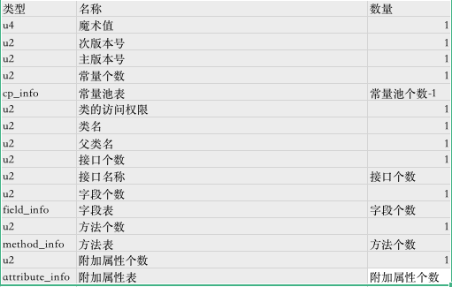
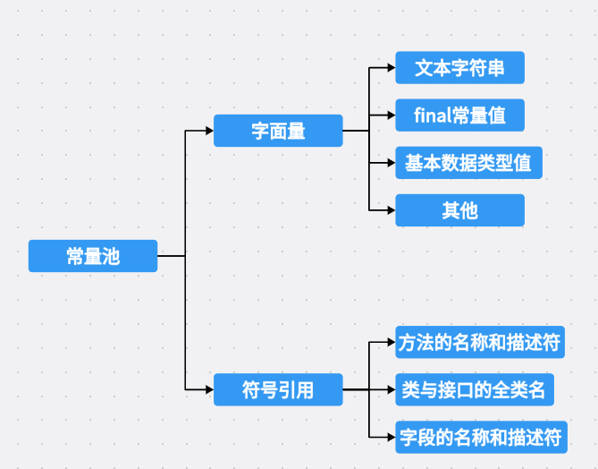
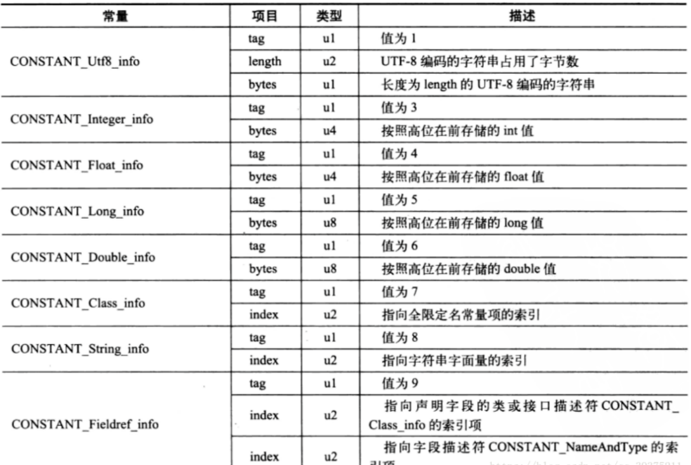
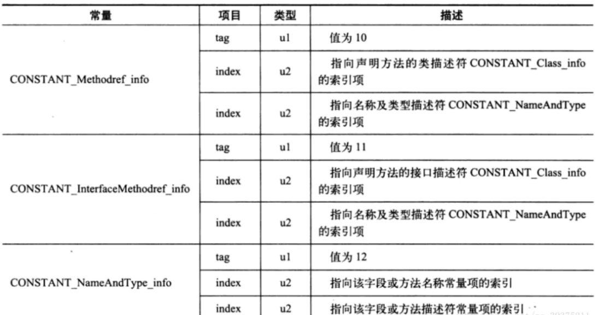

JVM 解读class文件

## Class 文件结构	

## 常量池存放了哪些内容

## 常量池数据结构

## 
## 实例
### 源码
```
package com.example.day1;

/**
 * @Description TODO
 * @Author 编程学习
 * @Date 2022/11/20 07:20
 */
public class TesTClassCode {
    public String a;
    public String b;
    public static int add(int a, int b){
        return a+b;
    }
    public static void main(String[] args) {
        System.out.println(add(1,2000));
    }

}
```

### 解析后的常量池表
```perl
mthod_info  6,26
field_info 27,28
mthod_info 5,29
mthod_info 30,31
class_info 32
class_info 33
utf8_info 1 a
utf8_info 18 Ljava/lang/String;
utf8_info 1 b
utf8_info 6 <init>
utf8_info 3 ()V
utf8_info 4 Code
utf8_info 15 LineNumberTable
utf8_info 18 LocalVariableTable
utf8_info 4 this
utf8_info 30 Lcom/example/day1/TesTClassCode;
utf8_info 3 add
utf8_info 5 (II)I
utf8_info 1 I
utf8_info 4 main
utf8_info 22 ([Ljava/lang/String;)V
utf8_info 4 args
utf8_info 19 [Ljava/lang/String;
utf8_info 10 SourceFile
utf8_info 18 TesTClassCode.java
name_and_type 10 11
class_info 34
name_and_type 35 36
name_and_type 17 18
class_info 37
name_and_type 38 39
utf8_info 28 com/example/day1/TesTClassCode
utf8_info 16 java/lang/Object 
utf8_info 16 java/lang/System
utf8_info 3 out
utf8_info 21 Ljava/io/PrintStream;
utf8_info 19 java/io/PrintStream
utf8_info 7 println
utf8_info 4 (I)V
```
