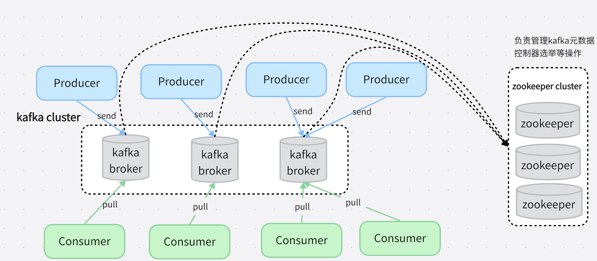
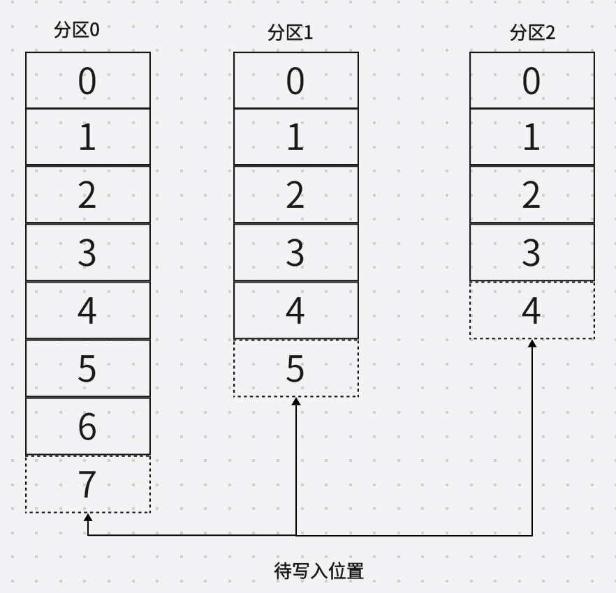

# Kafka 基本组件介绍

Kafka 是采用scala语言开发的一个多分区、多副本且基于zookeeper协调的分布式消息系统，它以高吞吐、可持久化、可水平扩展、支持流数据处理等多种特性而被广泛应用，那么它能做什么？
## Kafka能做什么？
### 消息系统
和传统消息中间件一样，具备系统解耦、冗余存储、流量消峰、缓冲、异步通信、扩展性、 可恢复性等功能，并且它还能保证在分区内的消息顺序性以及回溯消费的功能。
### 存储系统
不同与别的消息中间件，Kafka是直接将数据持久化到磁盘中的，也就是说只要你磁盘不坏，你的消息就不会丢，但是kafka也考虑到了磁盘坏的可能性，特地增加了多副本，有效的降低了数据丢失的可能性。所以基于这个特性，kafka是可以当作长期使用的存储系统来使用
### 流式处理
kafka不仅为流式处理框架提供了可靠的数据来源，还提供了完整的流式处理类库，如窗口、连接、变换和聚合等操作。

## 三个组件和两个核心概念
### 三个组件
kafka 整体架构中主要包括三个重要的组件：producer(生产者)、consumer(消费者)和broker(服务代理节点)

#### Producer
生产者，负责创建消息，然后将其投递到Kafka中
#### Consumer
消费者，负责从kakfa中拉取消息，进行相应的业务逻辑处理
#### Broker
作为一个独立的kafka服务节点或kafka服务实例存在，基本都是以集群方式出现。
### 两个核心概念
#### Topic(主题)
kafka中将消息以主题为单位进行划分，生产者负责将消息发送到kafka特定的主题中，消费者订阅主题进行消费
#### Partition(分区)
主题不是真实存在的，它只是一个逻辑概念，主题细分为多个分区，每个分区又会有多个副本，分区是真实文件存在的，一个分区只属于单个主题，且同一主题下的分区消息是不同的；分区其实就是一个可以追加的日志文件。
每个分区都会维护一个offset，offset在分区内唯一，所以kafka有序只能保证在分区上消息是有序。

消息在发送到broker之前，会计算出应该存放的分区。

