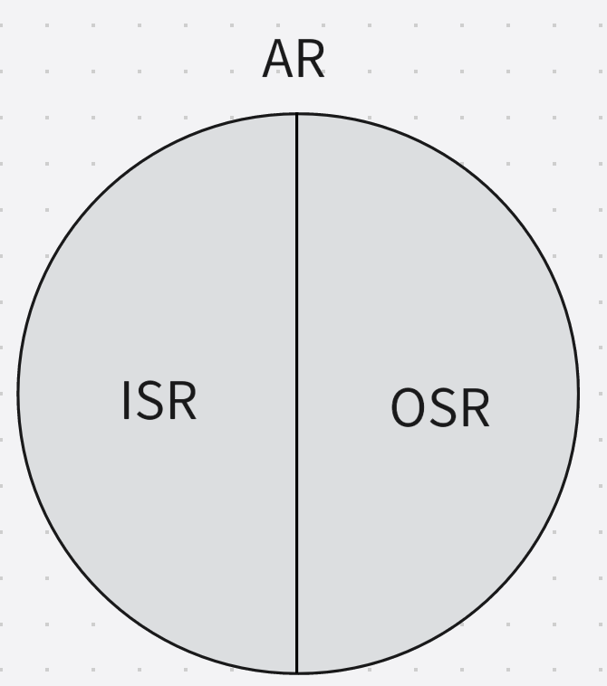
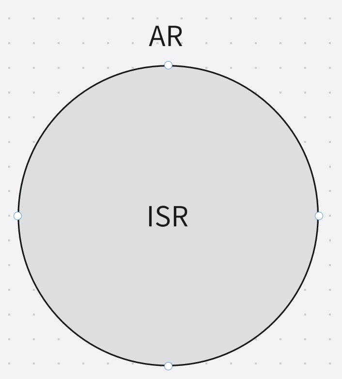

# Kafka 理解AR、ISR和OSR

前面我们讲过kafka为了进行分区容灾，引入了分区多副本机制，在多个副本中，其中有一个Leader副本，所有消息都是先写到Leader副本，然后其它副本会从Leader副本进行同步消息，所以这中间肯定会出现同步进度不一致的问题。
## AR
指的是分区中的所有副本，如某个分区0有三个副本，即 leader副本，follower副本1和follower副本2，那么这三个副本就组成了AR
## ISR
ISR是AR的子集，ISR里面存放的是AR副本中所有与Leader副本保持一定程度同步的副本，如果ISR中的副本与Leader副本同步滞后了，则会从ISR移除，进入OSR
## OSR
OSR是AR的子集，OSR里面存放的是AR副本中所有与Leader副本同步滞后过多的副本，如果OSR中的副本与Leader副本保持同步了，则会从OSR移除，进入ISR集合
## 关系
它们三者的关系可以用一张图表示

但是通常情况是这样，表示当前所有副本都与Leader副本保持一定程度同步，所OSR集合通常是空的。

