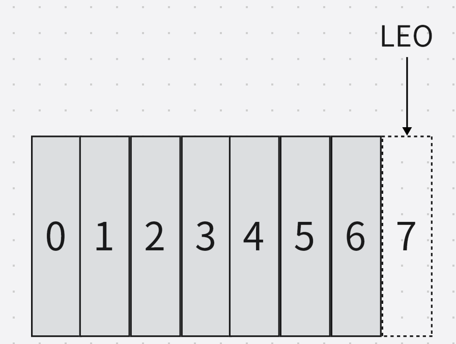
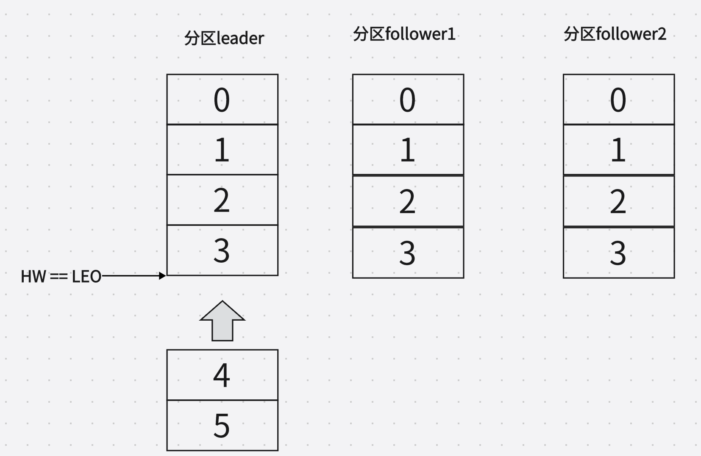
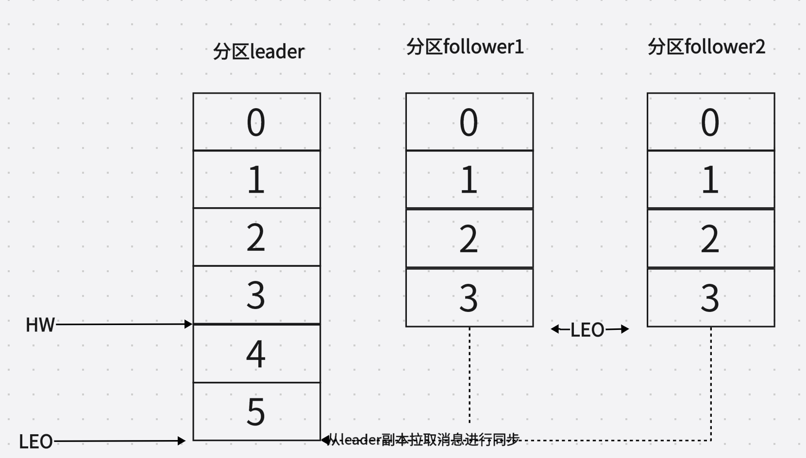
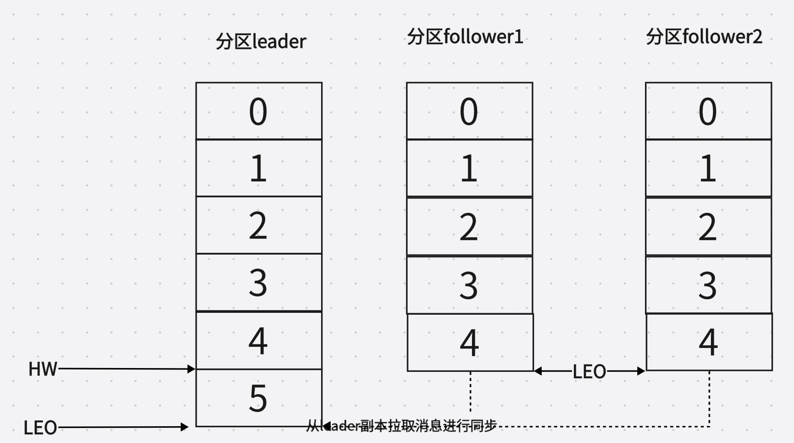
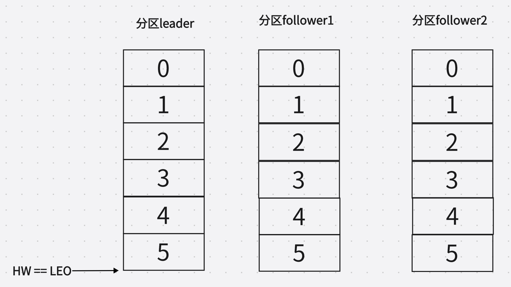

# Kafka 理解高水位(HW)和LEO之间的关系

LEO 是 Log End Offset 缩写，表示当前分区日志文件中下一条待写入消息的offset，如图：

其实HW也是LEO，为什么这么说呢，其实每个分区副本都维护了自己的LEO，然后将每个副本的LEO进行比较，最终取offset最小的LEO，就形成HW,可以看这张图

- 刚开始每个分区follower副本都和Leader分区副本保持同步

- 数据4，5写入到分区leader，生成新的LEO

- follower副本同步一定数据后

- 最终全部同步 HW = LEO

