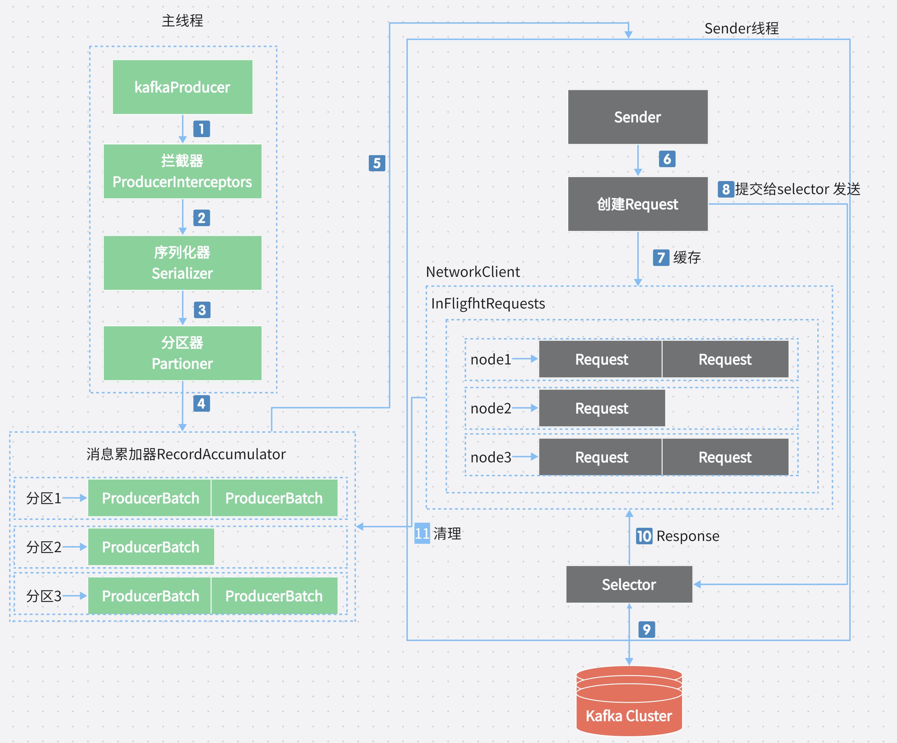

# Kafka 生产者发送消息的原理分析

通过前面几章的学习，我们了解到消息在被发送出去之前，会经过分区器、拦截器，这个只是大方向上，这节课将会带领大家全面剖析生产者发送的整体流程及架构原理分析。

## 整体架构
首先我们通过一张图来整体看下Kafka生产者的整体架构

## 两个线程
在生产者客户端中，主要通过两个线程协调运行：主线程和Sender线程
### 主线程
主线程负责创建消息，然后将消息传递给拦截器、序列化器和分区器，最后将消息缓存到消息累加器
### Sender线程
sender线程负责从消息累加器中获取消息，然后进行组装成<Node, List< ProducerBatch>>，-> <Node, Request> ->Map<Nodeld, Deque<Request>> 这样的形式发送到对应的broker中
## ProducerBatch
ProducerBatch 包含多个ProducerRecord，目的是为了消息更加紧凑，提高吞吐量
## BufferPool
因为kafka内部是通过ByteBuffer创建和释放内存，ByteBuffer的创建是很消耗资源的，为了解决这个问题，Kafka封装了BufferPool实现ByteBuffer重复使用，当然并不是所有大小的ByteBuffer都可以缓存到BufferPoll中的，可以通过配置batch.size，如果小于等于这个大小则可以被缓存到pool中，默认16kb.ProducerBatch 也和这个参数关联。
## InFlightRequests 额外控制

- max.in.flight.requests.per.connection

通过这个参数配置缓存未响应请求的个数，如果超过这个个数，则会阻塞当前发送或抛异常，在有响应回来之后才会创建新的连接

