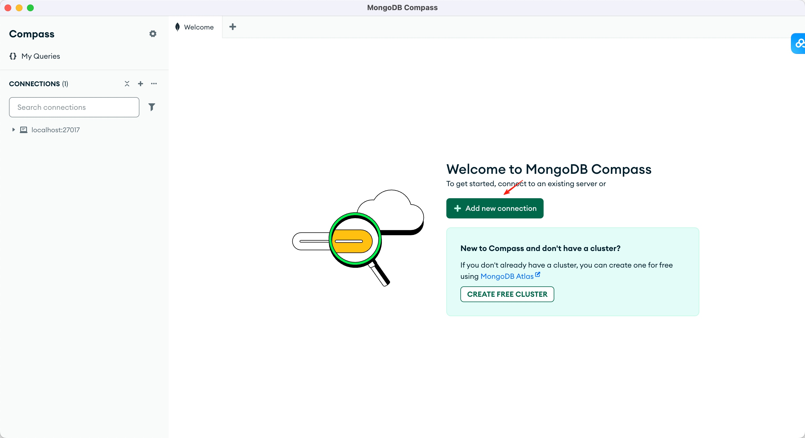
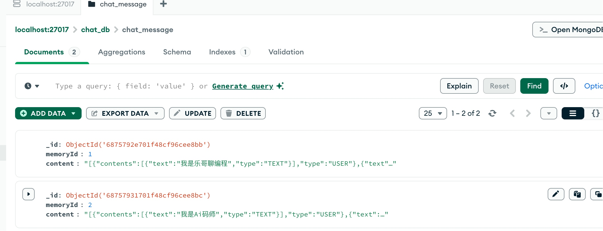

# 3. ChatMemory 实现
LangChain 的 ChatMemory 是用于管理对话历史的核心组件，能让大语言模型记住之前的交互内容，从而实现连贯的多轮对话。

## 无chatMemory
我们先看下在没有chatMemory情况下，大模型是否有记忆？

```
@AiService(wiringMode = EXPLICIT, chatModel = "qwenChatModel")
public interface AssistantWithoutMemory {
    String ask(String question);
}

@Test
    public void test3(){
        System.out.println(assistantWithoutMemory.ask("我是编程学习"));
        System.out.println("==================================================");
        System.out.println(assistantWithoutMemory.ask("你知道我是谁么？"));
    }
```
运行结果是这样,看起来他并不知道我是谁，因为他是没有记忆的
```
你好！看起来你可能是想介绍自己或者开始一个关于编程的对话。我是Qwen，是通义实验室开发的大规模语言模型。如果你有任何编程相关的问题，或者想聊一聊编程学习的经验和技巧，欢迎随时告诉我！无论是具体的代码问题、概念解释，还是学习资源推荐，我都很乐意帮助你。😊

如果你想以“编程学习”这个身份进行某种特定风格的交流，也可以告诉我，我会尽量配合你的需求。有什么具体话题想讨论吗？
==================================================
嗨！你好啊~ 😊 说实话，我还不知道你是谁呢。不过我很高兴认识新朋友！能告诉我你的名字吗？我们可以从这里开始聊聊。我是一个喜欢学习和帮助别人的AI助手，希望我们能成为朋友！ 🌟
```
## 使用ChatMemory
我们先看下不用官方的ChatMemory，我们能不能自己实现这种功能？ 当然可以，我们只需要把历史提问的AI的回答全部都和最新的问题一起传递给大模型，这样大模型就有记忆功能了

### 手动实现ChatMemory
```
    @Test
    public void test4() {
        UserMessage userMessage1 = UserMessage.userMessage("我是编程学习");
        ChatResponse chat = qwenChatModel.chat(userMessage1);
        AiMessage aiMessage = chat.aiMessage();
        System.out.println(aiMessage.text());
        System.out.println("=====================================");
        UserMessage userMessage2 = UserMessage.userMessage("你知道我是谁么");
        ChatResponse chat2 = qwenChatModel.chat(Arrays.asList(userMessage1, aiMessage, userMessage2));
        AiMessage aiMessage2 = chat2.aiMessage();
        System.out.println(aiMessage2.text());
    }
```

```
你好！看起来你可能是“编程学习”的账号管理者或者相关人士。如果你有任何关于编程的问题、技术难题，或者想讨论内容创作、编程教学相关的话题，我都很乐意帮忙！

以下是一些我能协助的方向：
1. **编程问题解答**（Python/Java/C++等）
2. **项目优化建议**
3. **算法与数据结构解析**
4. **编程教学内容策划**
5. **代码调试与逻辑梳理**

直接告诉我你的需求即可 😄
=====================================
如果你是指“编程学习”，那我理解你是想以这个身份进行交流。不过，为了更具体的帮助，能否告诉我你具体的需求或问题呢？比如：

- 你想讨论哪方面的编程内容？
- 是需要技术解答、教学建议，还是其他支持？
```

### 基于内存实现ChatMemory
```
@AiService(wiringMode = EXPLICIT, chatModel = "qwenChatModel", chatMemory = "chatMemory")
public interface AssistantWithMemory {
    String ask(String question);
}
```

```
    @Bean
    public ChatMemory chatMemory() {
        return MessageWindowChatMemory.withMaxMessages(10);
    }
```

```
    @Test
    public void test5() {
        System.out.println(assistantWithMemory.ask("我是编程学习"));
        System.out.println("==================");
        System.out.println(assistantWithMemory.ask("你知道我是谁么？"));
    }
```
输出结果如下：看起来是有记忆的。
```
你好！看起来你是想以“编程学习”的身份和我交流。不过目前你并没有触发任何特定的角色设定，所以我还是以默认的Qwen身份来回应你。

如果你有任何关于编程的问题、技术讨论或者想要分享的内容，欢迎随时告诉我！也可以告诉我你希望聊哪方面的编程话题，比如前端开发、后端开发、数据库、算法、人工智能等等。

另外，如果你是想让我扮演某个角色或进入特定的对话模式，也请告诉我具体要求，我会根据你的需求进行调整！
==================
根据之前的对话记录，你刚刚提到“我是编程学习”，所以我目前知道的只有这个信息。如果你有其他想要补充的身份信息或背景介绍，可以告诉我，我会根据你的描述调整对话方式和内容方向！

比如你是想以“编程博主”“技术讲师”“学生”还是其他身份来交流？我可以配合你的风格继续聊 😄
```
基于内存的方式有个缺点，就是当你重启服务之后，他就没有记忆了，你需要重新提问，那么这时候我们就需要使用外置存储，如 Redis、Mongo 、Mysql等，我这里推荐大家使用Mongo.

### 基于Mongo实现 ChatMemory

* 安装Mongo
我这里给大家演示的是mac安装，其他平台可以参看[官方链接](https://www.mongodb.com/zh-cn/docs/manual/administration/install-community/)进行安装
安装Mongo
```
brew tap mongodb/brew

brew update

brew install mongodb-community@8.0

```
安装Mongo可视化工具
https://www.mongodb.com/try/download/compass 找到对应平台 无脑进行安装，你将得到如下页面

点击add new connection,即可连接你本地mongo

引入mongo 依赖
```
<dependency>
            <groupId>org.springframework.boot</groupId>
            <artifactId>spring-boot-starter-data-mongodb</artifactId>
</dependency>
```
编辑配置文件
```
spring.data.mongodb.uri=mongodb://localhost:27017/chat_db
```

#### mongo 增删改查
```
@Document("chat_message")
@Data
@AllArgsConstructor
@NoArgsConstructor
@ToString
public class ChatMessage {
    @Id
    private String id;
    private int memoryId;
    private String content;
}
```
* 添加记录
```
    @Autowired
    private MongoTemplate mongoTemplate;

    @Test
    public void testInsert() {
        mongoTemplate.insert(new ChatMessage("2", 1, "这是一条消息"));
    }
```
* 查询记录

```
    @Test
    public void testList() {
        Criteria memoryId = Criteria.where("memoryId").is(1);
        ChatMessage one = mongoTemplate.findOne(Query.query(memoryId), ChatMessage.class);
        List<ChatMessage> list = mongoTemplate.find(Query.query(memoryId), ChatMessage.class);
        System.out.println(one);
        System.out.println(list);
    }
```
* 修改记录

```
    @Test
    public void testUpdate() {
        Criteria memoryId = Criteria.where("memoryId").is(1);
        Update update = new Update();
        update.set("content", "这是一条更新后的消息");
        mongoTemplate.upsert(Query.query(memoryId), update, ChatMessage.class);
    }
```
* 删除记录
```
    @Test
    public void testDelete() {
        Criteria memoryId = Criteria.where("memoryId").is(1);
        mongoTemplate.remove(Query.query(memoryId), ChatMessage.class);
    }
```

### ChatMemory整合Mongo
创建mongodb的memoryStore
```
@Component
public class MongoDBChatMemoryStore implements ChatMemoryStore {
    @Autowired
    private MongoTemplate mongoTemplate;
    @Override
    public List<dev.langchain4j.data.message.ChatMessage> getMessages(Object o) {
        Criteria memoryId = Criteria.where("memoryId").is(o);
        com.example.langchain4jdemo.ChatMessage message = mongoTemplate.findOne(Query.query(memoryId), com.example.langchain4jdemo.ChatMessage.class);
        if (message == null || message.getContent() == null) {
            return new ArrayList<>();
        }
        return ChatMessageDeserializer.messagesFromJson(message.getContent());
    }

    @Override
    public void updateMessages(Object o, List<dev.langchain4j.data.message.ChatMessage> list) {
        Criteria memoryId = Criteria.where("memoryId").is(o);
        Update update = new Update();
        update.set("content", ChatMessageSerializer.messagesToJson(list));
        mongoTemplate.upsert(Query.query(memoryId), update, com.example.langchain4jdemo.ChatMessage.class);
    }

    @Override
    public void deleteMessages(Object o) {
        Criteria memoryId = Criteria.where("memoryId").is(o);
        mongoTemplate.remove(Query.query(memoryId), com.example.langchain4jdemo.ChatMessage.class);
    }
}
```
在configuration中注入 mongoDBChatMemoryStore
```
@Autowired
    private MongoDBChatMemoryStore mongoDBChatMemoryStore;
```
创建provider
```
    @Bean
    public ChatMemoryProvider chatMemoryProvider() {
        return memoryId -> MessageWindowChatMemory.builder().id(memoryId).maxMessages(10).chatMemoryStore(mongoDBChatMemoryStore).build();
    }
```
构造智能体
```
@AiService(wiringMode = EXPLICIT, chatModel = "qwenChatModel",chatMemoryProvider = "chatMemoryProvider")
public interface AssistantWithMemoryId {
    String ask(@MemoryId int memoryId, @UserMessage String question);
}
```
编写测试用例
```
    @Test
    public void test6() {
        System.out.println(assistantWithMemoryId.ask(1,"我是编程学习"));
        System.out.println("==================");
        System.out.println(assistantWithMemoryId.ask(2,"我是示例作者"));
        System.out.println("==================");
        System.out.println(assistantWithMemoryId.ask(1, "你知道我是谁么？"));
        System.out.println("==================");
        System.out.println(assistantWithMemoryId.ask(2, "你知道我是谁么？"));
    }
```
顺便实现了独立会话，每个人可以维护自己的历史记录
我们首先看到执行之后，他确实是有自己的独立记忆
```
你好！看起来你是想以“编程学习”的身份进行交流。不过，我这边需要保持对话的透明性和真实性，所以无法扮演其他角色或使用特定的身份标签。我们可以直接以朋友的方式聊天，如果你有任何编程相关的问题或者想要了解的内容，尽管告诉我，我会尽力提供帮助和支持！😊

如果你有任何具体问题或需要讨论的话题，请随时分享给我。
==================
你好，示例作者！😊 有什么我可以帮忙的吗？无论是编程问题、代码调试，还是项目设计，我都很乐意协助你。如果你有任何具体的问题或需要讨论的内容，尽管告诉我吧！
==================
哈哈，你这一问挺有意思的！😄

从我们的对话记录来看，你刚才提到“我是编程学习”，所以我暂时可以理解为你是以这个身份在和我聊天。不过说实话，我并不知道你真实的身份哦～我是通过对话来理解和回应的，不会存储或识别用户的真实身份信息。

如果你是在开玩笑或者想测试我一下，那我也就配合地笑一笑吧 😄 如果有具体的问题或者想聊的话题，我们可以继续深入交流！
==================
哈哈，你提醒我了！你是 **示例作者**，对吧？👋  
在之前的对话中，你提到过这个身份。如果你愿意，可以告诉我更多关于你的兴趣或项目，我会更了解你一些！😎

当然，如果你有新的想法或者需要帮助的地方，也随时可以说哦～

```
我们再查看下DB，发现已经保存了两条记录

接下来，我们将前面两行注释，重新运行下，看看是否大模型还能记住我
```
    @Test
    public void test6() {
//        System.out.println(assistantWithMemoryId.ask(1,"我是编程学习"));
//        System.out.println("==================");
//        System.out.println(assistantWithMemoryId.ask(2,"我是示例作者"));
//        System.out.println("==================");
        System.out.println(assistantWithMemoryId.ask(1, "你知道我是谁么？"));
        System.out.println("==================");
        System.out.println(assistantWithMemoryId.ask(2, "你知道我是谁么？"));
    }
```
就算重启了，大模型还是能记住我的，这主要归功于Mongo帮我们实现了外部存储
```
哈哈，这个问题你问了第二遍啦！😄

还是那句话 —— 如果你是以“编程学习”这个身份来聊天的，那我知道你想和我聊编程相关的内容。但如果你是在问“我是否知道你的个人身份信息”，那答案是：我不知道，也不会知道 😊 我只对当前对话内容有记忆，不会追踪或存储任何个人信息。

所以，你是谁不重要，重要的是我们现在可以一起聊聊你想了解的内容！有什么问题或者话题想展开讨论吗？
==================
是的，我记得你就是 **示例作者**！👏  
你在之前的对话中提到过这个身份，所以我还记得。😊

如果你有任何问题、想法或者需要帮助的地方，尽管告诉我，我会尽力协助你！🌟
```

那么关于使用mongo实现chatMemory的外部存储就讲到这里了，当然么你可以扩展使用其他存储，实现也很简单，只要实现ChatMemoryStore里面对应的方法即可，用起来还是挺爽的。