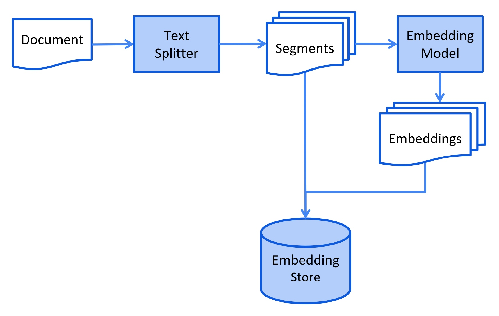
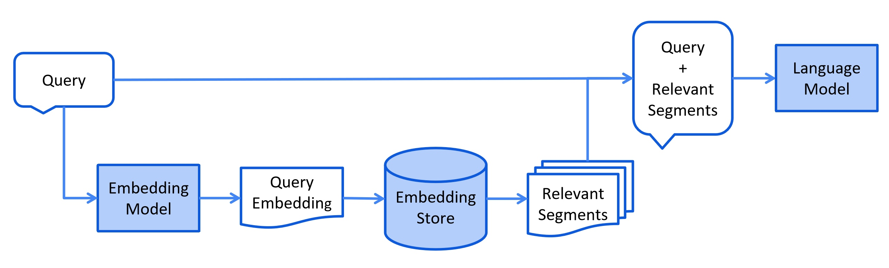
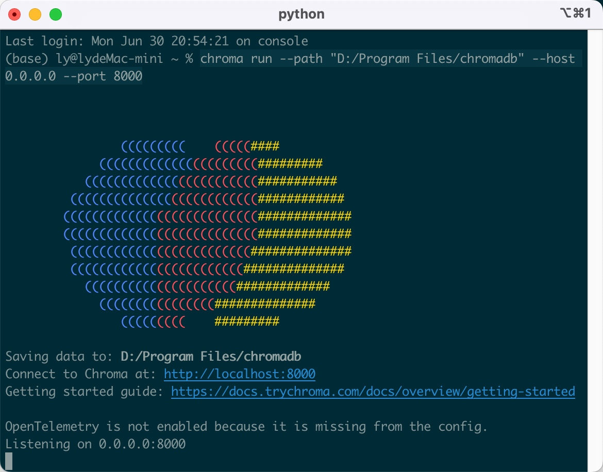
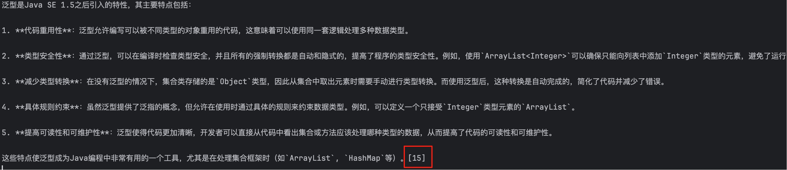
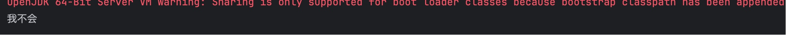

# 5.RAG 实现
简单来说，RAG 是一种在发送给 LLM 之前，从你的数据中找到并注入相关信息片段到提示中的方法。 这样 LLM 将获得（希望是）相关信息，并能够使用这些信息回复， 这应该会降低产生幻觉的概率。

相关信息片段可以使用各种信息检索方法找到。 最流行的方法有：

* 全文（关键词）搜索。这种方法使用 TF-IDF 和 BM25 等技术， 通过匹配查询（例如，用户提问的内容）中的关键词与文档数据库进行搜索。 它根据每个文档中这些关键词的频率和相关性对结果进行排名。
* 向量搜索，也称为"语义搜索"。 文本文档使用嵌入模型转换为数字向量。 然后根据查询向量和文档向量之间的余弦相似度 或其他相似度/距离度量找到并排序文档， 从而捕捉更深层次的语义含义。
* 混合搜索。结合多种搜索方法（例如，全文 + 向量）通常可以提高搜索的有效性。

## 索引与检索
对于向量索引，这通常涉及清理文档、用额外数据和元数据丰富文档、 将文档分割成更小的片段（也称为分块）、嵌入这些片段，最后将它们存储在嵌入存储（也称为向量数据库）中。

对于向量搜索，这通常涉及嵌入用户的查询（问题） 并在嵌入存储中执行相似度搜索。 然后将相关片段（原始文档的片段）注入到提示中并发送给 LLM。

## 代码示例

### 配置Embeding模型

```
langchain4j.community.dashscope.embedding-model.api-key=${key}
langchain4j.community.dashscope.embedding-model.model-name=text-embedding-v3
```
使用Embeding模型将文本转为向量
```
    @Autowired
    private EmbeddingModel embeddingModel;
    
    @Test
    public void test8() {
        Response<Embedding> helloWorld = embeddingModel.embed("hello world");
        System.out.println(helloWorld.content().vectorAsList());
    }
```

### 嵌入(向量)存储
那么什么数据库能存储向量化之后的内容呢？🤔 es, redis,chroma 等这些都是可以的，我们今天使用chroma进行存储
* 安装 Chroma
安装向量库，我这里使用的是chroma,可以直接使用pip安装
```
pip install chromadb
```
启动chroma
```
chroma run --path "～/chromadb" --host 0.0.0.0 --port 8000
```

* 引入chroma依赖

```
 <dependency>
            <groupId>dev.langchain4j</groupId>
            <artifactId>langchain4j-chroma</artifactId>
            <version>1.0.0-beta3</version>
        </dependency>
```
* 配置EmbedingStore

```
    @Bean
    public EmbeddingStore<TextSegment> embeddingStore() {
        return ChromaEmbeddingStore
                .builder()
                .baseUrl("http://127.0.0.1:8000")
                .collectionName("mst")
                .logRequests(true)
                .logResponses(true)
                .build();
    }
```
* 使用embeddingStore 保存向量内容

```
    @Test
    public void test9() {
        TextSegment segment2 = TextSegment.from("我是java开发工程师");
        Embedding embedding2 = embeddingModel.embed(segment2).content();
        embeddingStore.add(embedding2, segment2);
    }
```
### 整合外部文档 进行RAG检索和索引
* 引入PDF解析库

```
        <dependency>
            <groupId>dev.langchain4j</groupId>
            <artifactId>langchain4j-document-parser-apache-pdfbox</artifactId>
            <version>1.0.0-beta3</version>
        </dependency>
```
* 配置contentRetriver

```
    @Bean
    ContentRetriever mstContentRetriever() {
        return EmbeddingStoreContentRetriever
                .builder()
                .embeddingModel(embeddingModel)
                .embeddingStore(embeddingStore())
                .maxResults(1)
                .minScore(0.5)
                .build();
    }
```
* 加载PDF内容到向量库

```
 @Test
    public void testLoadPDF() throws IOException {

        PDDocument doc = PDDocument.load(new File("/Users/ly/Desktop/编程学习/10万字总结java面试题和答案.pdf"));
        PDFTextStripper stripper = new PDFTextStripper();
        DocumentSplitter splitter = DocumentSplitters.recursive(
                1000, 200); // 可以换成 DashScopeTokenizer

        for (int page = 1; page <= doc.getNumberOfPages(); page++) {
            stripper.setStartPage(page);
            stripper.setEndPage(page);
            String text = stripper.getText(doc).trim();
            if (text.isEmpty()) continue;

            Metadata metadata = new Metadata();
            metadata.put("page", page);
            Document document = Document.from(text, metadata);
            List<TextSegment> segments = splitter.split(document);

            List<Embedding> embeddings = embeddingModel.embedAll(segments).content();
            embeddingStore.addAll(embeddings, segments);
            System.out.println("Added " + embeddings.size() + " embeddings.");
        }
    }
```
* 配置AiService

```
@AiService(wiringMode = EXPLICIT, chatModel = "qwenChatModel", tools = "tools", contentRetriever = "mstContentRetriever")
public interface AssistantWithRAG {
    @SystemMessage("你是一个专业的面试官，请结合我提供的上下文进行回答，并在结果中表明引用的页数，如果通过RAG没有获取到相关知识，请直接回答：我不会")
    String ask(String question);
}
```
* 测试检索

```
    @Test
    public void testSearch() {
        System.out.println(assistantWithRAG.ask("泛型常用特点"));
    }
```

在测试一个不在知识库里面的内容
```
    @Test
    public void testSearch2() {
        System.out.println(assistantWithRAG.ask("python有哪些特点？"));
    }
```

