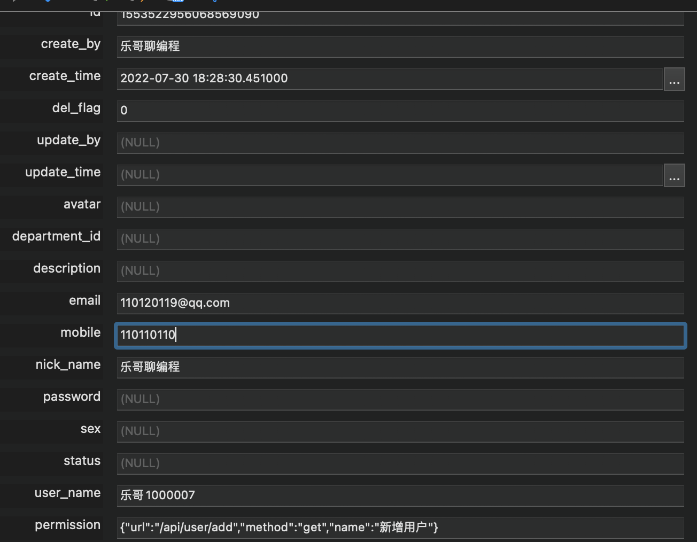
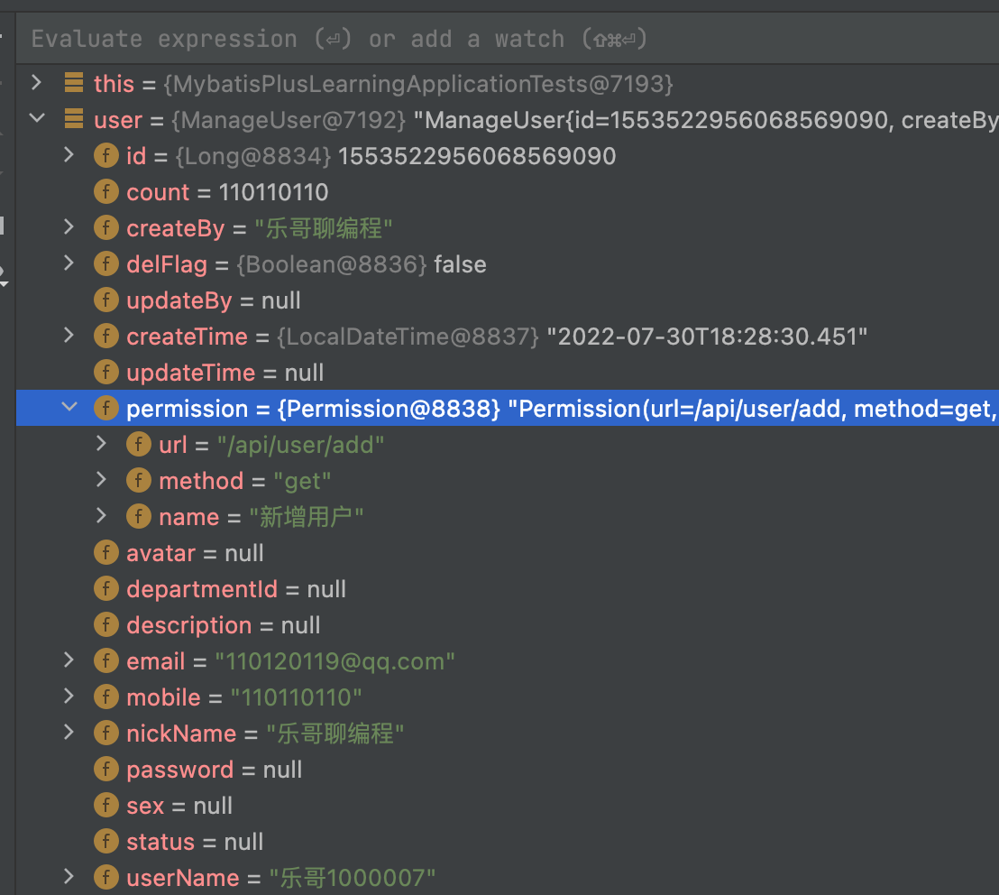
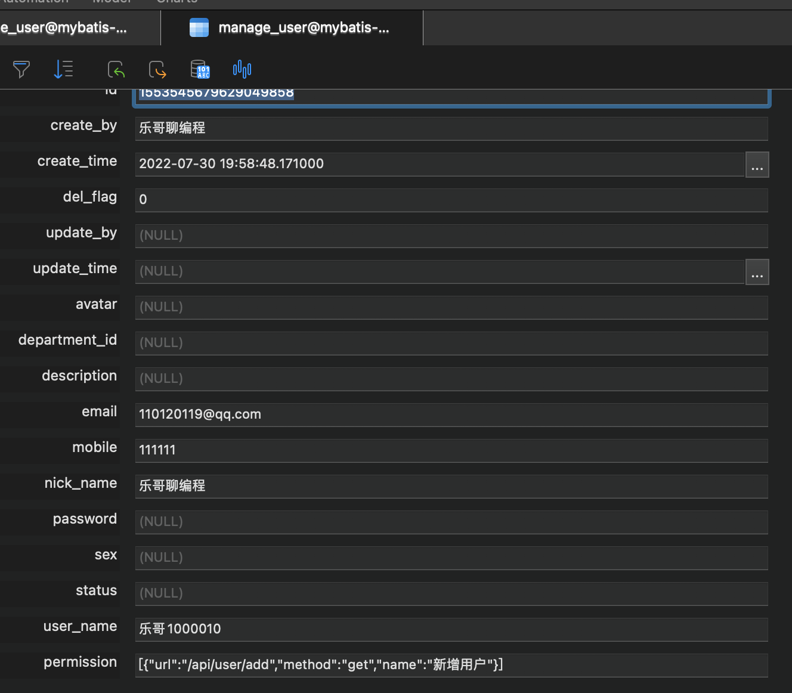
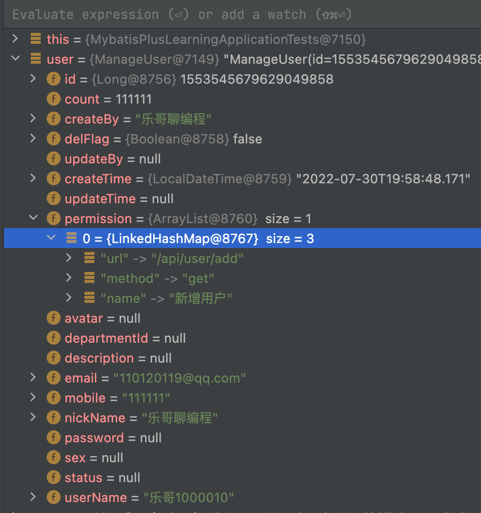
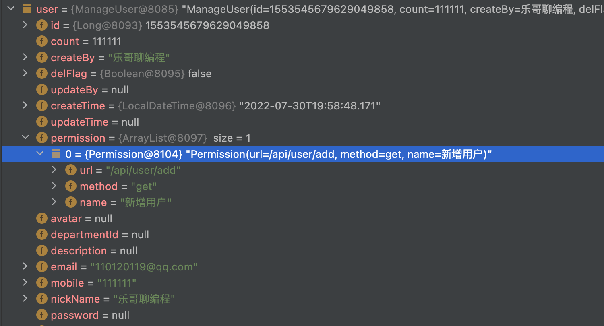

# 6.类型处理器

## 背景
当项目中的实体 包含了另外一个实体，并且想要将包含的实体当作字段存入数据库，这个时候就需要类型处理器了。
虽然MybatisPlus给我们提供了默认的处理器，将数据作为json存入字段，但是只处理了单个实体的存入和读取，并没有处理集合数据的读取反射，所以这节课就带大家怎么去处理集合数据从单个字段中进行读取映射。

## 使用默认的处理器处理单实体
### 实体修改
```

/**
 * <p>
 * 
 * </p>
 *autoResultMap = true	
 * @author 编程学习
 * @since 2022-07-18
 */
@TableName(value = "manage_user",autoResultMap = true)
```
```
 @TableField(typeHandler = JacksonTypeHandler.class)
    private Permission permission;
```
### 编写测试代码
```
    @Test
    public void testSave() {
        Permission permission = Permission.builder()
                .url("/api/user/add")
                .method("get")
                .name("新增用户")
                .build();
        ManageUser manageUser = ManageUser.builder()
                .userName("示例用户1000008")
                .delFlag(false)
                .email("sample@example.com")
                .nickName("编程学习")
                .mobile("13098987766")
                .permission(permission)
                .build();
        manageUserServiceImpl.save(manageUser);
    }
```
### 查看数据库

### 读取数据

## 定义集合处理器
```
package com.example.mybatispluslearning.configuration;

import com.baomidou.mybatisplus.extension.handlers.JacksonTypeHandler;
import com.fasterxml.jackson.core.type.TypeReference;
import com.example.mybatispluslearning.entity.Permission;

import java.io.IOException;
import java.util.List;

public class    MyListTypeHandler extends JacksonTypeHandler {
    private Class<?> type=null;
    public MyListTypeHandler(Class<?> type) {
        super(type);
        this.type=type;
    }

    @Override
    protected Object parse(String json) {
        try {
            return getObjectMapper().readValue(json, new TypeReference<List<Permission>>() {
            });
        } catch (IOException e) {
            throw new RuntimeException(e);
        }
    }
}
```
### 修改实体
```

    @TableField(typeHandler = MyListTypeHandler.class)
    private List<Permission> permission;
```
```
@TableName(value = "manage_user", autoResultMap = true)
@Builder
@AllArgsConstructor
@NoArgsConstructor
public class ManageUser implements Serializable {
```
### 编写测试代码
```
    @Test
    public void testSave() {
        Permission permission = Permission.builder()
                .url("/api/user/add")
                .method("get")
                .name("新增用户")
                .build();
        ManageUser manageUser = ManageUser.builder()
                .userName("示例用户1000009")
                .delFlag(false)
                .email("sample@example.com")
                .nickName("编程学习")
                .mobile("111111")
                .permission(Arrays.asList(permission))
                .build();
        manageUserServiceImpl.save(manageUser);
    }
```
### 查看数据库

### 读取数据(不实用自定义处理器)

### 读取数据(使用自定义处理器)

