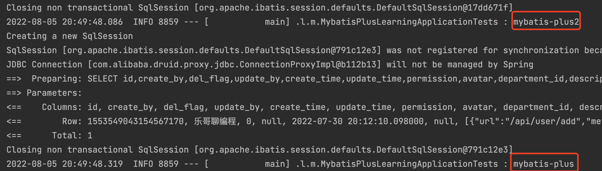

# 7.多数据源实战

## 背景
在项目开发过程中，我们普遍用到的都是单数据源，即所有DB操作的都是同一个数据库。那么当我们想要同时操作多个数据库的时候，应该怎么做呢？
我们有可能一时无法下手，但是好在我们用的是MyBatisPlus，它已经替我们想到了，天然支持多数据源，我们需要做的就是定义你需要的数据源，然后通过注解标明你当前的DB操作是基于哪个数据库就ok了，好了，现在我们就开始吧。
## 引入依赖
```
        <!-- https://mvnrepository.com/artifact/com.baomidou/dynamic-datasource-spring-boot-starter -->
        <dependency>
            <groupId>com.baomidou</groupId>
            <artifactId>dynamic-datasource-spring-boot-starter</artifactId>
            <version>3.5.1</version>
        </dependency>
```
## 配置数据源
```
spring:
  datasource:
    dynamic:
      primary: master #设置默认的数据源或者数据源组,默认值即为master
      strict: false #严格匹配数据源,默认false. true未匹配到指定数据源时抛异常,false使用默认数据源
      datasource:
        master:
          url: jdbc:mysql://192.168.64.2:3306/mybatis-plus
          username: root
          password: root
          driver-class-name: com.mysql.jdbc.Driver # 3.2.0开始支持SPI可省略此配置
        slave:
          url: jdbc:mysql://192.168.64.2:3306/mybatis-plus2
          username: root
          password: root
          driver-class-name: com.mysql.jdbc.Driver
```
## 使用注解
```
@Service
public class ManageUserServiceImpl extends ServiceImpl<ManageUserMapper, ManageUser> implements IManageUserService {

    @Override
    @DS("")
    public ManageUser getFromMybatisPlusDB() {
        return baseMapper.selectOne(lambdaQuery().getWrapper());
    }

    @Override
    @DS("slave")
    public ManageUser getFromMybatisPlus2DB() {
        return baseMapper.selectOne(lambdaQuery().getWrapper());
    }
}
```
## 编写测试代码
```
    @Test
    public void testDynamicDataSource(){
        ManageUser fromMybatisPlus2DB = manageUserServiceImpl.getFromMybatisPlus2DB();
        log.info(fromMybatisPlus2DB.getUserName());
        ManageUser fromMybatisPlusDB = manageUserServiceImpl.getFromMybatisPlusDB();
        log.info(fromMybatisPlusDB.getUserName());
    }
```
## 看结果

