# MySQL Explain 执行计划详解(实战)

本次测试使用的数据库版本为5.7
初始化sql语句：

```java
/*
 Navicat Premium Data Transfer

 Source Server         : localhost
 Source Server Type    : MySQL
 Source Server Version : 50739 (5.7.39)
 Source Host           : localhost:3306
 Source Schema         : cheetah

 Target Server Type    : MySQL
 Target Server Version : 50739 (5.7.39)
 File Encoding         : 65001

 Date: 12/11/2022 18:04:51
*/

SET NAMES utf8mb4;
SET FOREIGN_KEY_CHECKS = 0;

-- ----------------------------
-- Table structure for actor
-- ----------------------------
DROP TABLE IF EXISTS `actor`;
CREATE TABLE `actor` (
  `id` int(11) NOT NULL,
  `name` varchar(45) DEFAULT NULL,
  `update_time` datetime DEFAULT NULL,
  PRIMARY KEY (`id`)
) ENGINE=InnoDB DEFAULT CHARSET=utf8;

-- ----------------------------
-- Records of actor
-- ----------------------------
BEGIN;
INSERT INTO `actor` (`id`, `name`, `update_time`) VALUES (1, 'a', '2017-12-02 15:27:18');
INSERT INTO `actor` (`id`, `name`, `update_time`) VALUES (2, 'b', '2017-12-22 15:27:18');
INSERT INTO `actor` (`id`, `name`, `update_time`) VALUES (3, 'c', '2017-12-22 15:27:18');
COMMIT;

-- ----------------------------
-- Table structure for film
-- ----------------------------
DROP TABLE IF EXISTS `film`;
CREATE TABLE `film` (
  `id` int(11) NOT NULL AUTO_INCREMENT,
  `name` varchar(10) DEFAULT NULL,
  PRIMARY KEY (`id`),
  KEY `idx_name` (`name`)
) ENGINE=InnoDB AUTO_INCREMENT=4 DEFAULT CHARSET=utf8;

-- ----------------------------
-- Records of film
-- ----------------------------
BEGIN;
INSERT INTO `film` (`id`, `name`) VALUES (2, 'film 2');
INSERT INTO `film` (`id`, `name`) VALUES (3, 'film0');
INSERT INTO `film` (`id`, `name`) VALUES (1, 'film1');
COMMIT;

-- ----------------------------
-- Table structure for film_actor
-- ----------------------------
DROP TABLE IF EXISTS `film_actor`;
CREATE TABLE `film_actor` (
  `id` int(11) NOT NULL,
  `film_id` int(11) NOT NULL,
  `actor_id` int(11) NOT NULL,
  `remark` varchar(255) DEFAULT NULL,
  PRIMARY KEY (`id`),
  KEY `idx_film_actor_id` (`film_id`,`actor_id`)
) ENGINE=InnoDB DEFAULT CHARSET=utf8;

-- ----------------------------
-- Records of film_actor
-- ----------------------------
BEGIN;
INSERT INTO `film_actor` (`id`, `film_id`, `actor_id`, `remark`) VALUES (1, 1, 1, NULL);
INSERT INTO `film_actor` (`id`, `film_id`, `actor_id`, `remark`) VALUES (2, 1, 2, NULL);
INSERT INTO `film_actor` (`id`, `film_id`, `actor_id`, `remark`) VALUES (3, 2, 1, NULL);
COMMIT;

SET FOREIGN_KEY_CHECKS = 1;

```

先执行exlpain语句，`EXPLAIN SELECT * from film`，执行结果如下：
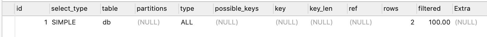

我们接下来对这12个字段依次进行解释
## ID列

id列的值是代表了select语句执行顺序，是和select相关联的；id列的值大会优先执行，如果id列为空最后执行，id列相同，则从上到下依次执行。
```
EXPLAIN  SELECT *,(select id from actor) 's' from film
```
## select_type列

代表查询的类型，有如下几个值：

### simple:

不包含子查询和join关键字
`explain select * from film where id = 2;`


### primary：

复杂查询最外层select语句或者union语句中最左边的select
`explain select *,(select id from actor where id=1) from film`
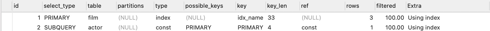

最外层查的是film表的，所以film对应的查询类型就是primary；

### subquery：

仅限在from前面的select语句，不包括select后面的语句
`explain select *,(select id from actor where id=1) from film`

### derived：

衍生表，如果from子句后面包含select语句，则会产生这种类型，它会把中间结果存放在临时表中，但是在5.7中需要使用`set session optimizer_switch='derived_merge=off';`关闭mysql对衍生表的合并优化，我们先看下不关闭之前，我们执行如下sql的情况：
`explain select (select 1 from actor where id = 1) from (select * from film where id = 1) der;`
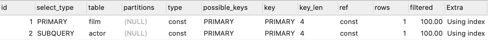

发现查询类型没有derived，我们关闭优化看下`set session optimizer_switch='derived_merge=off'`
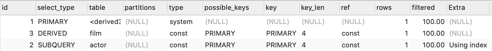

发现出现了derived查询了，

### union：

在 union 中的第二个和随后的 select
`explain select 1 union select 2 UNION select 3`
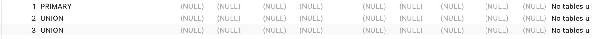


## table列

table列代表当前select语句正在查询哪张表。
`EXPLAIN SELECT id from actor UNION select id from film`
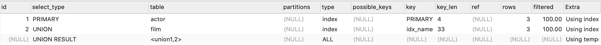

优先执行的是union后面的查询语句当前访问的是film表，接着执行union左边查询语句，当前查询的是actor表，最后查询的是依赖1和2的查询结果，所以使用`<union1,2>`来代替。

## type列

type列的值分别为：
NULL>system > const > eq_ref > ref > range > index > ALL;
执行效率依次递减。

### NULL:

代表查询在mysql能够在优化阶段分解查询语句的时候直接能完成，不需要查询表和索引，例如获取逐渐最大列或最小列:
`EXPLAIN select min(id),max(id) from film`
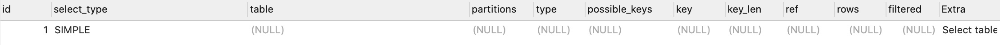
Select tables optimized away:代表从表信息中就能获取结果
### system:

如果要达到sysytem级别，那么它必须要达到以下几个条件：

1.是系统表或者是临时表
2.表中有且只有一条记录

-  我在mysql库中找到了proxies_priv表，我们看执行如下sql：
`explain select * from proxies_priv`

可以看出已经到了system级别； 
-  我们再看一种情况：派生表（临时表）
`set session optimizer_switch='derived_merge=off';`
- `explain extended select * from (select * from film where id = 1) tmp;`
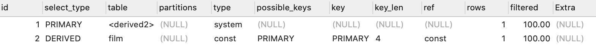
可以看到查询类型为PRIMARY已经达到了system级别，它是从派生表（临时表）中查询，并且派生表中只有一条记录，也能够达到system级别。 
### const:

当where后面是一个主键或者唯一索引 与一个常量精确比较时，mysql会把查询优化为常量查询，执行如下sql：
`explain select * from film where id = 2`
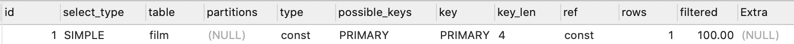

我们可以看下mysql内部进行了如何优化：
`explain EXTENDED select * from film where id = 2; 	show WARNINGS;`
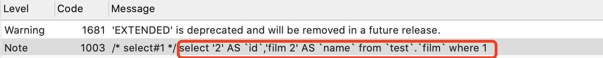

可以看出mysql直接将其转换为常量进行查询

### eq_ref：

主键或者唯一索引与其它表或字段进行关联查询，最多只会返回一条记录，如下代码：
`explain select * from film_actor left join film on film_actor.film_id = film.id;`
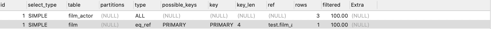

可以看出访问film表的时候，type达到了eq_ref级别，因为id字段在film表中是唯一的，所以查询film表的时候按照id查询只会有一条记录与其关联；

### ref:

相对于eq_ref,ref只需要要求是普通索引或者联合索引的前缀匹配

-  普通索引查询
`explain select * from film where name = 'film1';`

 
-  联合索引前缀匹配
`explain select film_id from film left join film_actor on film.id = film_actor.film_id;`
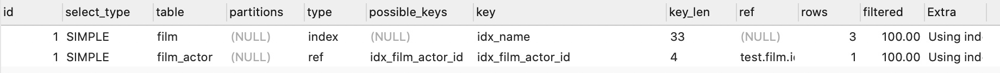
 
### range:

范围索引，通常为in、> < >= 这样的比较符，会达到range级别
`explain select * from actor where id > 1;`


### index

扫描全表索引：所查询的列都创建了索引，但是没有按照索引字段过滤（除了让索引失效的操作除外）
`explain select * from film`


### all

扫描全表，通常情况下，是没有创建索引，需要增加索引优化
`explain select * from actor;`


## possible_keys

这一列显示查询可能使用哪些索引来查找。 explain 时可能出现 possible_keys 有列，而 key 显示 NULL 的情况，这种情况是因为表中 数据不多，mysql认为索引对此查询帮助不大，选择了全表查询。 如果该列是NULL，则没有相关的索引。在这种情况下，可以通过检查 where 子句看是否可 以创造一个适当的索引来提高查询性能，然后用 explain 查看效果。

## key

这一列显示mysql实际采用哪个索引来优化对该表的访问。 如果没有使用索引，则该列是 NULL。如果想强制mysql使用或忽视possible_keys列中的索 引，在查询中使用 force index、ignore index。

## key_len

该列记录了使用索引的长度，一般用来判断联合索引是否全部生效的作用，该值是根据不同数据类型进行计算的。

key_len计算规则如下：

- 字符串 
   - char(n)：n字节长度
   - varchar(n)：2字节存储符串长度，如果是utf-8，则长度 3n + 2
- 数值类型 
   - tinyint：1字节
   - smallint：2字节
   - int：4字节
   - bigint：8字节
- 时间类型 
   - date：3字节
   - timestamp：4字节
   - datetime：8字节

如果字段允许为 NULL，需要1字节记录是否为 NULL 索引最大长度是768字节，当字符串过长时，mysql会做一个类似左前缀索引的处理，将前半 部分的字符提取出来做索引。

在创建表film_actor的时候我们已经创建了联合索引

```
KEY `idx_film_actor_id` (`film_id`,`actor_id`)
```

我们利用这个联合索引进行计算

- 只使用联合索引的第一个字段：
`explain select * from film_actor where film_id = 2;`
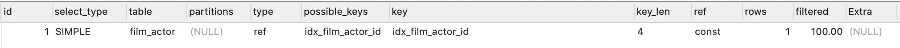

可以看到key_len是4，我们是根据联合索引字段的第一个字段进行过滤的，我们看下film_id字段的类型的int类型，结合上面的计算方式，file_id不能为NULL，那么key_len就是4；

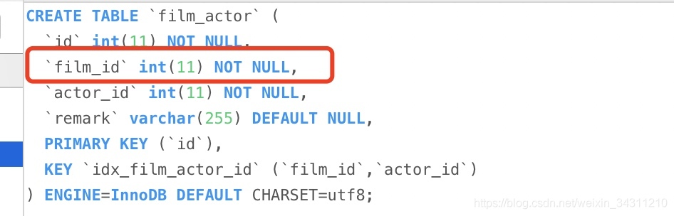

- 使用联合索引的两个字段：
`explain select * from film_actor where film_id = 2 and actor_id = 3`
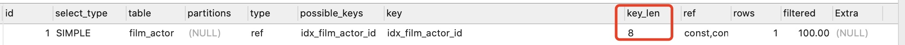

发现结果为8，这个因为这两个字段都是int类型，并且都不为NUll,那么加起来索引长度就是8，那就说明这个索引完全生效了。

## ref

这一列显示了在key列记录的索引中，表查找值所用到的列或常量，常见的有：const（常 量），字段名（例：film.id）

## rows

这一列是mysql估计要读取并检测的行数，注意这个不是结果集里的行数。

## Extra列

这个展示索引的额外信息，主要字段信息如下：

-  Using index
查询的字段被索引覆盖

`explain select film_id from film_actor`

 
-  using where
where 后面的字段没有使用被创建索引,优化方式，创建索引。
`explain select film_id from film_actor where remark = '描述';`
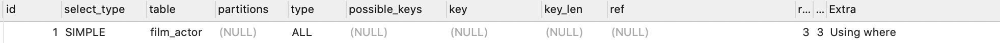
 
-  using index condition
查询的语句中，where条件中是一个前导列的范围；
`explain select * from film_actor where film_id = 1 and actor_id >3;` 
-  Using temporary
创建临时表，mysql查询过程中需要创建临时表来辅助查询，像这种情况是需要优化的。
`explain select distinct name from actor;`
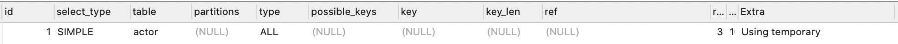

通过给去重的字段添加索引，可达到优化的效果
`CREATE index idx_name on actor(name)`
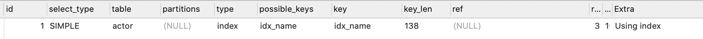

方便后续测试，需要删除刚创建的索引：`DROP INDEX idx_name on actor` 
-  Using filesort
数据排序的时候没有通过索引排序，当数据量小时通过内存排序，大的时候在磁盘中进行排序，需要进行索引优化,通常是排序字段没有创建索引。
`explain select * from actor order by name;`
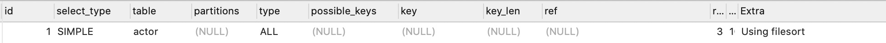

下面的排序字段创建了索引，所以是在索引内进行排序
`explain select * from film order by name;`
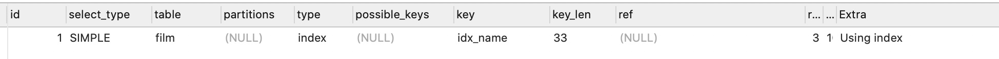
 
-  Select tables optimized away
直接从表信息就能得倒结果
`explain select max(id) from actor`
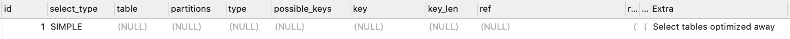
 
