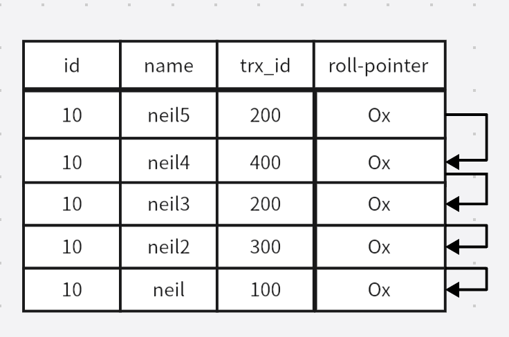
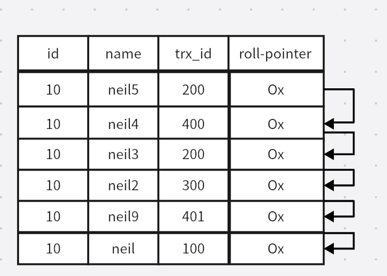

# MySQL MVCC 机制 工作原理
## 概念篇
我们上节课给大家介绍可重复读的时候，给大家提过一嘴：mvcc机制，今天就给大家详细介绍下。
MVCC 翻译过来叫多版本并发控制机制，从字面意思可以看出，每条数据都会存在一个或多个版本，那么怎么找到自己可见的那个版本呢? MVCC使用日志版本链+一致性视图来实现。
## undo log 日志版本链
什么是undo log呢？它其实就是把每次修改的数据都会保存一份，然后在每条数据基础上增加两个隐藏咧，trx_id+roll_pointer,分别存储当前事务ID和上一个版本的数据地址，所以它长这样：

有一点需要注意的是：如果记录被删除，数据也不会真的被删除，它也被当作update操作，复制一份数据出来，然后更新trx_id为当前事务的id，然后再更新记录的头信息为删除状态。
## read view 一致性视图
在可重复读级别，开启事务后，第一次执行sql查询时会生成生一致性视图，在事务提交之前这个都不会变更。这个视图由所有未提交的事务数组和已提交的最大事务id组成，它长这样：
trx_ids: 表示事务开启的时候, 其它未提交的活跃的事务ID，这是一个集合，相对于当前事务一直是不可见的
low_limit_id：表示在生成一致性视图时，当前已经产生的最大事务ID+1 (max_id)
up_limit_id：表示未提交事务组中最小的事务ID(min_id)
## 如何判断可见性？
### 直接上源码
```
bool changes_visible(
        trx_id_t        id, // 记录的id
    const table_name_t& name) const
MY_ATTRIBUTE((warn_unused_result))
{
    ut_ad(id > 0);
    if (id < m_up_limit_id || id == m_creator_trx_id) {
        return(true);
    }
    check_trx_id_sanity(id, name);
    if (id >= m_low_limit_id) {
        return(false);
    } else if (m_ids.empty()) {
        return(true);
    }
    const ids_t::value_type*    p = m_ids.data();
    return(!std::binary_search(p, p + m_ids.size(), id));
}
```
### 查找过程
目前的日志版本链

当前生成的一致性视图：[200,300,400] 401

- 第一条
   - trx_id为200，在未提交事务数组内，则不可见
   - 根据回滚指针继续往前找
- 第二条
   - trx_id为400，在未提交事务数组内，则不可见
   - 根据回滚指针继续往前找
- 第三条
   - trx_id为200，在未提交事务数组内，则不可见
   - 根据回滚指针继续往前找
- 第四条
   - trx_id为300，在未提交事务数组内，则不可见
   - 根据回滚指针继续往前找
- 第五条
   - trx_id为401，大于等于max_id则不可见，因为有可能是在生成一致性视图之后，又有新的事务ID产生并对数据进行了修改，所以也不可见
   - 根据回滚指针继续往前找
- 第六条
   - trx_id为100，不在未提交事务数组内
   - trx_id<最小未提交事务ID，则可见
- 所以最终查到的数据为neil
