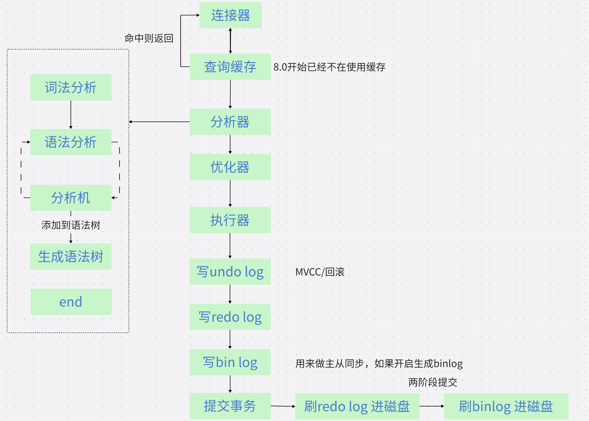
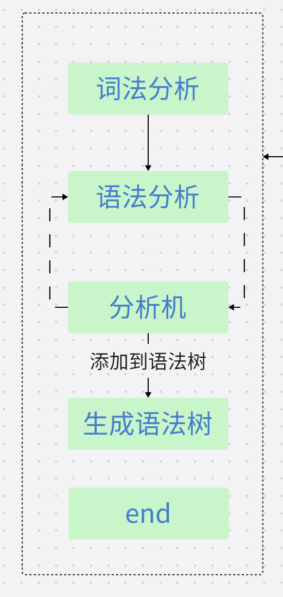

# MySQL 一条SQL的执行过程

## 整体流程

## 组件介绍
### 连接器
处理客户端的连接，一般处理我们这个命令，判断是否满足接入server的条件
```
mysql ‐h host[数据库地址] ‐u root[用户] ‐p root[密码] ‐P root
```
### 查询缓存
在8.0之前，如果用户开启了查询缓存的开关，那么客户端发起请求连接之后，首先会去缓存中查询，缓存中存储的key是查询语句，value是 查询结果，如果缓存中没查到，就会执行下一步了，进入分析器阶段，当然了，如果查到缓存就回直接返回，如果对应的数据被update了，缓存将会同时被清除。
### 为什么8.0删除了缓存呢？
因为如果对一个表的数据更新压力比较大，就回导致这样一个现象：我刚把数据放进缓存后，过了一会就被更新数据操作，将缓存删除了，所以加入缓存就没有一点益处了，综合考虑之后，加入缓存这个鸡肋操作后，往往是弊大于利，索性在8.0就直接给删除了。
### 分析器
如果查询缓存没命中（或没有开启缓存），那么会直接来到这一层：分析器
进入分析器后，首先需要经过词法分析这一个关，如果这一关没过，就直接给你抛出错误了
通俗的来说词法分析器主要做了什么：

- 解析所有关键词，如 select、update、insert、from、where、表名、字段名、group by 等
- 如果解析出来的标识符不对，则会抛出异常，拒绝执行下一步


经过分析器之后，我们最终就能生成一个语法树，后续执行引擎执行语句，就得靠这个语法树进行
### 优化器
在经过分析器之后，mysql需要做的是对我们的sql进行一定的优化，那么它做了哪些优化呢

- 决定使用哪个索引
- 调整where 字段位置：如建立了一个联合索引 abc,但是我们的where 条件是这么写的 where b =1 and a=2 and c=4,这样写肯定不满足最左前缀匹配原则的，所以mysql决定给你优化下，直接调整成这样：where a=2 and b=1 and c=4,最终使用到了索引；
### 执行器
调用不同的索引存储引擎API，执行解析后的sql,

