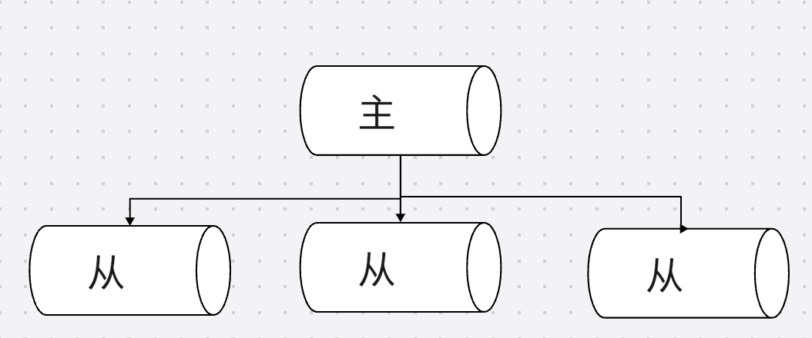
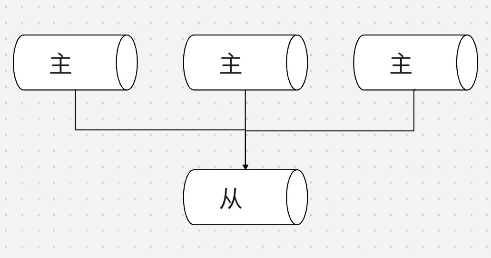
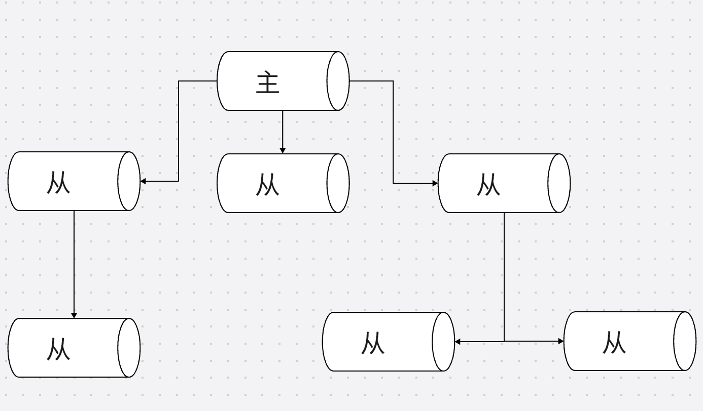
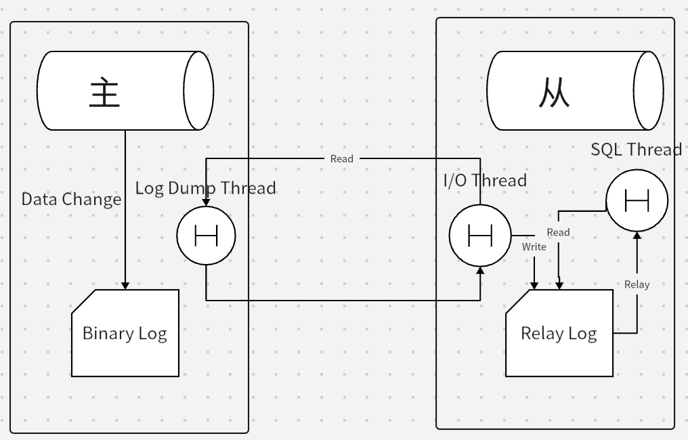
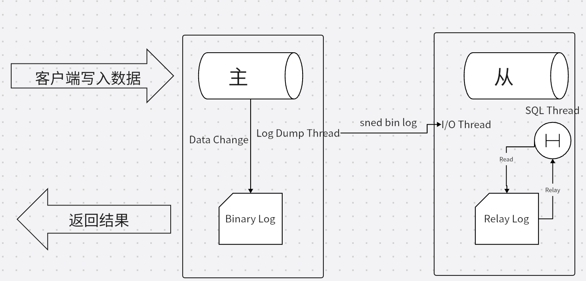
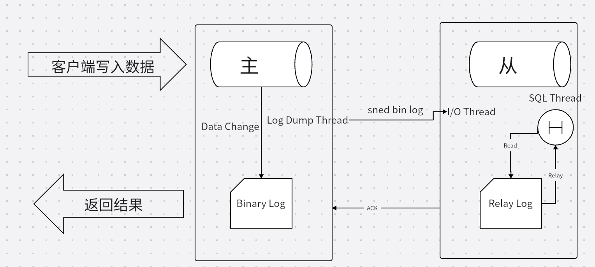
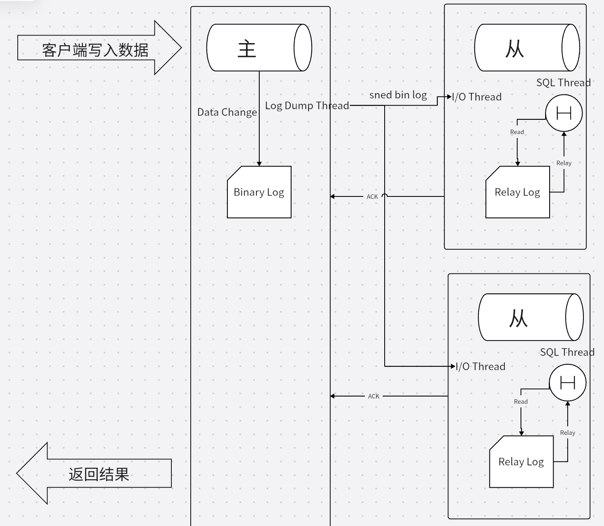

# MySQL 主从复制工作原理
## 什么是主从复制
从mysql3.23版本开始，mysql官方就开始提供主从复制，最简单的主从复制架构就是有两个mysql节点，一个作为主节点，用户可以进行读写，另外一台作为从节点，从节点只接受主节点同步过来的数据，相当于是数据的备份
## 主从复制解决了哪些问题

- 读写分离
- 数据备份
- 高可用
- 架构扩展
## 有哪几种主从形式
### 一主多从(一从)

- 读写分离
- HA
### 多主一从

- 报表统计
### 双主复制

- 互相备份
- 读写负载均衡
### 主从级联复制

- 缓解主节点IO压力
## 主从复制的工作原理

### 重要的三个线程
#### Log Dump 线程
当从节点与主节点建立连接后，主节点会为从节点创建一个Log Dump线程，用来监听bin log文件内容的变化，如果有变化会将新增的部分发送给丛节点
#### IO/Thread
从节点和主节点建立连接后，会开启一个I/O线程，用来接受主节点dump 线程发送过来的bin log，I/O线程收到bin log之后，会写到Relay Log
#### SQL Thread
sql读取relay log的文件内容，进行sql重放，维护数据一致性。
### 重要的两个日志文件：bin log 和 relay log
#### bin log
二进制日志（binnary log）以事件形式记录了对MySQL数据库执行更改的所有操作。
#### relay log
用来保存从节点I/O线程接受的bin log日志，作为中继日志存在
### 工作过程

- 从节点执行 start salve，开启主从复制，从节点I/O线程与主节点建立连接，请求同步数据
- 主节点接受从节点的数据同步请求，负责该从节点的log dump线程会将数据返回给从节点
- 从节点的I/O 线程收到主节点发过来的bin log之后，会将bin log追加到relay log后面，并保存bin log的位置，以便下次从这个位置开始获取后续的内容
- SQL线程 监测到relay log 内容有变化，会将relay追加的内容解析成sql，然后依次执行sql，实现数据同步
## 主从复制的工作模式
### 异步复制
mysql默认复制模式，当主节点将数据写到binlog之后，并提交事务，就立即返回结果给客户端，并不关注更新bin log有没有同步到从节点

### 半同步复制
相对于异步复制，增加了等待从节点成功提交事务的逻辑，但是并不是等待所有从节点提交事务，而是只要有一个从节点提交事务，则返回客户端结果。

### 全同步
这就很好理解了，就是在半同步的基础上，增加了等待所有从节点都成功写入数据，才返回结果给客户端。

### GTID
为了阶段数据同步丢失的问题(因为每次都要带着pos去主节点定位数据起始节点)，所以GTID就诞生了。
主节点更新binlog之前，会产生一个GTID，一同保存到bin log中，当从节SQL线程读取relay log时，会提取里面gtid，如果发现gtid已经存在本地，则说明该组sql已经执行过，即跳过，否则执行，并保存gtid
## bin log 数据存储格式
### Statement-base Replication
只将修改的数据写入到bin log中，减少了binlog的日志量，但是某些函数 now()会导致在从节点执行时，出现数据不一致的情况，5.1.4 之后就不再使用这种方式了
### Row-based Relication
只记录数据被修改成什么样子，而不记录执行的sql，这样就不会出现第一种方式的数据不一致问题，但是会产生大量的日志，导致同步时间增加。
### Mixed-format Replication
混合模式，融合前两种方式的优点，一般不会导致数据不一致的sql使用第一种方式保存，否则使用第二种方式存储。即降低了日质量，也能保证数据一致。
