# MySQL 事务隔离级别

## 概念介绍
### 读未提交（**Read Uncommitted**）
A开启事务后，能够读取到B事务未提交的数据，当A事务根据数据做一些逻辑处理时，这时候B回滚了事务，就会导致A读到的是脏数据
### 读已提交（**Read Committed**）
A开启事务后，只能看到B在提交事务之后产生的更新数据，会有一个问题：A如果在B提交事务前后分别对同一条数据进行了查询，会发现前后不一致，这也就造成了不可重复读的问题
### 可重复读（**Repeatable Read**）
MySQL 使用MVCC机制解决了不可重复读的问题，但是如果在开启事务后，执行了更新操作，还是会出现幻读问题
### 串行化（**Serializable**）
这个最好理解了，通过事务间进行排序，在每个读数据上加上共享锁，但是这个级别一般不用。
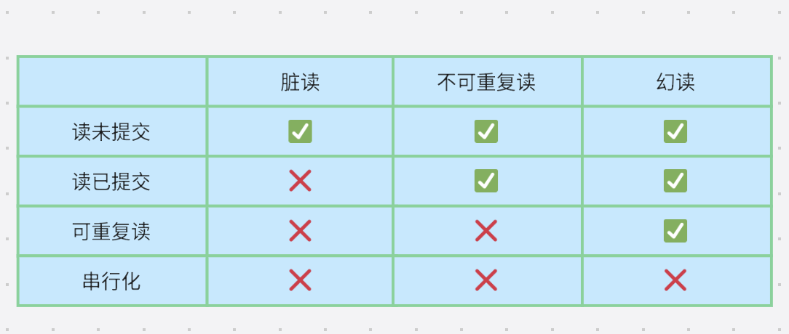
## 实战分析
### 读未提交
客户端A
**set tx_isolation='**read-uncommitted**'; **
start transaction;
客户端B
**set tx_isolation='**read-uncommitted**'; **
start transaction;
客户端A
select * from test_tx;
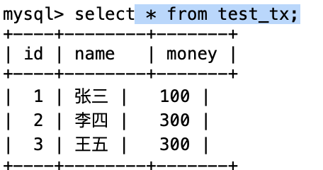
客户端B
update test_tx set money=200 where id=3;
客户端A
select * from test_tx;
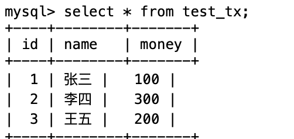
如果这时候A拿到b更新后的数据去做一些业务操作，当准备更新时，B回滚了事务
客户端B
rollback;
这时A拿到的就是脏数据，而且还有可能把脏数据更新到库里面了。
### 读已提交
客户端A
**set tx_isolation='**read-committed**'; **
start transaction;
客户端B
**set tx_isolation='**read-committed**'; **
start transaction;
客户端A
select * from test_tx;
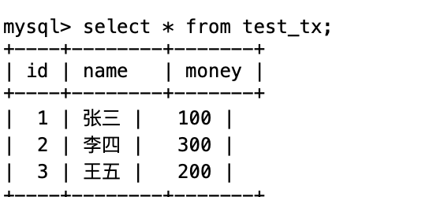
客户端B
update test_tx set money=100 where id=3;
select * from test_tx;
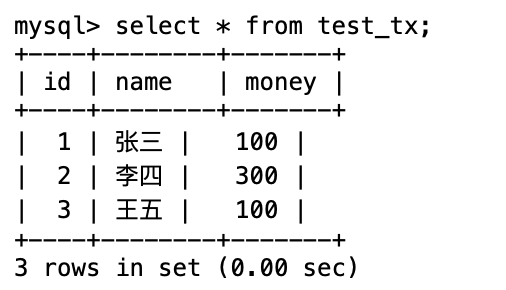
客户端A
select * from test_tx;
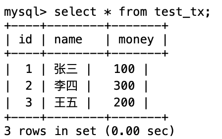
可以看到读的数据没有变更

这时候B提交事务
客户端B
commit;
客户端A
select * from test_tx;
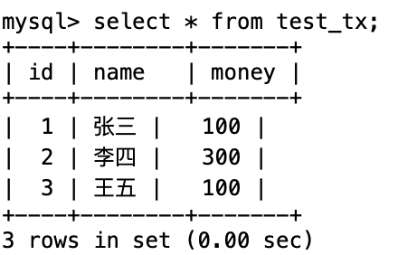
读到了已提交的变更，这就是不可重复度
### 可重复读
客户端A
**set tx_isolation='**repeatable-read**';**
start transaction;
客户端B
**set tx_isolation='**repeatable-read**';**
start transaction;
客户端A
select * from test_tx;
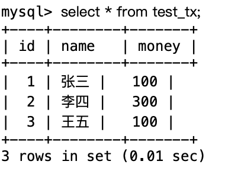
客户端B
update test_tx set money=50 where id=3;
commit;
客户端A
select * from test_tx;
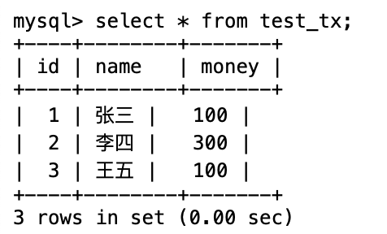
A没有将B提交的数据查出来，解决了不可重复读的问题，难道说就没有问题了么
### 验证幻读
客户端A
**set tx_isolation='**repeatable-read**';**
start transaction;
客户端B
**set tx_isolation='**repeatable-read**';**
start transaction;
客户端A
select * from test_tx;
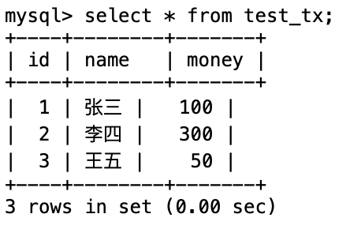
客户端B
insert into test_tx values(null,'编程学习',19);
commit;
select * from test_tx;
客户端A
select * from test_tx;
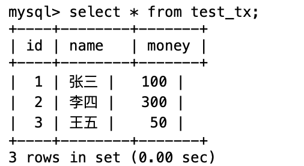
目前看来好像也没有什么问题，但是还是有问题的：
客户端A
update test_tx set money=10 where id=4;
select * from test_tx;
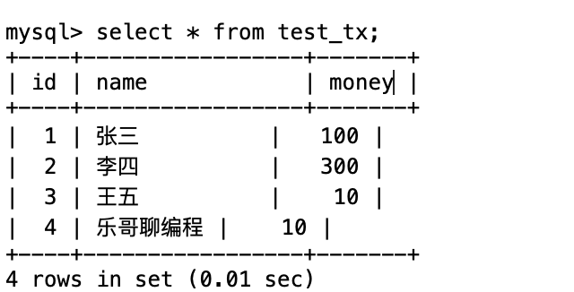
神奇的发现b新增的数据被查出来了，这就是幻读了
### 串行化
**set tx_isolation='**serializable**'; **
