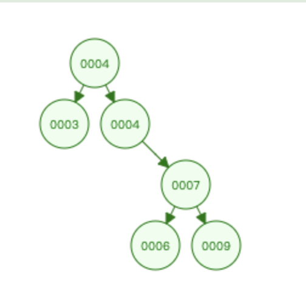
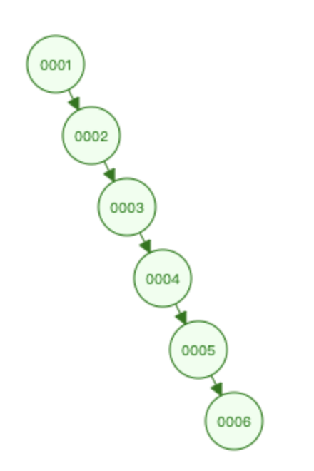
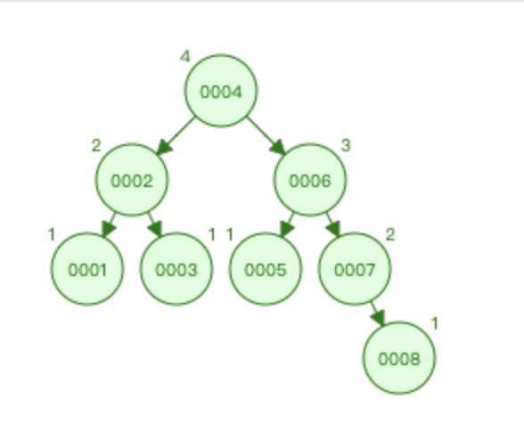
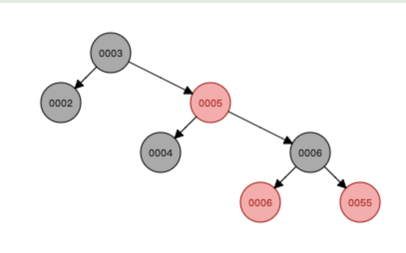
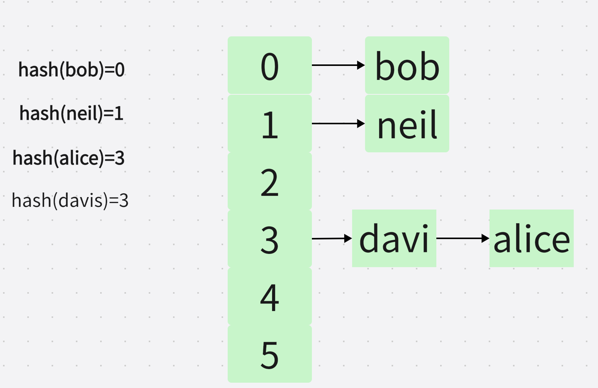
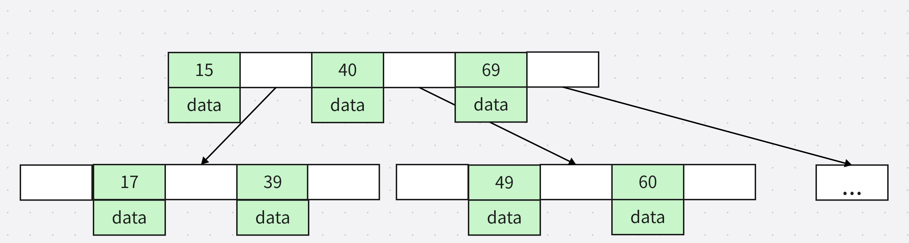
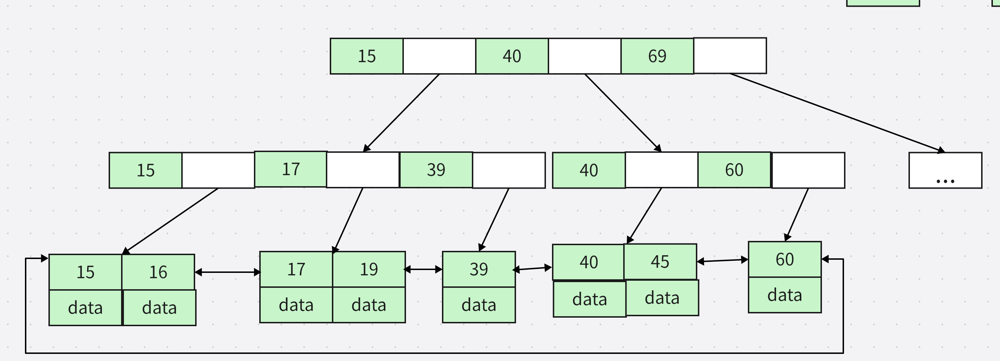

# MySQL 索引的数据结构有哪些？

## 二叉树
- 对半搜索，每个节点最多两个孩子
- 左侧孩子小于根节点，右侧孩子大于等于根节点
- 二叉排序树的查找性能在0(Log2n)到O(n)之间

正常情况下长这样

极端情况下长这样

如果长这样的，查找时间复杂度就是O(n)了，那么就得靠平衡二叉树优化了，现在有请平衡二叉树登场...
## 平衡二叉树

- 满足二叉树
- 任何节点的两个子树的高度最大差为1
- 如果对平衡二叉树进行删除和新增，那么会破坏平衡，就会出发旋转，最终达到平衡，也成自平衡二叉树

虽然能做到平衡了，避免了O(n)，但是每次都进行频繁的左旋或右旋，咱也扛不住啊，所以来试试红黑树
## 红黑树

- 也是自平衡（但没有高度差为1的限制，它有另外一套规则）
- 每个结点是红的或者黑的
- 根结点是黑的
- 每个叶子结点是黑的（NULL）
- 树中不存在两个相邻的红色结点（即红色结点的父结点和孩子结点均不能是红色）
- 从根结点到其任何后代 NULL 结点（默认是黑色的）的每条路径都具有相同数量的黑色结点。

这一点比较难懂：从任意一个结点（包括根结点）到其任何后代 NULL 结点（默认是黑色的）的每条路径都具有相同数量的黑色结点。没听懂？
解释下：这里每个叶子结点（2，4，6，55）都有一个黑色的NULL节点，那么从根节点003到任意的null节点都会经过相同个数的黑色节点（包括黑色的null节点），这样懂了吧。
## Hash

- 对索引的key进行一次hash计算就可以定位出数据存储的位置
- 很多时候Hash索引要比B+ 树索引更高效
- 仅能满足 “=”，“IN”，不支持范围查询
- hash冲突问题

## B-Tree

- 叶节点具有相同的深度，叶节点的指针为空；
- 所有索引元素不重复；
- 节点中的数据索引从左到右递增排列；
- 数据节点存在每个节点上

## B+ -Tree

- 非叶子节点不存储data，只存储索引(冗余)，可以放更多的索引
- 叶子节点包含所有索引字段
- 叶子节点用双向指针连接，提高区间访问的性能

