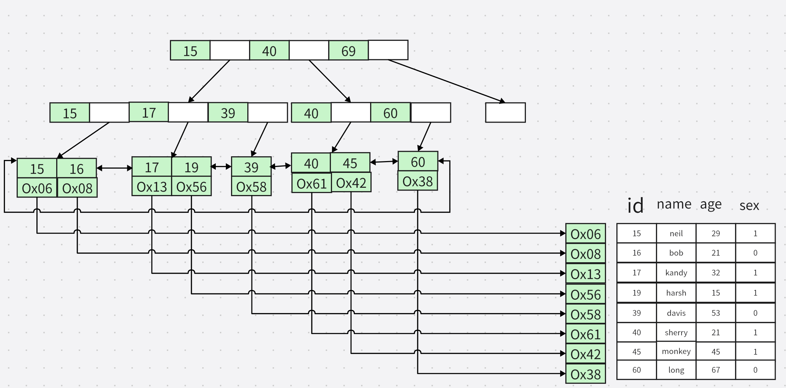
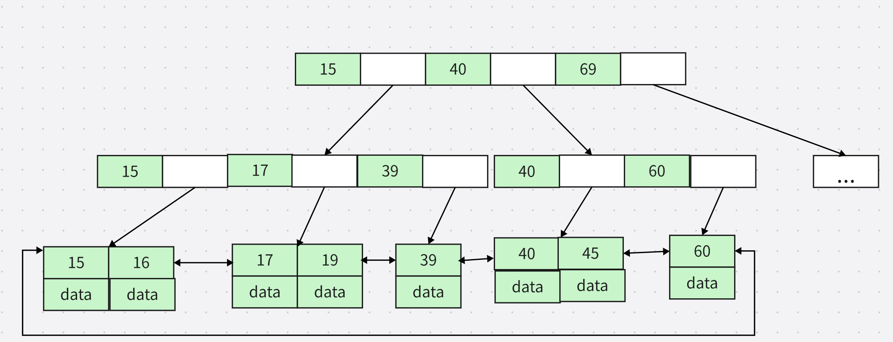
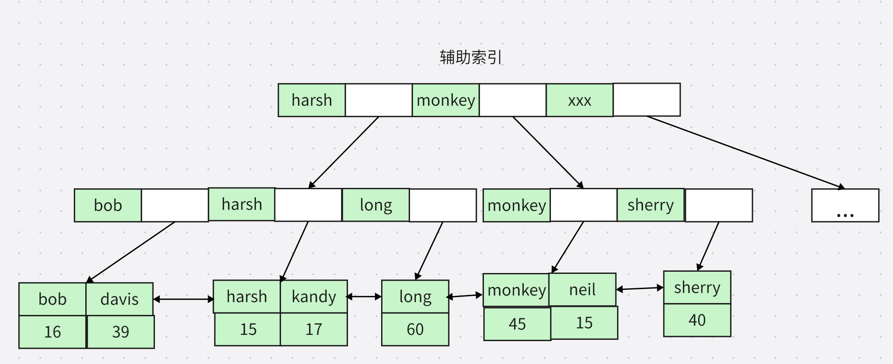

# MySQL 聚集索引和 非聚集索引 精讲

## 非聚集索引（MyISAM）

- 索引和数据单独存放
- 表有三个文件
- 叶子结点存放行数据地址信息
- 通过查找到主键key，然后还得根据指针地址去数据表中找对应的数据行
## 聚集索引(InnoDB)

- 索引和数据存放在一起
- 创建表之后会产生两个文件
- 叶子结点存放行数据

## 留几个关于InnoDB 常见的几个面试题
### 为什么DBA要求我们必须要给Innodb表建主键？
### 为什么DBA推荐我们使用整型做主键？
### 为什么Innodb非主键索引叶子节点存储的是主键值，而不是数据本身？
