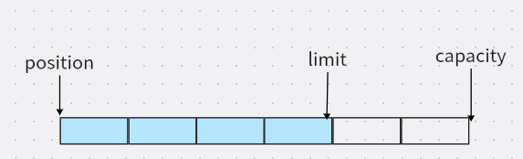
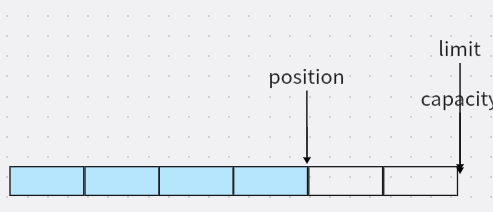
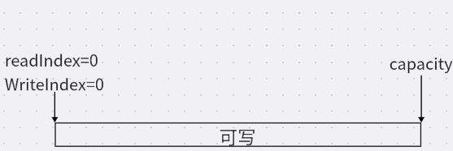
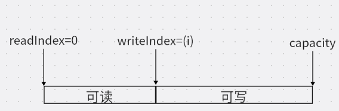
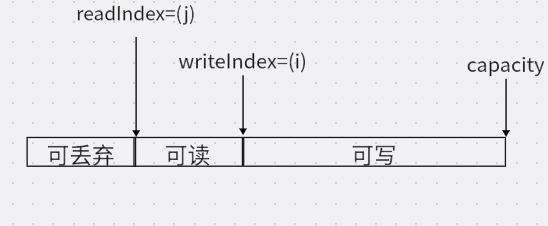
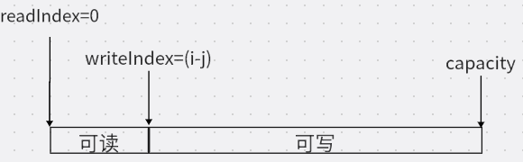

# Netty ByteBuf 和 ByteBuffer 工作原理

## 为什么有了ByteBuffer，Netty还弄一套ByteBuf？
当然是在某些场景下，jdk自带的ByteBuffer 性能不是很令netty满意，而且使用比较复杂，所以netty团队重新设计了ByteBuf重新替代ByteBuffer
## 工作原理
### ByteBuffer
#### 读模式

#### 写模式

在读模式下，从头开始读取数据，直到limit代表数据读取完成,capacity代表容量
在写模式下，position移到数据终点位置，limit移到capacity位置，数据从position位置开始写，直到limit(capacity)位置，停止写入。
### ByteBuf
主要通过两个index:readindex和writeindex来完成数据的读写，整个缓冲区分为三个部分：可丢弃部分、可读部分、可写部分。
#### 初始位置
当缓冲区为空的时候，writeindex和readindex都为0，整个区域都为可写部分

#### 写了一点数据后

#### 读了一点数据后

#### 丢弃部分被清理后

