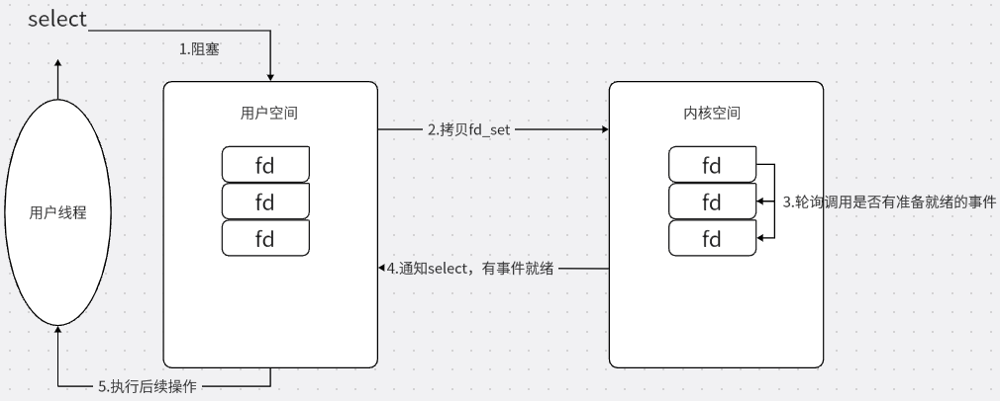
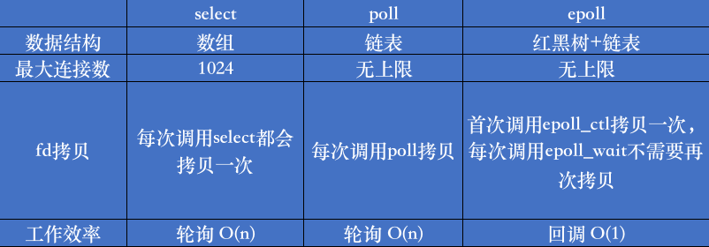

# Netty 实现IO多路复用的几种方式

## 什么是IO多路复用
利用IO多路复用模型，就可以实现一个线程监视多个文件句柄。当某个文件句柄就绪后，就能够通知到应用程序去处理对应IO事件。没有文件句柄就绪时就会阻塞应用程序，从而释放CPU资源。
### IO
在操作系统中，数据在内核态和用户态进行读写操作。一般情况下指网络IO
### 多路
指的是多个TCP连接，如多个scocket或多个channel
### 复用
一个或多个线程资源
### 目的
在并发请求中，通过一个或多个线程处理多个TCP连接，而无需创建和维护过多的线程，节省系统资源。
## Select
### 工作过程

- select函数中存在三种fds，分别代表三种事件，readfds表示读描述符集合，writefds表示读描述符集合，exceptfds表示异常描述符集合
- 调用select之后，select会将fd_set从用户空间拷贝到内核空间
- 拷贝完成后，开始轮询每个fd
- 当有就绪的事件后，通知用户线程
- 用户线程收到通知后，开始遍历用户空间的fd，得到就绪的事件，进行处理

### 优点
跨平台支持性比较好，几乎所有平台都支持
### 缺点

- 调用seelct之后，需要将fds从用户空间拷贝到内核空间
- 随着fd数量增多，性能随之下降，因为需要遍历每个fd
- 操作系统对进程打开的fd数量有限制，一般默认为1024个
## Poll
和select基本一样，不过它的存储方式是采用链表结构，没有最大文件描述符限制。
所以它的缺点比select少一个，其它优缺点都一样。
## Epoll
### 存储结构

- 红黑树：通过红黑树来管理用户主进程accept添加进来的所有 socket 连接。
- 链表：当有连接就绪的时候，内核会把就绪的连接放到 rdllist 链表里，方便用户线程只遍历准备就绪的事件
### 工作过程

- 在使用epoll时，首先会构建epoll对象。
- 有客户端接入时，会插入到epoll对象中
- 一旦fd就绪，会触发回调把fd插入到就绪链表中，并唤醒等待队列中的线程。
- 调用epoll_wait方法时只需要检查就绪链表，如有则返回给用户程序，如没有进入等待队列。
### 优点

- 不需要遍历所有fd
- 只需拷贝一次fd
- 支持异步回调，避免无效轮询
- 不受fd数量影响
### 缺点
只有Linux平台支持
## 区别

