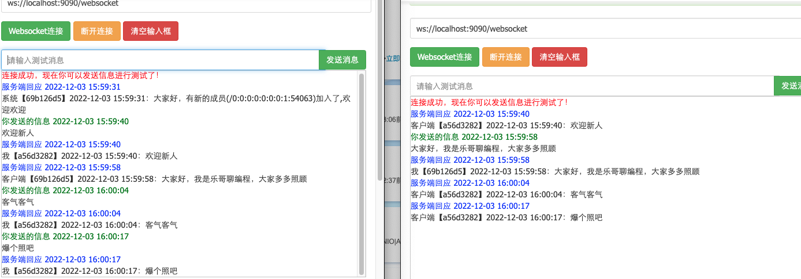

# Netty 手写一个聊天室系统

## 最终效果
 
 
## 服务端
```
@Slf4j
public class ChatServer {
    public static void main(String[] args) {
        start();
    }
    private static void start() {
        EventLoopGroup bossGroup = new NioEventLoopGroup(1);
        // 创建子线程组，专门负责IO任务的处理
        EventLoopGroup workGroup = new NioEventLoopGroup();
        try {
            ServerBootstrap bootstrap = new ServerBootstrap();
            bootstrap.group(bossGroup, workGroup);
            bootstrap.channel(NioServerSocketChannel.class);
            bootstrap.childHandler(new WebSocketChannelInitializer());
            log.info("Chat服务已启动....");
            Channel ch = bootstrap.bind(9090).sync().channel();
            ch.closeFuture().sync();


        } catch (Exception e) {
            e.printStackTrace();
        } finally {
//            //退出程序
            bossGroup.shutdownGracefully();
            workGroup.shutdownGracefully();
        }
    }
}
```

### Channel 初始化
```
class WebSocketChannelInitializer extends ChannelInitializer<SocketChannel>{

    @Override
    protected void initChannel(SocketChannel ch) throws Exception {
        ch.pipeline().addLast("http-codec",new HttpServerCodec());//设置解码器
        ch.pipeline().addLast("aggregator",new HttpObjectAggregator(65536));//聚合器，使用websocket会用到
        ch.pipeline().addLast("http-chunked",new ChunkedWriteHandler());//用于大数据的分区传输
        ch.pipeline().addLast(new ChatEngine());

    }
}
```

### 聊天内容处理
```
class ChatEngine extends SimpleChannelInboundHandler<Object>{
    private static ChannelGroup channelGroup = new DefaultChannelGroup(GlobalEventExecutor.INSTANCE);
    private WebSocketServerHandshaker handshaker;

    @Override
    protected void channelRead0(ChannelHandlerContext ctx, Object msg) throws Exception {
        if (msg instanceof FullHttpRequest){
            //以http请求形式接入，但是走的是websocket
            handleHttpRequest(ctx, (FullHttpRequest) msg);
        }else if (msg instanceof WebSocketFrame){
            //处理websocket客户端的消息
            handlerWebSocketFrame(ctx, (WebSocketFrame) msg);
        }
    }

    @Override
    public void channelReadComplete(ChannelHandlerContext ctx) throws Exception {
        ctx.flush();
    }
    private void handlerWebSocketFrame(ChannelHandlerContext ctx, WebSocketFrame frame){
        // 判断是否关闭链路的指令
        if (frame instanceof CloseWebSocketFrame) {
            handshaker.close(ctx.channel(), (CloseWebSocketFrame) frame.retain());
            return;
        }
        // 判断是否ping消息
        if (frame instanceof PingWebSocketFrame) {
            ctx.channel().write(
                    new PongWebSocketFrame(frame.content().retain()));
            return;
        }
        // 返回应答消息
        String msg = ((TextWebSocketFrame) frame).text();

        channelGroup.forEach(channel -> {
            if (channel!=ctx.channel()){
                TextWebSocketFrame tws = new TextWebSocketFrame("客户端【"+ctx.channel().id()+"】"+DateUtil.now()
                        +"：" + msg);
                channel.writeAndFlush(tws);
            }else{
                TextWebSocketFrame tws = new TextWebSocketFrame("我【"+ctx.channel().id()+"】"+DateUtil.now()
                        +"：" + msg);
                channel.writeAndFlush(tws);
            }
        });
    }
    /**
     * 唯一的一次http请求，用于创建websocket
     * */
    private void handleHttpRequest(ChannelHandlerContext ctx,
                                   FullHttpRequest req) {
        WebSocketServerHandshakerFactory wsFactory = new WebSocketServerHandshakerFactory(
                "ws://localhost:9090/websocket", null, false);
        handshaker = wsFactory.newHandshaker(req);
        if (handshaker == null) {
            WebSocketServerHandshakerFactory
                    .sendUnsupportedVersionResponse(ctx.channel());
        } else {
            handshaker.handshake(ctx.channel(), req);
        }
    }
    @Override
    public void channelActive(ChannelHandlerContext ctx) throws Exception {
        String message = String.format("大家好，有新的成员(%s)加入了,欢迎欢迎", ctx.channel().remoteAddress());
        if (!channelGroup.isEmpty()){
            TextWebSocketFrame tws = new TextWebSocketFrame("系统【"+ctx.channel().id()+"】"+DateUtil.now()
                    +"：" + message);
            channelGroup.writeAndFlush(tws);
        }
        log.info(message);
        channelGroup.add(ctx.channel());
    }

    @Override
    public void channelInactive(ChannelHandlerContext ctx) throws Exception {
        String message = String.format("大家好，有成员(%s)下线了...%s", ctx.channel().remoteAddress(), DateUtil.now());
        if (!channelGroup.isEmpty()){
            TextWebSocketFrame tws = new TextWebSocketFrame(DateUtil.now()
                    + ctx.channel().id() + "：" + message);
            channelGroup.writeAndFlush(tws);
        }
        log.info(message);
    }
}
```