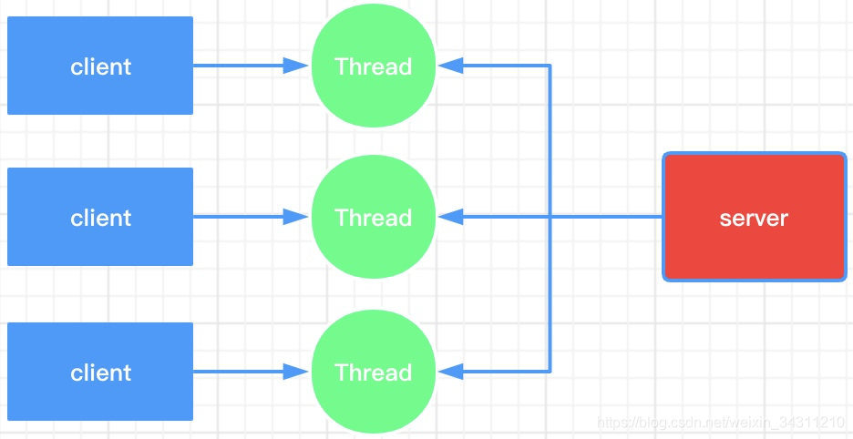
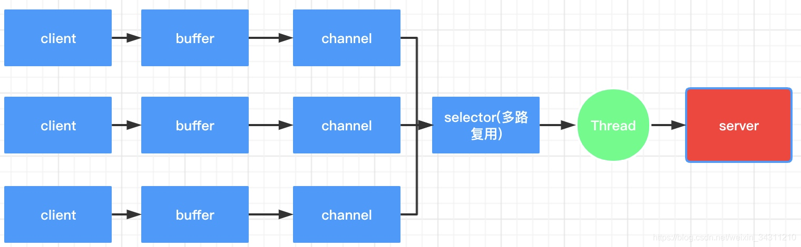
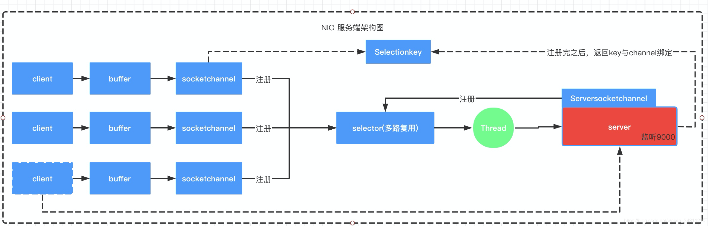
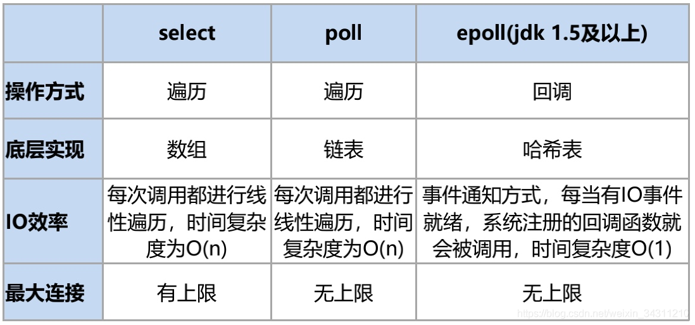
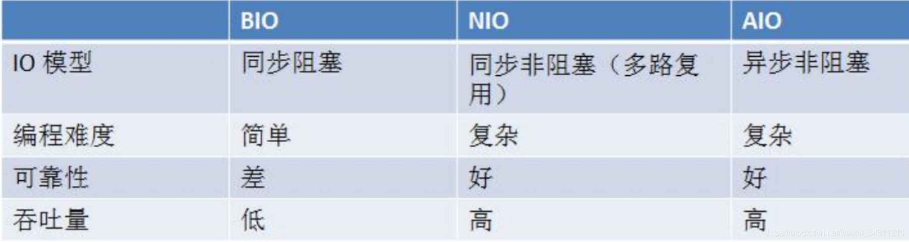

# Netty 理解 BIO_NIO_AIO 的区别

IO模型指的是在网络数据传输过程中，使用什么通道去发送和接收数据，我们常见的有BIO、NIO、AIO(NIO2.0),我接下来会对这些进行详细的介绍
## 同步/异步/阻塞/非阻塞 到底是什么意思？

-  同步/异步
指的是你去调用一个方法，如果这个方法是同步的，那么你就会等待这个方法执行结束后才能执行后续操作；
如果是异步的话，他会立即给你返回，但是这个不是真实的结果，真实的结果它是通过消息机制通知你或者回调机制通知你的。 
-  阻塞/非阻塞
阻塞指的是当你去调用一个获取洗衣机信息方法的时候，如果这个时候没有洗衣机，那么方法就会一直阻塞，直到能查询到洗衣机的信息才会返回结果；
非阻塞指的是当你调用一个获取洗衣机信息方法的时候，如果当时没有查到信息，你不会一直阻塞在那里，你这时可以去做别的事，但是你会时不时的去检查下是否有结果，然后再阻塞获取下，但是这不会影响你做其它事。 

## BIO(同步阻塞)

我们经常使用的就是BIO，在我们学习编程基础javaSE的时候，大家应该都会学过socket通信，这里面使用的就是同步阻塞。
我们先看下BIO的模型：



在BIO模型中，一个连接会对应一个处理线程，如果服务端使用单线程进行处理，后续连接将会一直阻塞；

- 缺点： 
   - 代码中的read,accept操作是阻塞操作，如果连接之后，服务端一直不发送数据，将会一直阻塞当前线程，浪费资源。
   - 如果连接数很多，意味着创建的线程数量就会越来越多，会造成服务器压力太大，后续优化成线程池处理方式，勉强解决了此问题。
- 应用场景
BIO适用于连接数较少且固定的架构，这种模式对服务器资源要求较高，但程序复杂度比较低；

### 代码示例

```
// 客户端
package com.example.netty.bio;

import java.io.IOException;
import java.net.Socket;

public class SocketClient {
    public static void main(String[] args) throws IOException {
        Socket socket = new Socket("127.0.0.1",9000);
        socket.getOutputStream().write("我是客户端".getBytes());
        socket.getOutputStream().flush();
        System.out.println("向服务端发送数据结束");
        byte[] bytes = new byte[1024];
        try {
            int read = socket.getInputStream().read(bytes);
            System.out.println("服务端发送过来的数据为："+new String(bytes,0,read));
        } catch (IOException e) {
            e.printStackTrace();
        }finally {

        }

    }
}
 //服务端
 package com.example.netty.bio;

import java.io.IOException;
import java.net.ServerSocket;
import java.net.Socket;

public class SocketServer{
    public static void main(String[] args) throws IOException {
        ServerSocket serverSocket=new ServerSocket(9000);
        while (true){
            System.out.println("等待连接");
            // 阻塞等待
            Socket client = serverSocket.accept();
            System.out.println("有客户端连接了");
            handleRead(client);
        }
    }

    /**
     *
     * @param client
     */
    private static void handleRead(Socket client) {
        new Thread(new Runnable() {
            @Override
            public void run() {
                byte[] bytes = new byte[1024];
                try {
                    int read = client.getInputStream().read(bytes);
                    System.out.println("客户端发送过来的数据为："+new String(bytes,0,read));
//                    Thread.sleep(Integer.MAX_VALUE);
                    client.getOutputStream().write("你好，我收到你的数据了".getBytes());
                    client.getOutputStream().flush();
                } catch (IOException e) {
                    e.printStackTrace();
                } catch (InterruptedException e) {
                    e.printStackTrace();
                } finally {

                }
            }
        }).start();

    }
}
```

## NIO(同步非阻塞)

NIO在BIO的基础上进行了升级，将阻塞换成非阻塞，虽然只是模式变了下，但是代码复杂量却增加了不少。
在NIO模型中，服务端可以开启一个线程处理多个连接，它是非阻塞的，客户端发送的数据都会注册到多路复用器selector上面，当selector（selector的select方法是阻塞的）轮询到有读、写或者连接请求时，才会转发到后端程序进行处理，没有数据的时候，业务程序并不需要阻塞等待。

### NIO有三大组件：Channel(通道)、Buffer（缓存区）、Selector(选择器)

- Channel
类似于流，但是它是一个双向的流，他是连接服务端和客户端的通道，不管是客户端还是服务端，都可以使用通道进行读写数据。
- Buffer
它就是一个缓冲区，用来存放数据的载体，它借助通道，在客户端和服务端之间传递数据。
- Selector
它对应一个或多个channel，客户端的连接都会注册到selector上面，然后由selector去调用后端处理程序

### NIO结构模型



### NIO的非阻塞到底体现在哪里呢？

看模型图大家有可能都知道，客户端所有的连接通道都会注册到selector上面，select会通过轮询去获取这些通道的状态，这些状态有accpet(连接请求)、READ读请求。

如果在轮询过程中发现已经有一个连接请求状态的话，这说明已经有一个客户端想要和服务端进行连接，直接把这个通道传给后端程序去处理连接操作；如果是在BIO模型下的话，会一直阻塞在accept上，直到有连接请求才会释放，继续执行后续的代码。

如果在轮询过程中发现已经有一个读请求状态的话，这说明已经有一个客户端把数据发送给服务端了，服务端可以直接把通道交给后端程序进行读操作的处理；如果是在BIO模型下的话，会一直阻塞的read上，直到有连接请求才会释放，继续执行后续的代码。

**以上可以总结为：在NIO模型中，如果服务端执行了read操作的话，就说明已经有可用的数据进行读取了，如果执行了accpet操作的话，就说明此时一定有客户端发起了与服务端的连接，能够保证这种操作的前提是selector轮询到了可读可连接的通道状态。**

### 如果selector轮询后，得到了多个通道的read和accpet状态，NIO是如何处理的？

-  单线程
如果在单线程模式下，处理方式是按照轮询后得到的变化的通道的先后顺序进行处理的，没错，它是同步进行处理的，也就是它只能处理完这个通道的操作，才能继续处理下个通道的请求，在selector代码中，是通过遍历所有有变化的通道进行处理的，后面大家看代码就明白了，这种一个selector对应一个线程的模式其实就是**redis的单线程IO模型**。 
-  多线程
如果是在多线程模式下，selector在遍历每一个通道的时候，都会把对通道的操作交给一个线程去处理，一般都会丢到线程池中去处理，这个时候执行顺序就得看cpu的调度情况来决定了。 

接下来我们结合代码来整体看下NIO的工作机制

### 代码示例

- 服务端代码

```
package com.example.netty.nio;

import java.io.IOException;
import java.net.InetSocketAddress;
import java.nio.ByteBuffer;
import java.nio.channels.SelectionKey;
import java.nio.channels.Selector;
import java.nio.channels.ServerSocketChannel;
import java.nio.channels.SocketChannel;
import java.util.Iterator;

public class NioServer {
    public static void main(String[] args) throws IOException {
        ServerSocketChannel serverSocketChannel = ServerSocketChannel.open();
        serverSocketChannel.configureBlocking(false);
        serverSocketChannel.socket().bind(new InetSocketAddress(9000));

        Selector selector = Selector.open();
        serverSocketChannel.register(selector, SelectionKey.OP_ACCEPT);
        while (true) {
            System.out.println("等待事件发生");
            // 这里还是阻塞等待，
            int select = selector.select();
            Iterator<SelectionKey> iterator = selector.selectedKeys().iterator();
            while (iterator.hasNext()) {
                SelectionKey selectionKey = iterator.next();
                iterator.remove();
                handleChannel(selectionKey);
            }
        }
    }

    private static void handleChannel(SelectionKey selectionKey) {
        if (selectionKey.isAcceptable()) {
            System.out.println("有客户端发生了连接");
            ServerSocketChannel channel = (ServerSocketChannel) selectionKey.channel();
            try {
                SocketChannel client = channel.accept();
                client.configureBlocking(false);
                // 连接之后立即注册读操作，客户端发送数据过来才能监听到
                client.register(selectionKey.selector(), SelectionKey.OP_READ);
            } catch (IOException e) {
                e.printStackTrace();
            }
        } else if (selectionKey.isReadable()) {

            System.out.println("收到客户端发送数据的请求");
            SocketChannel channel = (SocketChannel) selectionKey.channel();

            // 如果这里你不读取数据，读事件会一直触发，这是有NIO属于水平触发决定的，
            ByteBuffer allocate = ByteBuffer.allocate(1024);
            try {
                int read = channel.read(allocate);
                if (read != -1) {
                    System.out.println("客户端发送的数据:" + new String(allocate.array(), 0, read));
                }
                channel.write(ByteBuffer.wrap("你好，我是服务端".getBytes()));
                // 处理完读操作之后，需要重新注册下读操作，
                // 如果下面一行被放开，将会一直会有可写操作触发，因为网络中99.999%的情况下都是可写的，一般不监听
//                selectionKey.interestOps(SelectionKey.OP_WRITE | SelectionKey.OP_READ);
                selectionKey.interestOps(SelectionKey.OP_READ);
            } catch (IOException e) {
                e.printStackTrace();
            }
        } else if (selectionKey.isWritable()) {
            System.out.println("触发写事件");
        }
    }
}
```

- 服务端架构图



-  服务端代码说明 
   1. 创建一个 ServerSocketChannel 和 Selector ，并将 ServerSocketChannel 注册到 Selector 上
   2. selector 通过 select() 方法监听 channel 事件，当客户端连接时，selector 监听到连接事件， 获取到 ServerSocketChannel 注册时 绑定的 selectionKey
   3. selectionKey 通过 channel() 方法可以获取绑定的 ServerSocketChannel
   4. ServerSocketChannel 通过 accept() 方法得到 SocketChannel
   5. 将 SocketChannel 注册到 Selector 上，关心 read 事件
   6. 注册后返回一个 SelectionKey, 会和该 SocketChannel 关联
   7. selector 继续通过 select() 方法监听事件，当客户端发送数据给服务端，selector 监听到read事件，获取到 SocketChannel 注册时 绑定的 selectionKey
   8. selectionKey 通过 channel() 方法可以获取绑定的 socketChannel
   9. 将 socketChannel 里的数据读取出来
   10. 用 socketChannel 将服务端数据写回客户端

大家有可能注意到我在代码注释中提到的水平触发，我这做下解释：水平触发是多路复用中的一种模式，与此对应的还有一个边缘触发。 

-  水平触发
如果在通道中检测到数据变化后会触发通知，如果收到通知后，事件处理程序没有完全读取缓冲区中的所有数据或压根就没有读，那么在水平触发模式下，就会一直触发这个通知，直到缓冲区的内容被读取完，NIO中select和poll就属于这种模式 
-  边缘触发
情况同上，不过是当系统通知一次之后，只有当通道中的数据再次发生改变后，才会再次发生通知。epoll既可以采用水平触发,也可以采用边缘触发. 
-  客户端代码 

```
package com.example.netty.nio;

import java.io.IOException;
import java.net.InetSocketAddress;
import java.nio.ByteBuffer;
import java.nio.channels.SelectionKey;
import java.nio.channels.Selector;
import java.nio.channels.SocketChannel;
import java.util.Iterator;

public class NioClient {
    private Selector selector;

    public static void main(String[] args) throws IOException {
        NioClient client = new NioClient();
        client.initClient("127.0.0.1", 9000);
        client.connect();
    }

    private void connect() throws IOException {
        while (true) {
            // 阻塞等待
            selector.select();
            Iterator<SelectionKey> iterator = selector.selectedKeys().iterator();
            while (iterator.hasNext()) {
                SelectionKey selectionKey = iterator.next();
                iterator.remove();
                handler(selectionKey);
            }
        }
    }

    private void handler(SelectionKey selectionKey) throws IOException {
        // 收到服务端发送的数据
        if (selectionKey.isReadable()) {
            SocketChannel channel = (SocketChannel) selectionKey.channel();
            ByteBuffer buffer = ByteBuffer.allocate(1024);
            int len = channel.read(buffer);
            if (len != -1) {
                System.out.println("客户端收到信息：" + new String(buffer.array(), 0, len));
            }
        // 连接事件发生
        } else if (selectionKey.isConnectable()) {
            SocketChannel channel = (SocketChannel) selectionKey.channel();
            // 一般发起了连接后，会立即返回，需要使用isConnectionPending判断是否完成连接，如果正在连接，则调用finishConnect，如果不能连接则会抛出异常
            if (channel.isConnectionPending()) {
                channel.finishConnect();
            }
            channel.configureBlocking(false);
            ByteBuffer buffer = ByteBuffer.wrap("你好，我是客户端".getBytes());
            channel.write(buffer);
            selectionKey.interestOps(SelectionKey.OP_READ);
        }
    }

    private void initClient(String s, int i) throws IOException {
        SocketChannel socketChannel = SocketChannel.open();
        socketChannel.configureBlocking(false);
        selector = Selector.open();
        socketChannel.connect(new InetSocketAddress(s, i));
        socketChannel.register(selector, SelectionKey.OP_CONNECT);
    }
}
```

### 多路复用常见的底层实现api



poll相比selelct，没有最大连接的限制；
epoll相对于前两者，是一个不一样的机制，基于事件通知的方式，通知调用者；

## AIO(异步非阻塞)

异步非阻塞， 由操作系统完成后回调通知服务端程序启动线程去处理， 一般适用于连接数较多且连接时间较长的应用
应用场景： AIO方式适用于连接数目多且连接比较长（重操作） 的架构，JDK7 开始支持

- AIO代码示例：

```
    // 服务端代码
    package com.example.netty.aio;

import java.io.IOException;
import java.net.InetSocketAddress;
import java.nio.ByteBuffer;
import java.nio.channels.AsynchronousServerSocketChannel;
import java.nio.channels.AsynchronousSocketChannel;
import java.nio.channels.CompletionHandler;

public class AioServer {
    public static void main(String[] args) throws IOException, InterruptedException {
        final AsynchronousServerSocketChannel serverChannel =
                AsynchronousServerSocketChannel.open().bind(new InetSocketAddress(9000));
        serverChannel.accept(null,new  CompletionHandler<AsynchronousSocketChannel, Object>() {

            @Override
            public void completed(AsynchronousSocketChannel socketChannel, Object attachment) {
                serverChannel.accept(attachment, this);
                try {
                    System.out.println(socketChannel.getRemoteAddress());
                    ByteBuffer buffer = ByteBuffer.allocate(1024);
                    socketChannel.read(buffer, buffer, new CompletionHandler<Integer, ByteBuffer>() {

                        @Override
                        public void completed(Integer result, ByteBuffer attachment) {
                            buffer.flip();
                            System.out.println(new String(buffer.array(), 0, result));
                            socketChannel.write(ByteBuffer.wrap("HelloAioClient".getBytes()));
                        }

                        @Override
                        public void failed(Throwable exc, ByteBuffer attachment) {

                        }
                    });
                } catch (IOException e) {
                    e.printStackTrace();
                }
            }

            @Override
            public void failed(Throwable exc, Object attachment) {

            }
        });
        Thread.sleep(Integer.MAX_VALUE);
    }
}

// 客户端代码
package com.example.netty.aio;

import java.io.IOException;
import java.net.InetSocketAddress;
import java.nio.ByteBuffer;
import java.nio.channels.AsynchronousSocketChannel;
import java.util.concurrent.ExecutionException;

public class AioClient {
    public static void main(String[] args) throws ExecutionException, InterruptedException, IOException {
        AsynchronousSocketChannel socketChannel = AsynchronousSocketChannel.open();
        socketChannel.connect(new InetSocketAddress("127.0.0.1", 9000)).get();
        socketChannel.write(ByteBuffer.wrap("HelloServer".getBytes()));
        ByteBuffer buffer = ByteBuffer.allocate(512);
        Integer len = socketChannel.read(buffer).get();
        if (len!=-1) {
            System.out.println("客户端收到信息：" + new String(buffer.array(), 0, len));
        }
    }
}
```

**总结：可以看出异步非阻塞模式的代码是非常简单的，所有的操作都是通过回调机制触发的，我们只需要在回调方法中处理我们自己的逻辑就行了，其实AIO是基于NIO进行封装，后面会讲到netty也是基于NIO进行封装的**

## BIO、NIO、AIO区别



