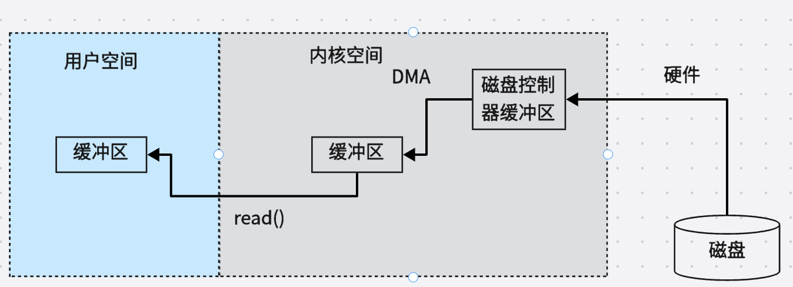
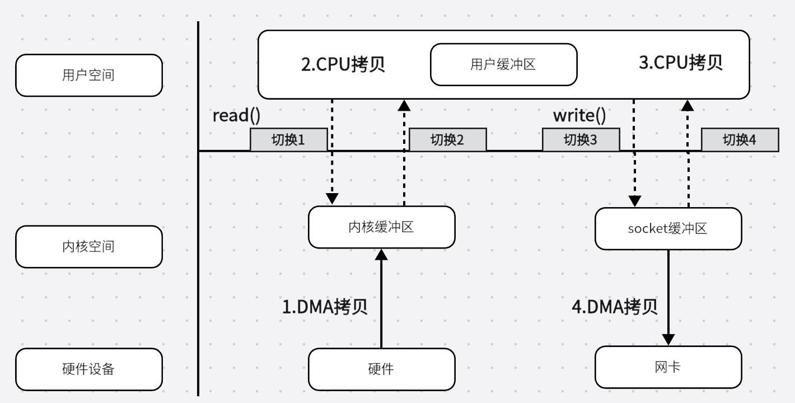
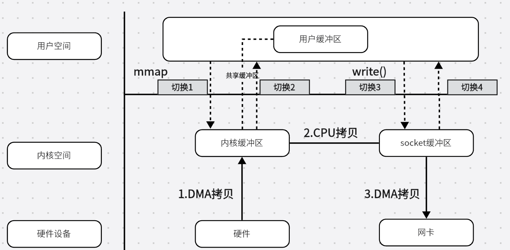
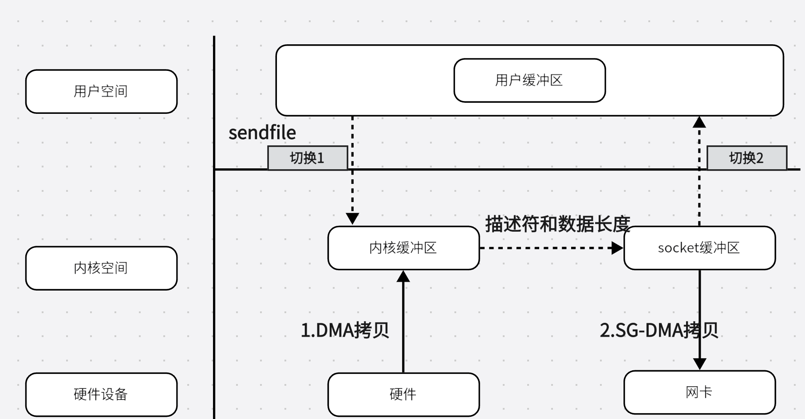

# Netty 零拷贝机制

## 必须掌握的知识点
### 用户空间与内核空间
操作系统的核心是内核，它不同于普通应用程序，所以为了保护内核的存储空间，操作系统将虚拟空间分为了两个部分：内核空间和用户空间

### 传统IO流程

- DMA：直接内存访问，是主板上的一块独立芯片，允许外设设备和内存之间进行数据IO传输
- 四次上下文切换，四次拷贝


## 什么是零拷贝
首先从字面意思可以将“零拷贝”拆成“零”和“拷贝”两个概念

- 零：指的是拷贝次数相对较少，并不是真的拷贝次数为零
- 拷贝：指数据从一个存储空间拷贝到另一个存储空间

连起来的意思就是：通过零拷贝技术，减少将数据从一个存储空间复制到另一个空间的次数
## 为什么要使用零拷贝

- 在传统IO数据传输中，拷贝次数和上下文切换次数太多。
- 通过使用零拷贝，能实现减少上下文切换的次数和数据拷贝的次数。
## 零拷贝常见的实现方式
### mmap + write
我们在前面内容介绍过，用户进程在调用read函数读取数据时，操作系统会将内核缓冲区的数据拷贝一份到用户空间缓冲区，所以为了减少这一步开销，我们可以使用mmap代替read函数。
mmap将内核空间缓冲区的数据直接映射到用户空间，这样就不需要再拷贝一份数据了，但是还是会有上下文切换的。

优化点：三次拷贝+四次上下文切换

### sendfile
sendfile实现有两个版本，我们这里只介绍真正实现零拷贝技术的后者，即通过SG-DMA技术实现数据拷贝

- 工作过程
   - 通过DMA拷贝技术将磁盘数据拷贝到内核缓冲区
   - 缓冲区描述符和数据长度传到socket缓冲区，这样网卡的SG-DMA控制器就可以直接将内核缓冲区的数据拷贝到网卡缓冲区，而不再需要借助socket缓冲区，多一次拷贝


优化后：两次上下文切换+两次拷贝

## Netty 中如何实现零拷贝
netty中的零拷贝和操作系统中零拷贝有点不一样，操作系统实现零拷贝主要是在内核态的优化，netty完全是在用户状态实现零拷贝。
### CompositeByteBuf 实现零拷贝
通过将多个ByteBuf合并为一个逻辑上的ByteBuf，避免了各个ByteBuf之间的拷贝

- 常规使用
```
ByteBuf allBuf = Unpooled.buffer(header.readableBytes() + body.readableBytes());
allBuf.writeBytes(header);
allBuf.writeBytes(body);
```

- 使用CompositeByteBuf
```
CompositeByteBuf compositeByteBuf = Unpooled.compositeBuffer();
compositeByteBuf.addComponents(true, header, body);
```
### wrap 实现零拷贝
将byte[]数组、ByteBuf、ByteBuffer等包装成一个Netty ByteBuf对象进而避免了拷贝操作

- 常规使用
```
byte[] bytes = ...
ByteBuf byteBuf = Unpooled.buffer();
byteBuf.writeBytes(bytes);
```

- 使用wrap
```
byte[] bytes = ...
ByteBuf byteBuf = Unpooled.wrappedBuffer(bytes);
```
### slice 实现零拷贝
将ByteBuf 拆解成多个ByteBuf，但是共享同一存储空间不同分区，避免了内存拷贝
```
ByteBuf byteBuf = ...
ByteBuf header = byteBuf.slice(0, 5);
ByteBuf body = byteBuf.slice(5, 10);
```
### FileRegion实现零拷贝
通过FileRegion包装的FileChannel.tranferTo实现文件传输，可以直接将文件缓冲区的数据发送到目标Channel，避免了传统通过循环write方式导致的内存拷贝问题。

- 传统文件传输
```
public static void copyFile(String srcFile, String destFile) throws Exception {
    byte[] temp = new byte[1024];
    FileInputStream in = new FileInputStream(srcFile);
    FileOutputStream out = new FileOutputStream(destFile);
    int length;
    while ((length = in.read(temp)) != -1) {
        out.write(temp, 0, length);
    }

    in.close();
    out.close();
}
```

- file Region
```
public static void copyFileWithFileChannel(String srcFileName, String destFileName) throws Exception {
    RandomAccessFile srcFile = new RandomAccessFile(srcFileName, "r");
    FileChannel srcFileChannel = srcFile.getChannel();

    RandomAccessFile destFile = new RandomAccessFile(destFileName, "rw");
    FileChannel destFileChannel = destFile.getChannel();

    long position = 0;
    long count = srcFileChannel.size();

    srcFileChannel.transferTo(position, count, destFileChannel);
}

```
