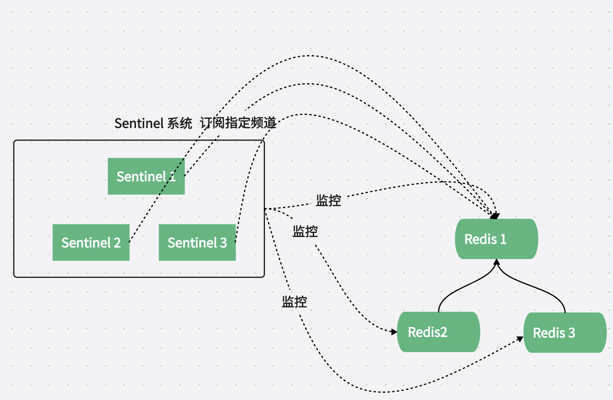

# Redis Sentinel 哨兵模式工作原理

## 什么是哨兵机制？
Sentinel是Redis官方提出的一个高可用解决方案。它由一个或多个 sentinel 实例构成 sentinel 系统。
## 
## 为什么要用哨兵机制？
我们都知道Redis 具备主从复制的功能，但是当主服务器发生故障时，我们需要人工干预，去修改每个实例的配置文件，然后重启，这样不仅费时费力，还有可能导致出错概率比较高，最终导致服务不可用。
那么哨兵就是为了解决这个问题，帮助我们自动化实现故障转移，不需要人工干预，高效、精准的实现故障转移。
## 哨兵机制能做什么？
（1）集群监控，负责监控redis master和slave进程是否正常工作
（2）消息通知，如果某个redis实例有故障，那么哨兵负责发送消息作为报警通知给管理员
（3）故障转移，如果master node挂掉了，会自动转移到slave node上
（4）配置中心，如果故障转移发生了，通知client客户端新的master地址
## 什么是主观下线和客观下线？
### 主观下线
当sentinel 系统中其中一个server认为redis中某个实例宕机或不可用，则就标记为主观下线
### 客观下线
如果被标记主观下线的redis实例是主节点，则还得需要获得其他sentinel节点的判断，如果超过法定的数量的投票认为该redis server不可用，则标记该redis主节点为客观下线
## 哨兵有哪些定时监控
### 监控1
哨兵节点每隔10秒向主节点和从节点发送info指令，获取最新的拓扑结构，更新自身保存的节点信息
### 监控2
每隔2秒哨兵节点向redis指定频道上发送哨兵节点对主节点的判断和哨兵节点自身的信息，其他哨兵节点也会订阅这个频道，来了解其他节点的信息及对主节点的判断
### 监控3
每隔1秒哨兵向redis 节点和其他哨兵节点发送ping信息，进行心跳检测。
## 主节点客观下线后，怎么进行故障转移？
这里主要有两步，首先是选举哨兵leader，再由哨兵leader负责故障转移
### 选举哨兵leader
1）当master 下线后，每个哨兵都可以选择自己作为leader，将请求发送给其它哨兵
2）其它哨兵接收到请求后，可以选择同意或者不同意(根据判定基础决定)
3）如果最终某个哨兵节点获得了超过半数的投票，则该哨兵节点就成为了leader，负责故障转移
### 故障转移
#### 选举新的master
1）过滤与哨兵断开连接时间比较长的节点
2）优先选择replica-priority低的
3）选择偏移量比较大的(复制的数据越多)
4）运行ID越小
#### 执行故障转移
1）sentinel leader向新主节点发送slave no one命令，让它成为独立节点
2）sentinel leader 向其它从节点发送slave ip port指令，让它从新的主节点同步
## client是和哨兵通信还是和Redis 主从通信？
其实都有建立通信，情况是这样的：
1）client连接集群，首先会连接sentinel，然后订阅相关的频道获取主从切换、切换进度、新master地址等信息
2）拿到redis连接地址后，则会与redis master建立连接
3）当sentinel执行了故障转移，选举了新的redis master之后，也会在client订阅的频道中发送最新的master redis 地址
4）client 拿到最新的地址后，还是同样的建立新的redis连接。
