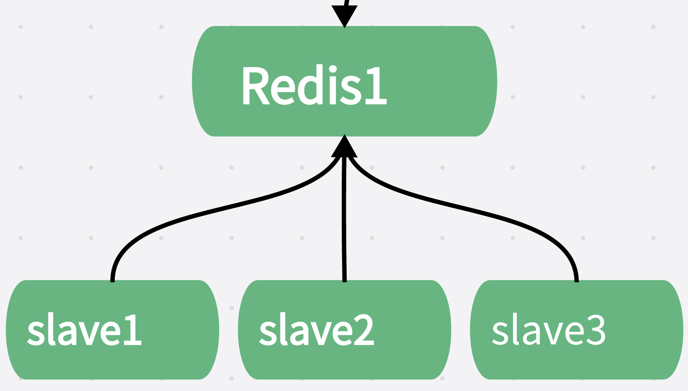
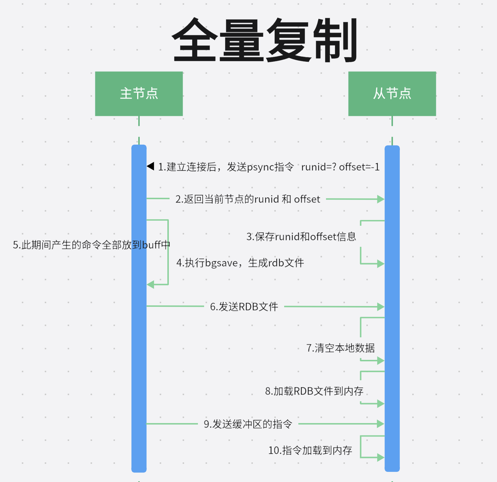
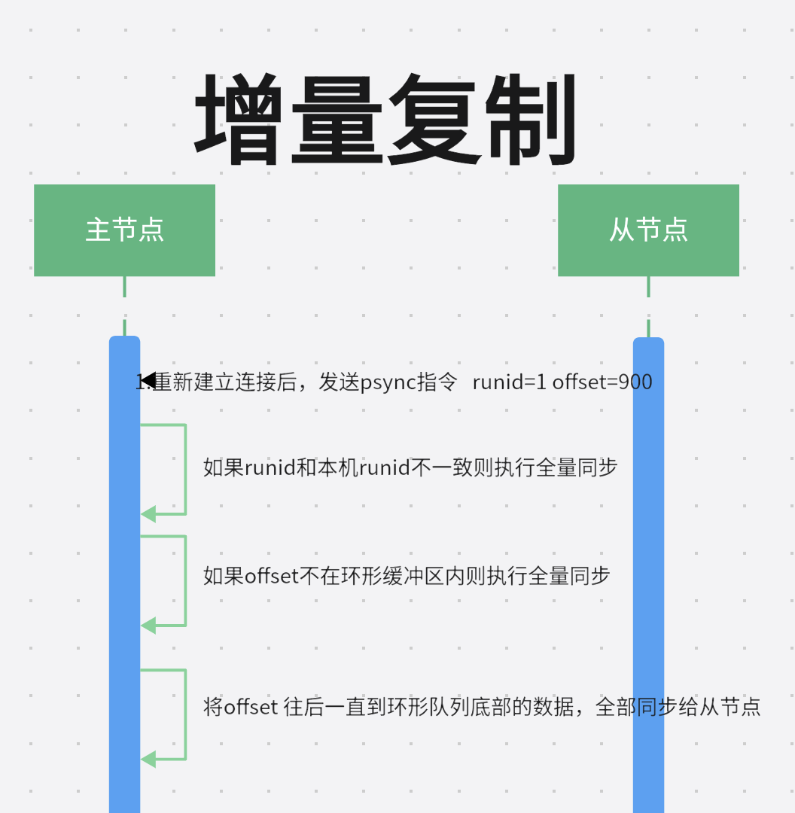

# Redis 主从复制工作原理

## 主从复制的架构
- 一主一从
- 一主多从

## 主从复制的作用

- 数据备份
- 读写分离
## 主从复制的工作原理

- runid

主节点的runid，从节点第一次请求复制主节点的时候，主节点会将此runid返回

- offset（偏移量）

当前数据的偏移量，例如执行一条指令后，产生一条数据后，会增大偏移量，从节点请求复制主节点的时候，会带上这个信息，让主节点从这个偏移量之后的数据返回给我。
### 全量复制

- 建立连接后，从节点向主节点发送psync命令，请求同步，携带 runid和offset，如果第一次同步，传 ？和-1
- 主节点收到psync请求后，发现runid为？和offset为-1，则知道从节点希望全量复制，于是将自己的runid和offset返回给从节点
- 主节点执行bgsave，生成RDB文件，在此期间生成的命令全部放到buffer中
- 主节点将生成后的rdb文件，传输给从节点
- 从节点收到rdb文件后，首先清除自己的数据，然后将rdb文件加载到内存
- 主节点再把缓冲区的命令发给从节点
- 从节点再把缓冲区的命令加载到内存

### 增量复制
如果由于网络问题出现抖动或连接断开，则会导致主从复制不同步，所以当网络连接正常时，则主从之间将发生增量复制而不是全量复制。

- 从节点向主节点发送psync 命令 携带 已保存的runid和offset
- 主节点判断runid是否和自己的id一致，如果不一致则执行全量同步
- 主节点判断offset是否在环形缓冲区内，如果不在泽执行全量同步
- 否则执行增量同步

