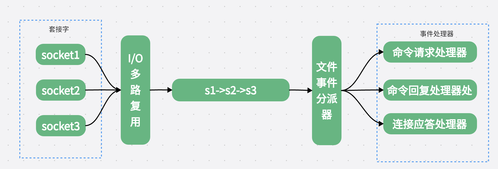
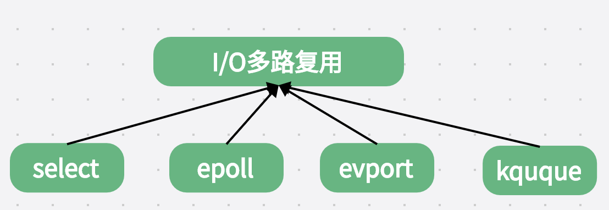
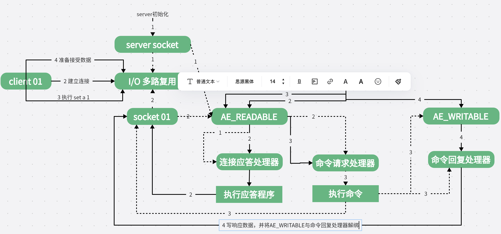

# Redis 单线程模型

## 为什么Redis是单线程？
这个是由Redis的实现机制决定的，Redis网络事件处理器是基于文件事件处理器实现的，这个文件事件处理器是单线程的，所以决定了Redis是以单线程运行
## 文件事件

### 构成组件

- 多个socket
- I/O多路复用程序
- 文件事件分派器
- 命令请求处理器
- 命令回复处理器
- 连接应答处理器
- 时间处理器(做定时用)
### I/O多路复用的实现

### 文件事件处理器
#### 连接应答处理器
当Redis初始化时，程序会将连接应答处理器与服务端监听套接字的AE_READABLE事件关联起来，当有客户端通过socket连接服务端时，套接字就会产生AE_READABLE事件，引发连接应答处理器执行，并执行相应的套接字应答操作。
#### 命令请求处理器
当一个客户端通第一步通过socket与服务端连接成功后，服务端将会把该socket的AE_READABLE事件和命令请求处理器关联起来，当客户端向服务端发起命令请求时，如 get xxx，set xxx,套接字就会产生AE_READABLE事件，关联的命令请求处理器就会被执行
#### 命令回复处理器
当服务端需要给客户端响应时，服务端会将客户端套接字的AE_WRITABLE事件和命令回复处理器关联，当客户端准备好接受响应数据时，就会触发AE_WRITABLE事件，执行关联的命令回复处理器的程序，执行对应的套接字写入操作，当数据写入完毕，就会将客户端套接字的AE_WRITABLE事件和命令回复处理器解绑，但是客户端套接字的AE_READABLE事件还是会和命令请求处理器关联。
## 完整的客户端与服务端交互流程

1.server初始化后，在serversocket上注册AE_READABLE事件，并与连接应答处理器关联
2.客户端请求与服务端建立连接，server收到AE_READABLE事件，通过事件分发处理器，找到关联的连接应答处理器，执行应答程序，并且注在客户端的socket上注册AE_READABLE事件，并与命令请求处理器关联
3.客户端发起命令请求，如set a 1,server会收到AE_READABLE事件，通过事件分发处理器，找到关联的命令请求处理器，在内存中执行命令，并在client的套接字上注册AE_WRITABLE事件，并与命令回复处理器绑定
4.客户端告诉server自己准备好接受响应数据了，server会收到AE_WRITABLE事件，通过事件分发处理器，找到关联的命令回复处理器，将数据写入套接字，写入完毕，再将Ae_WRITABLE与命令回复处理器解绑。

