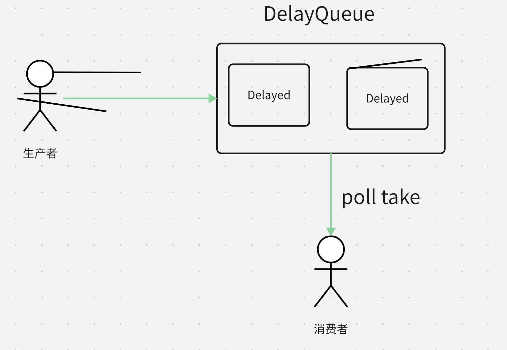
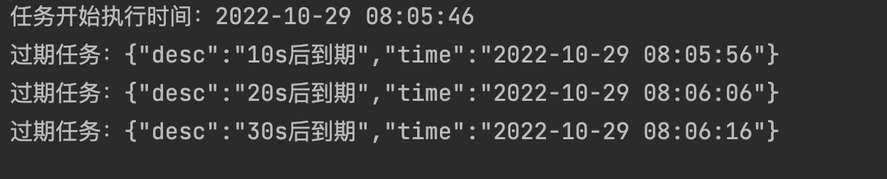
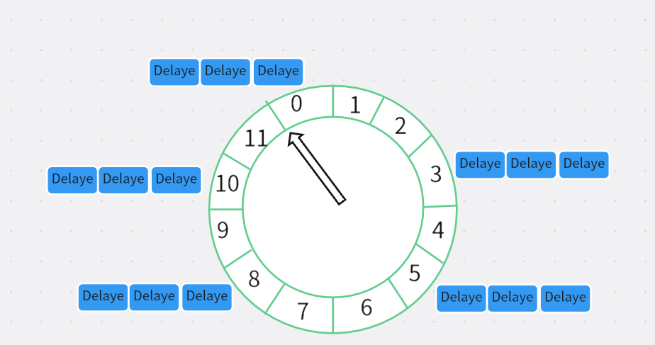
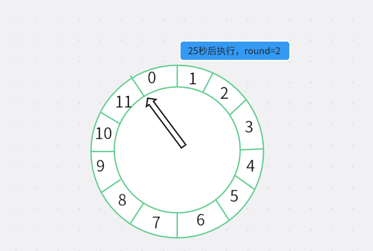

# Redis 实战：常见的延时队列解决方案及代码实现

## 延时队列应用场景
- 订单超时自动取消
- 活动到开始时间后给用户发送消息
- ...
## 常见的延时队列实现方法
### 通过定时任务实现数据库轮询
可以借助xxjob或spring的cron job实现，
#### 优点

- 实现简单
- 支持集群
#### 缺点

- 耗内存
- 延迟时间取决于你扫描间隔
### JDK延时队列

DelayQueue是一个无界阻塞队列，内部有一个优先队列，当使用put方法添加元素到DelayQueue时，会塞一个延时条件，DelayQueue会按照延时条件排序，最先过期的排在队首，只有元素过期了，才能从队首取出数据，取出数据的方法有take和poll
#### 实现代码
```
package com.example.day1;

import com.alibaba.fastjson.JSON;
import com.alibaba.fastjson.annotation.JSONField;

import java.text.SimpleDateFormat;
import java.util.Date;
import java.util.Objects;
import java.util.concurrent.DelayQueue;
import java.util.concurrent.Delayed;
import java.util.concurrent.TimeUnit;

/**
 * @Description TODO
 * @Author 编程学习
 * @Date 2022/10/29 07:04
 */
public class TestDelayQueue {
    public static class DelayTask implements Delayed{
        @JSONField(deserializeUsing = JSONDateDeserializer.class,serializeUsing = JSONSerializer.class)
        private long time;
        private String desc;

        public DelayTask(long time,String desc) {
            this.time = time*1000+System.currentTimeMillis();
            this.desc=desc;
        }

        @Override
        public long getDelay(TimeUnit unit) {
            return time-System.currentTimeMillis();
        }

        @Override
        public int compareTo(Delayed o) {
            DelayTask delayTask = (DelayTask) o;
            return time-delayTask.getTime()<=0?-1:1;
        }

        public long getTime() {
            return time;
        }

        public void setTime(long time) {
            this.time = time;
        }

        public String getDesc() {
            return desc;
        }

        public void setDesc(String desc) {
            this.desc = desc;
        }
    }

    public static void main(String[] args) throws InterruptedException {
        DelayQueue<DelayTask> queue = new DelayQueue<>();
        queue.put(new DelayTask(10,"10s后到期"));
        queue.put(new DelayTask(30,"30s后到期"));
        queue.put(new DelayTask(20,"20s后到期"));
        System.out.println("任务开始执行时间："+new SimpleDateFormat("yyyy-MM-dd hh:mm:ss").format(new Date()));
        while (queue.size()>0){
            DelayTask delayTask = queue.take();
            if (Objects.nonNull(delayTask)){
                System.out.println("过期任务："+ JSON.toJSONString(delayTask));
            }
        }
    }
}

```

#### 优点

- 效率高，低延迟
#### 缺点

- 服务器宕机后，数据丢失
- 集群扩展麻烦
### 时间轮算法


#### 核心参数

- tickDuration

每个刻度代表的时长

- round

第几圈后可以执行，使用延期时常/一圈的时长得来

- ticksPerWheel

一圈下来有几个刻度
#### 工作原理

- 指针停在0处
- tickDuration=1
- ticksPerWheel=12

如果一个25秒才执行的延时任务添加进来，首先它会计算它的round和index，round=25/12 =2
index=25%12=1.
所以时间轮长这样:

当指针转到index=1的刻度时，会判断第一个task的round是不是为0，如果为0则取出来，去执行，如果大于0，则将round-1.
#### 实现代码
```
    <dependency>
        <groupId>io.netty</groupId>
        <artifactId>netty-all</artifactId>
        <version>4.1.78.Final</version>
    </dependency>
```
```
package com.example.day1;

import io.netty.util.HashedWheelTimer;
import io.netty.util.Timeout;
import io.netty.util.TimerTask;

import java.text.SimpleDateFormat;
import java.util.Date;
import java.util.concurrent.Executors;
import java.util.concurrent.TimeUnit;

/**
 * @Description TODO
 * @Author 编程学习
 * @Date 2022/10/29 07:57
 */
public class TestNettyWheel {
    public static void main(String[] args) {
        HashedWheelTimer hashedWheelTimer = new HashedWheelTimer(Executors.defaultThreadFactory(), 1, TimeUnit.SECONDS, 12);
        System.out.println("任务开始执行时间："+new SimpleDateFormat("yyyy-MM-dd hh:mm:ss").format(new Date()));
        hashedWheelTimer.newTimeout(new TimerTask() {
            @Override
            public void run(Timeout timeout) throws Exception {
                System.out.println("13秒后输出："+new SimpleDateFormat("yyyy-MM-dd hh:mm:ss").format(new Date()));
            }
        },13,TimeUnit.SECONDS);
        hashedWheelTimer.newTimeout(new TimerTask() {
            @Override
            public void run(Timeout timeout) throws Exception {
                System.out.println("29秒后输出："+new SimpleDateFormat("yyyy-MM-dd hh:mm:ss").format(new Date()));
            }
        },29,TimeUnit.SECONDS);
        hashedWheelTimer.newTimeout(new TimerTask() {
            @Override
            public void run(Timeout timeout) throws Exception {
                System.out.println("14秒后输出："+new SimpleDateFormat("yyyy-MM-dd hh:mm:ss").format(new Date()));
            }
        },14,TimeUnit.SECONDS);
    }
}

```

#### 优点
效率高，代码复杂度低
#### 缺点
服务器宕机数据消失，需要考虑持久化
### Redis实现延时队列
#### 方案一：过期key监控

- 开启 key事件通知

notify-keyspace-events Ex
```
package com.example.day1;

import redis.clients.jedis.Jedis;
import redis.clients.jedis.JedisPool;
import redis.clients.jedis.JedisPubSub;

import java.text.SimpleDateFormat;
import java.util.Date;
import java.util.List;

/**
 * @Description TODO
 * @Author 编程学习
 * @Date 2022/10/29 08:43
 */

public class TestRedisKeyExpireListen {
    public static void main(String[] args) {

        //配置
        JedisPool pool = new JedisPool("127.0.0.1");
        Jedis jedis = pool.getResource();
        String parameter = "notify-keyspace-events";
        List<String> notify = jedis.configGet(parameter);
        if ("".equals(notify.get(1))) jedis.configSet(parameter, "Ex");

        //订阅过期事件
        new Thread(() -> {jedis.psubscribe(new MyJedisPubSub(), "__keyevent@0__:expired");}).start();
        System.out.println("开始执行"+new SimpleDateFormat("yyyy-MM-dd HH:mm:ss").format(new Date()));
        //储存数据 5秒后过期
        new Thread(() -> pool.getResource().setex("key_5", 5, "hello word")).start();
        new Thread(() -> pool.getResource().setex("key_10", 10, "hello word")).start();
        new Thread(() -> pool.getResource().setex("key_7", 7, "hello word")).start();
        new Thread(() -> pool.getResource().setex("key_9", 9, "hello word")).start();
        new Thread(() -> pool.getResource().setex("key_2", 2, "hello word")).start();
    }
}

/**
 * 事件回调
 */
class MyJedisPubSub extends JedisPubSub {

    @Override
    public void onMessage(String s, String s1) {
    }

    @Override
    public void onPMessage(String s, String s1, String s2) {
        System.out.println("过期key:"+s2+":::::::::::"+new SimpleDateFormat("yyyy-MM-dd HH:mm:ss").format(new Date()));
    }

    @Override
    public void onSubscribe(String s, int i) {
        System.out.println(s+i);
    }

    @Override
    public void onUnsubscribe(String s, int i) {
        System.out.println(s+i);

    }

    @Override
    public void onPUnsubscribe(String s, int i) {
        System.out.println(s+i);

    }

    @Override
    public void onPSubscribe(String s, int i) {

    }
}


```
#### 方案二：使用zrangebyscore 高性能排序实现
```
package com.example.day1;

import com.alibaba.fastjson.JSON;
import redis.clients.jedis.Jedis;
import redis.clients.jedis.JedisPool;

import java.time.LocalDateTime;
import java.util.Set;
import java.util.concurrent.Executors;
import java.util.concurrent.TimeUnit;

/**
 * @Description TODO
 * @Author 编程学习
 * @Date 2022/10/29 09:43
 */
public class TestRedisZset {
    private static String key ="delay_queue";

    public static void main(String[] args) {
        //配置
        JedisPool pool = new JedisPool("127.0.0.1");
        Jedis jedis = pool.getResource();
        Executors.newSingleThreadExecutor().submit(new Runnable() {
            @Override
            public void run() {
                while (true) {
                    Set<String> taskIdSet = jedis.zrangeByScore(key, 0, System.currentTimeMillis(), 0, 1);
                    if (taskIdSet!=null && taskIdSet.size()>0){
                        System.out.println("----取到了"+ JSON.toJSONString(taskIdSet));
                        taskIdSet.forEach(id -> {
                            long result = jedis.zrem(key, id);
                            if (result == 1L) {
                                System.out.println("从延时队列中获取到任务(1)，taskId:" + id + " , 当前时间：" + LocalDateTime.now());
                            }
                        });
                    }
                    try {
                        TimeUnit.MILLISECONDS.sleep(100);
                    } catch (InterruptedException e) {
                        e.printStackTrace();
                    }
                }
            }
        });
        System.out.println("当前时间"+LocalDateTime.now());
        produce(jedis,1001_10,10);
        produce(jedis,1002_30,30);
        produce(jedis,1003_20,20);
        produce(jedis,1003_15,15);
        produce(jedis,1003_14,14);
        produce(jedis,1003_13,13);
        produce(jedis,1003_12,12);
        produce(jedis,1003_11,11);
        produce(jedis,1003_9,9);
    }
    public static void produce(Jedis jedis,Integer taskId, long exeTime) {
        System.out.println("加入任务， taskId: " + taskId + ", exeTime: " + exeTime + ", 当前时间：" + LocalDateTime.now());
        jedis.zadd(key, exeTime*1000+System.currentTimeMillis(), String.valueOf(taskId));
    }
}

```
需要优化的地方：多个进程同时跑，有可能取到同一个任务，但是执行rem的时候只会是一个进程执行成功，也就是虽然能拿到任务，但是自己并不能去执行，redis只允许一个进程去执行，这是合理的，但是却造成了资源浪费
##### 优化方案：使用Lua脚本优化
只有当获取当任务，并且成功删除，才返回当前任务，否则返回空
```
package com.example.day1;

import com.alibaba.fastjson.JSON;
import jodd.util.StringUtil;
import redis.clients.jedis.Jedis;
import redis.clients.jedis.JedisPool;

import java.time.LocalDateTime;
import java.util.Objects;
import java.util.Set;
import java.util.concurrent.Executors;
import java.util.concurrent.TimeUnit;

/**
 * @Description TODO
 * @Author 编程学习
 * @Date 2022/10/29 09:43
 */
public class TestRedisZsetWithLua {
    private static String key ="delay_queue";
public static final   String luaScript = "local resultArray = redis.call('zrangebyscore', KEYS[1], 0, ARGV[1], 'limit' , 0, 1)\n" +
        "if #resultArray > 0 then\n" +
        "    if redis.call('zrem', KEYS[1], resultArray[1]) > 0 then\n" +
        "        return resultArray[1]\n" +
        "    else\n" +
        "        return ''\n" +
        "    end\n" +
        "else\n" +
        "    return ''\n" +
        "end";
    public static void main(String[] args) {
        //配置
        JedisPool pool = new JedisPool("127.0.0.1");
        Jedis jedis = pool.getResource();
        Executors.newSingleThreadExecutor().submit(new Runnable() {
            @Override
            public void run() {
                while (true) {
                    String eval = (String) jedis.eval(TestRedisZsetWithLua.luaScript, 1, key, String.valueOf(System.currentTimeMillis()));
                    if (!StringUtil.isBlank(eval)){
                        System.out.println("从延时队列中获取到任务(1)，taskId:" +JSON.toJSONString(eval) + " , 当前时间：" + LocalDateTime.now());
                    }
                    try {
                        TimeUnit.MILLISECONDS.sleep(100);
                    } catch (InterruptedException e) {
                        e.printStackTrace();
                    }
                }
            }
        });
        System.out.println("当前时间"+LocalDateTime.now());
        produce(jedis,1001_10,10);
        produce(jedis,1002_30,30);
        produce(jedis,1003_20,20);
        produce(jedis,1003_15,15);
        produce(jedis,1003_14,14);
        produce(jedis,1003_13,13);
        produce(jedis,1003_12,12);
        produce(jedis,1003_11,11);
        produce(jedis,1003_9,9);
    }
    public static void produce(Jedis jedis,Integer taskId, long exeTime) {
        System.out.println("加入任务， taskId: " + taskId + ", exeTime: " + exeTime + ", 当前时间：" + LocalDateTime.now());
        jedis.zadd(key, exeTime*1000+System.currentTimeMillis(), String.valueOf(taskId));
    }
}

```
### 消息队列实现
##### RabbitMQ
死信队列+TTL
##### Kafka
也是用时间轮实现
##### RocketMQ
自带延时队列
