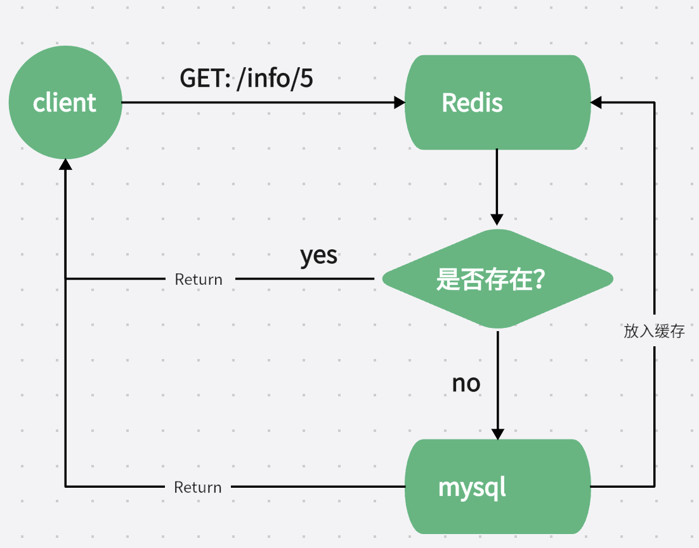
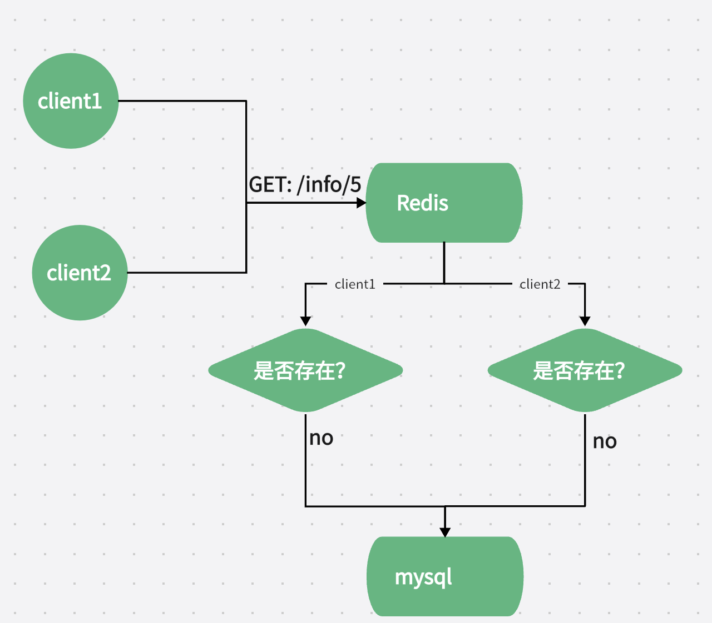
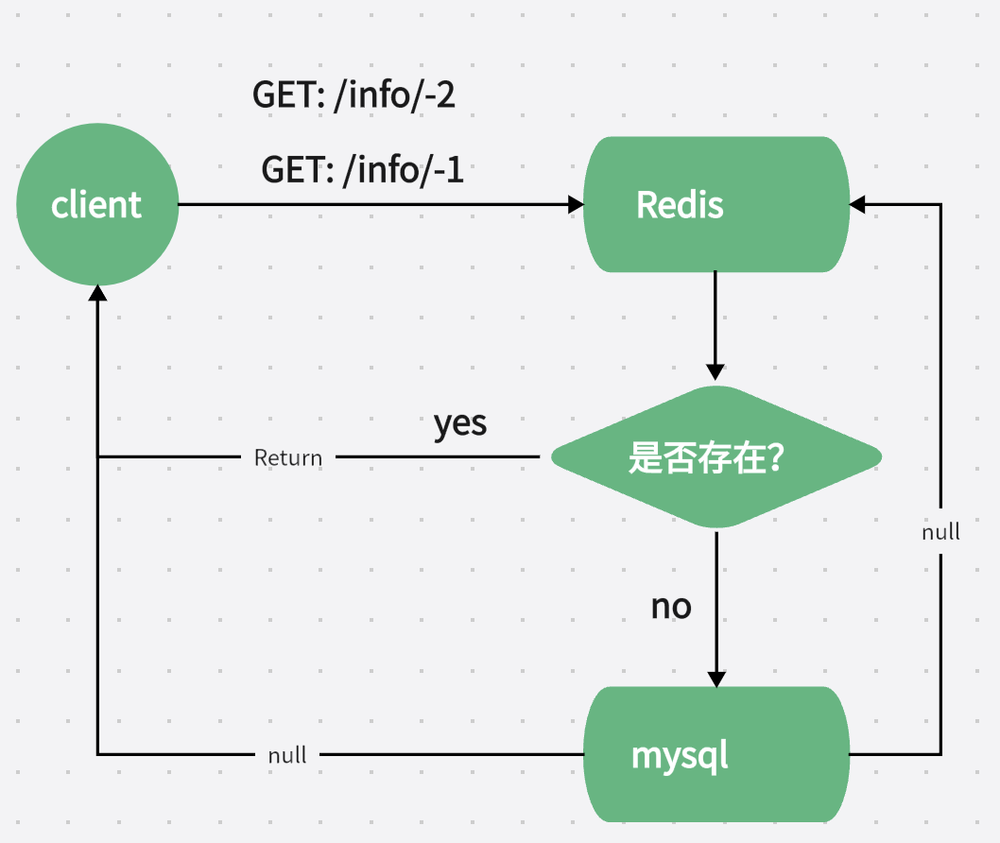

# Redis 搞懂缓存击穿、缓存穿透、缓存雪崩 及对应解决方案

## 缓存击穿
### 原因
指某些热点key到达了过期的那个时间点，这个时候刚好有大量的并发请求需要查询这个key，从而导致并发请求直接打到了数据库，这就是缓存击穿。
### 解决方案

- 提前将热门数据放入redis缓存
- 对热门key进行监控，定期进行续期
- 对不同级别的key设置不同的缓存时间
- 设置分布式锁

## 缓存穿透
### 原因
这个是恶意攻击导致的，黑客通过伪造非法的id，查询数据库中不存在的key，导致经过redis缓存时：判断key不存在，则直接查DB，最终导致所有请求全部达到了DB中，造成缓存穿透
### 解决方案

- 缓存一个特定的值，代表数据库中不存在，如 空值
- 使用Redis布隆过滤器：如果不存在那就一定不存在，如果存在但是不一定存在
- 设置有规律的id，如果不满足规则条件则拦截

## 缓存雪崩
### 原因1:
大量key同时过期，导致所有请求全部打到DB中
### 解决方案1

- 缓存时间最好不要设置一样，可以上下波动一个阈值
- 服务降级
### 原因2
缓存中间件直接宕机
### 解决方案2

- 限流
- 熔断
- 建立高可用缓存集群

