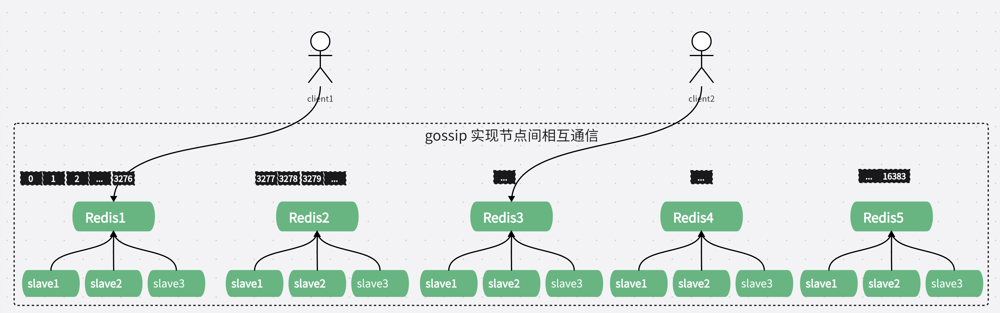
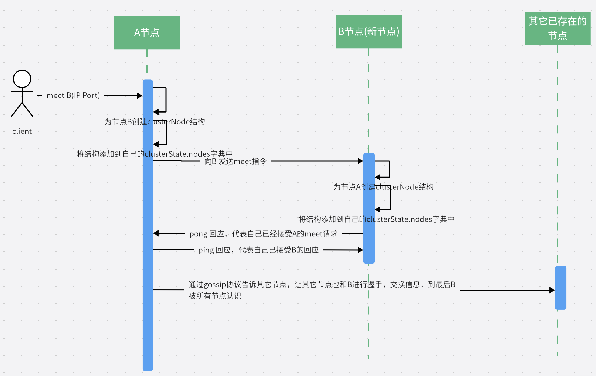
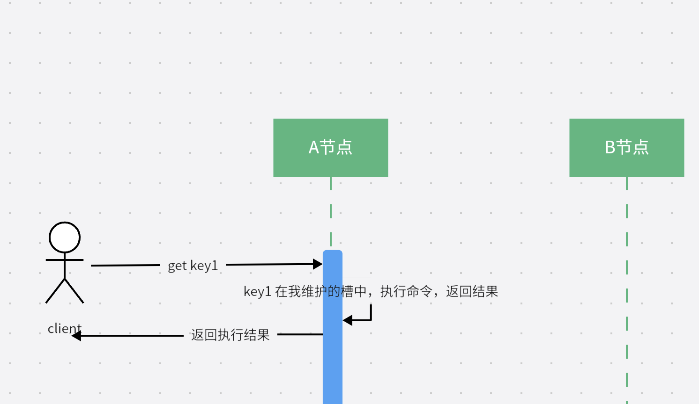
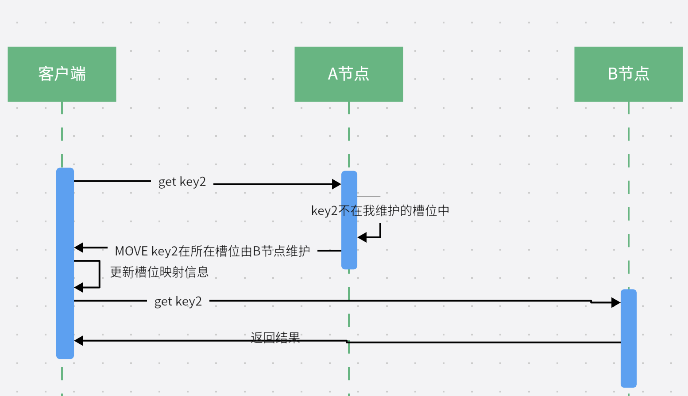

# Redis 集群 Cluster工作原理

## 什么是Redis集群?
Redis从3.0开始就支持集群，节点之间使用gossip协议进行通信，实现了去中心化，集群中支持动态的添加和删除节点，动态迁移数据以及自动执行故障转移。

## 什么是数据Sharding？
Redis Cluster 使用数据分片实现key的存储分布。
Redis Cluster将集群划分为16384个槽位，数据库中所有的key进行hash计算后，都会落到这16384个槽位中的其中一个槽位。那么key 是如何定位到哪个槽位的，可以通过公式进行计算：CRC16(key)%16384,得到的值就是槽位；16384个槽位全部分配给cluster中的节点，每个节点维护自己的槽位，同时每个节点也会存储其他节点维护的槽位信息。
当然你也可以指定到哪个槽位，这就涉及到了hash tag。
### 什么是hash tag
hash tag 是用来解决用户想要将一堆数据key全部放到一个槽位而提出来的，用户可以将key设置成这样：原始的key+{tag标签}，当redis cluster碰到这样的key，就会提取{}里面值，进行槽位计算。
### 集群中删除或新增节点，数据如何迁移？
假设cluster 目前有 四个节点 A,B,C,D
如何删除D节点，则会将D节点中的所有草味全部分配给ABC节点，
如果新增E节点，则会将ABC中的部分槽点移到D节点。
主要是在节点变化之后，每个节点所维护的槽位变化，然后将槽位挪到对应节点就好。
## Redis集群如何使用gossip通信？
### 定义
gossip使得元数据分布存储，不做集中存放，实现了去中心化，当一个节点信息变更，就会触发集群中整个节点信息的更新，缺点就是更新会有延迟。
### meet消息
用于在集群中通知新节点加入
### ping消息
用于检测节点是否在线及交换每个节点之间的状态信息
### pong消息
pong消息是用来回应其他节点向自己发的消息，还可以通过发此消息，让其他节点更新此节点的状态信息
### fail消息(不是用gossip协议实现)
当集群里的主节点A将主节点B标记为下线时，**会通过集群广播一条关于主节点B的FAIL消息，所有接收到这条消息的节点（包括主从节点）都会将主节点B标记为下线**

## 数据访问如何定位到具体的节点？
### 正常访问

### 访问已被迁移至其他节点的数据

# 

