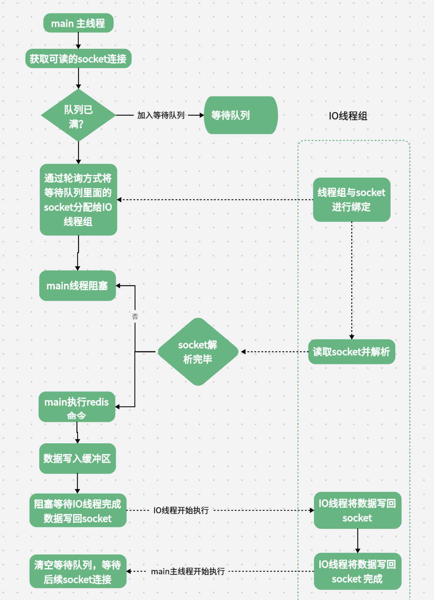

# Redis多线程模型 6.0

[单线程模型](https://mp.weixin.qq.com/s?__biz=MzU2MzYwMDI0Ng==&mid=2247493021&idx=1&sn=8e0896a2800da25c1101818c5b6e703e&chksm=fc556b84cb22e2923740e5a5e11a7b0fa31b5931e7cd6460d3ef9b7a8d962fad619acb1ae270#rd)
## 为什么引入多线程？
有很多同学就有疑问了，既然官方都表示CPU不是Redis的性能瓶颈，那么为什么还要引入多线程呢？
虽然单线程有很多优点，但对应的也必然会有一些缺点存在：

- 只能使用CPU的单核
- 如果删除的key过大（set 里面有一堆key）,会导致服务端阻塞(后面通过LazyFree机制)
- QPS难以提高

但是redis并没有直接上多线程IO去处理这些，而是在多线程之前引入了LazyFree机制
### 引入多线程的优点

- 充分利用CPU资源
- 多线程任务有利于分担Redis同步IO读写的负荷
### LazyFree
lazyFree 主要包括有：flushDb操作，flushall，berewriteaof，删除大key等操作，采用多线程去单独做这些事情，主线程只负责关系的解除，子线程在后台默默的异步执行这些耗时的操作。

## 多线程模型

- 主线程接收到客户端的连接请求，获取socket放入等待队列
- 主线程判断等待队列已满，则通过轮询的方式，将这些连接分配给线程组
- 主线程等待IO线程执行读取socket完毕
- IO线程读取socket完毕之后，主线程开始执行redis命令
- 将执行结果写入缓冲区
- 阻塞等待IO线程将数据写入socket
- 等待IO线程写入完毕，主线程清空队列，解绑关系，等待后续的连接请求

## redis多线程安全么？
安全的
一句话总结：多线程只用在了IO读写上面，redis命令执行还是单线程执行。
****Request URL: **
https://play2.laoyacdn.com/20220929/tBfZnYCj/1500kb/hls/index.m3u8
****Request URL: **
https://play2.laoyacdn.com/20220929/tBfZnYCj/1500kb/hls/index.m3u8

