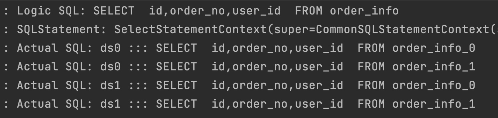
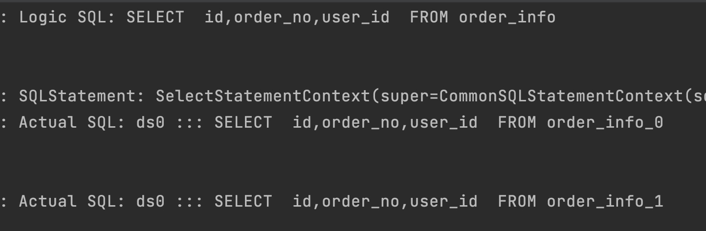
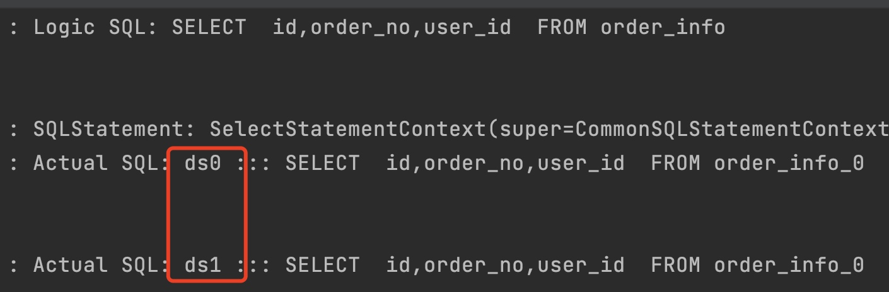
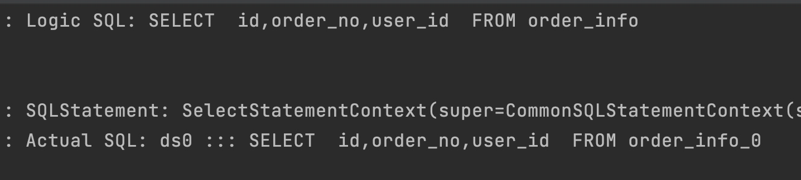

# 1.Sharding-JDBC 分库分表实战
## 引入依赖
```
        <dependency>
            <groupId>com.baomidou</groupId>
            <artifactId>mybatis-plus-boot-starter</artifactId>
            <version>3.5.1</version>
        </dependency>
        <dependency>
            <groupId>org.apache.shardingsphere</groupId>
            <artifactId>sharding-jdbc-spring-boot-starter</artifactId>
            <version>4.1.1</version>
        </dependency>
         <dependency>
            <groupId>com.alibaba</groupId>
            <artifactId>druid-spring-boot-starter</artifactId>
            <version>1.2.8</version>
        </dependency>
        <dependency>
            <groupId>mysql</groupId>
            <artifactId>mysql-connector-java</artifactId>
            <version>8.0.19</version>
        </dependency>
```
## 分库分表配置
### 配置
```
  shardingsphere:
# 数据分片配置
    datasource:
      names: ds0,ds1
      ds0:
        driver-class-name: com.mysql.cj.jdbc.Driver
        type: com.alibaba.druid.pool.DruidDataSource
        url: jdbc:mysql://192.168.64.2:3306/sharding_db_0?useUnicode=true&characterEncoding=utf8&zeroDateTimeBehavior=convertToNull&useSSL=true&serverTimezone=GMT%2B8
        username: root
        password: root
      ds1:
        driver-class-name: com.mysql.cj.jdbc.Driver
        type: com.alibaba.druid.pool.DruidDataSource
        url: jdbc:mysql://192.168.64.2:3306/sharding_db_1?useUnicode=true&characterEncoding=utf8&zeroDateTimeBehavior=convertToNull&useSSL=true&serverTimezone=GMT%2B8
        username: root
        password: root
    sharding:
      default-database-strategy:
        inline:
          algorithm-expression: ds$->{user_id % 2}
          sharding-column: user_id
      tables:
        order_info:
          actual-data-nodes: ds$->{0..1}.order_info_$->{0..1}
          table-strategy:
            inline:
              algorithm-expression: order_info_$->{order_no % 2}
              sharding-column: order_no
```
### 配置介绍
* 定义了两个数据源ds和ds1
* 分库策略按照 user_id%2
* 分表策略按照 order_no%2
## 创建库和表
### 创建两个库
```
CREATE DATABASE sharding_db_0
CREATE DATABASE sharding_db_1
```
### 创建表
分别在两个库下面执行
```
CREATE TABLE `order_info_0` (
  `id` bigint(20) NOT NULL AUTO_INCREMENT,
  `order_no` int(11) DEFAULT NULL,
  `user_id` int(11) DEFAULT NULL,
  PRIMARY KEY (`id`)
) ENGINE=InnoDB AUTO_INCREMENT=1856012290 DEFAULT CHARSET=utf8 COLLATE=utf8_bin;
CREATE TABLE `order_info_1` (
  `id` bigint(20) NOT NULL AUTO_INCREMENT,
  `order_no` int(11) DEFAULT NULL,
  `user_id` int(11) DEFAULT NULL,
  PRIMARY KEY (`id`)
) ENGINE=InnoDB AUTO_INCREMENT=1856012290 DEFAULT CHARSET=utf8 COLLATE=utf8_bin;
```
## 测试验证
### 插入数据
* 库：11%2=1
* 表：10%2=0
```
    void insert() {
        Order order1 = new Order();
        order1.setUserId(11);
        order1.setOrderNo(10);
        orderMapper.insert(order1);
    }
```


### 查询数据不带分片键
```
      @Test
    public void testList(){
        List<Order> orders = orderMapper.selectList(null);
        System.out.println(orders.size());
    }
```


### 带库分片键查询
```
    @Test
    public void testListByUserId(){
        LambdaQueryWrapper<Order> queryWrapper = new LambdaQueryWrapper<>();
        List<Order> orders = orderMapper.selectList(queryWrapper.eq(Order::getUserId,10));
        System.out.println(orders.size());
    }
```


### 带表分片键查询
```
    @Test
    public void testListByOrderNo(){
        LambdaQueryWrapper<Order> queryWrapper = new LambdaQueryWrapper<>();
          List<Order> orders = orderMapper.selectList(queryWrapper.eq(Order::getOrderNo,10));
        System.out.println(orders.size());
    }
```


### 带表分片和库分片键查询
```
    @Test
    public void testListByOrderNoAndUserId(){
        LambdaQueryWrapper<Order> queryWrapper = new LambdaQueryWrapper<>();
        List<Order> orders = orderMapper.selectList(queryWrapper.eq(Order::getOrderNo,10).eq(Order::getUserId,10));
        System.out.println(orders.size());
    }
```

